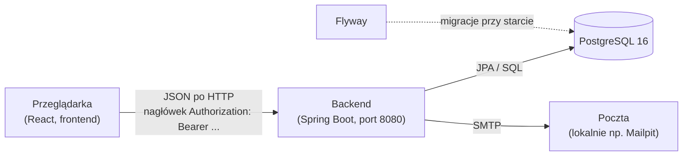
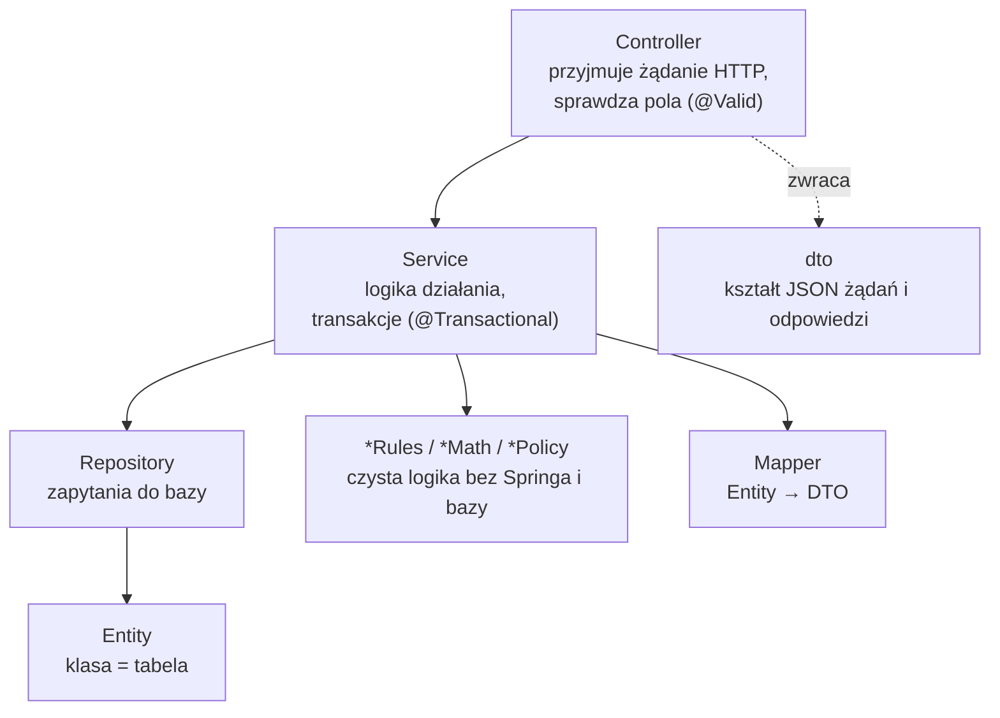
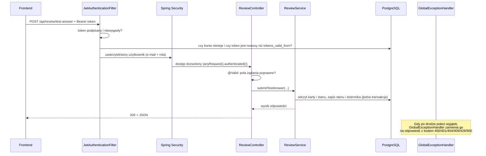

# 01. Architektura backendu

[← Spis treści](README.md)

## Czym jest backend

Backend Tutlaw to **serwer REST API** napisany w Javie (Spring Boot). Nie wyświetla żadnych stron: przyjmuje
żądania HTTP od frontendu (React), zapisuje i czyta dane z bazy PostgreSQL i odsyła JSON. Cała „inteligencja” nauki
(które pytanie pokazać dziś, kiedy wróci, jak policzyć wynik egzaminu) jest tutaj, a nie we frontendzie.



## Technologie

| Co | Wersja / szczegół | Po co |
|----|-------------------|-------|
| Java | 17 | Język i środowisko uruchomieniowe |
| Spring Boot | 4.1.1 | Szkielet aplikacji (serwer, wstrzykiwanie zależności, konfiguracja) |
| Spring Web MVC | w Spring Boot | Kontrolery REST |
| Spring Data JPA + Hibernate | w Spring Boot | Mapowanie tabel na klasy Javy, zapytania |
| PostgreSQL | 16 (z `docker-compose.yml`) | Baza danych |
| Flyway | w Spring Boot | Migracje bazy (`V1`–`V20`), uruchamiane przy starcie |
| Spring Security | w Spring Boot | Ochrona endpointów, role |
| jjwt | 0.12.6 | Tworzenie i sprawdzanie tokenów JWT |
| Bean Validation | w Spring Boot | Sprawdzanie pól żądań (`@NotBlank`, `@Min` itd.) |
| springdoc-openapi | 3.0.3 | Dokumentacja Swagger UI generowana z kodu |
| Actuator | w Spring Boot | Endpointy zdrowia aplikacji (`/actuator/health`) |
| Spring Mail | w Spring Boot | Wysyłanie maili (aktywacja konta, reset hasła) |
| Lombok | w Spring Boot | Mniej powtarzalnego kodu (gettery, settery, konstruktory) |
| spring-dotenv | 5.1.0 | Czyta plik `.env` z głównego katalogu projektu |
| DevTools | w Spring Boot | Automatyczny restart podczas pracy lokalnej |

Hibernate nie tworzy tabel: `spring.jpa.hibernate.ddl-auto` jest ustawione na `validate`, więc przy starcie tylko
**sprawdza**, czy klasy zgadzają się z tabelami. Tabele tworzą wyłącznie migracje Flyway.

## Mapa pakietów

Cały kod jest w `src/main/java/pl/tutlaw/backend/`. Każda funkcja ma własny pakiet („pakiet funkcji”), a w nim
komplet klas.

| Pakiet | Za co odpowiada |
|--------|-----------------|
| `auth` | Rejestracja, aktywacja, logowanie, reset hasła, JWT, maile, limity prób |
| `user` | Encja użytkownika, rola, konto zalogowanego (eksport danych, zmiana hasła, usunięcie konta) |
| `security` | Filtr JWT (sprawdza token przy każdym żądaniu) i reguła ważności sesji |
| `category` | Kategorie (rodzaje, np. „Prawo karne i postępowanie karne”) |
| `subject` | Przedmioty i akty prawne (np. „Kodeks karny”) |
| `source` | Źródła pytań: podręcznik (`TEXTBOOK`) albo pula płaska (`FLAT_POOL`) |
| `chapter` | Rozdziały podręczników |
| `tag` | Tagi kart |
| `progress` | Oznaczanie rozdziałów jako przeczytane |
| `card` | Karty: pytania testowe ABC i fiszki; reguły treści, import zbiorczy |
| `catalog` | Drzewo ekranu Testów: rodzaj → przedmiot → źródło, z licznikami pytań |
| `review` | Kolejki nauki, przyjmowanie odpowiedzi, planowanie powtórek (FSRS), zawieszanie, błędy |
| `review.fsrs` | Sam algorytm FSRS-6 (wzory matematyczne) |
| `flashcard` | Fiszki powiązane z pytaniami: odblokowywanie, „Dodaj do fiszek” |
| `exam` | Egzamin próbny w stałym formacie (150 pytań, próg 100 punktów): losowanie, ocena, historia podejść |
| `report` | Zgłoszenia błędów w pytaniach |
| `statistics` | Statystyki: przegląd, skuteczność, aktywność, rozbicie wg aplikacji i roku |
| `settings` | Ustawienia nauki (limity dzienne, retencja, data egzaminu) i filtr pochodzenia |
| `common` | Elementy wspólne: stronicowanie, sortowanie po polsku, wyjątki, konfiguracja |
| `common.config` | Konfiguracja Springa: bezpieczeństwo, CORS, hasła, zegar |
| `common.exception` | Wyjątki i jedno miejsce zamieniające je na odpowiedzi HTTP |

## Warstwy w pakiecie funkcji

W każdym pakiecie powtarza się ten sam układ. Dzięki temu wiadomo, gdzie czego szukać.



- **Controller** (`*Controller`): tylko adres, parametry i oddanie pracy serwisowi. Nie ma w nim logiki.
- **Service** (`*Service`): właściwa logika. Metody zmieniające dane mają `@Transactional`: albo zapisze się
  wszystko, albo nic.
- **Repository** (`*Repository`): interfejsy Spring Data z zapytaniami JPQL i SQL.
- **Entity**: klasa Javy odpowiadająca tabeli (np. `Card` ↔ `cards`).
- **dto**: „rekordy” opisujące JSON, który wchodzi i wychodzi. Encji nie wysyła się na zewnątrz wprost.
- **Mapper**: zamienia encję na DTO.
- **`*Rules`, `*Math`, `*Policy`**: czyste funkcje bez bazy i bez Springa, np. `ReviewPolicy`, `SchedulingRules`,
  `QueueRules`, `CardContentRules`, `AuthRules`, `StatisticsMath`, `ExamScoring`, `ReportRules`. Cała arytmetyka i
  reguły „co jest poprawne” są właśnie tam, dlatego da się je przetestować zwykłym JUnitem, bez uruchamiania
  aplikacji.

## Droga jednego żądania

Przykład: użytkownik odpowiada na pytanie w teście (`POST /api/review/test-answer`).



Kroki szczegółowo:

1. **`JwtAuthenticationFilter`** czyta nagłówek `Authorization: Bearer <token>`. Jeśli token jest poprawny i
   niewygasły, filtr dodatkowo jednym lekkim zapytaniem sprawdza w bazie, czy konto nadal istnieje i czy token nie
   został wystawiony przed ostatnią zmianą hasła. Wtedy ustawia zalogowanego użytkownika (e-mail i rolę). Gdy tokenu
   brak albo jest zły, żądanie przechodzi dalej jako anonimowe.
2. **`SecurityConfig`** decyduje, co wolno anonimowym: `/api/auth/**`, `/actuator/**`, Swagger i `/error`. Wszystko
   inne wymaga zalogowania, a brak logowania daje **401** (nie 403).
3. **Controller** sprawdza pola żądania adnotacją `@Valid`. Endpointy tylko dla administratora mają
   `@PreAuthorize("hasRole('ADMIN')")`.
4. **Service** wykonuje pracę w transakcji. `CurrentUserResolver` zamienia e-mail z tokenu na użytkownika z bazy.
5. Odpowiedź wraca jako JSON. Każdy błąd, który poleci jako wyjątek, trafia do **`GlobalExceptionHandler`**, więc
   błędy mają jeden, przewidywalny format (patrz niżej).

## Rozwiązania wspólne

### Format błędów

Każdy błąd ma ten sam kształt (klasa `ErrorResponse`):

```json
{
  "timestamp": "2026-10-12T08:15:30.123Z",
  "status": 400,
  "error": "Bad Request",
  "message": "Hasło musi mieć co najmniej 8 znaków",
  "path": "/api/auth/register"
}
```

Pole `message` jest po polsku i nadaje się do pokazania użytkownikowi. Pełna tabela kodów jest w
[API: przegląd](api/README.md#kody-błędów).

### Czas

Cała aplikacja używa jednego zegara (`TimeConfig`, bean `Clock`). Strefę czasową ustawia `BackendApplication.main`:
domyślnie **Europe/Warsaw**, można zmienić zmienną środowiskową `APP_TIMEZONE`. Dzięki temu „dzisiaj” (dzienny
limit nowych pytań, początek doby dla terminów powtórek, wykres aktywności) jest takie samo niezależnie od strefy
serwera. Daty w bazie to czas lokalny **bez strefy** (`TIMESTAMP`).

### Stronicowanie

Listy kart dla administratora zwracają `PageResponse` (`items`, `page`, `size`, `totalElements`, `totalPages`).
`PageParams` przycina wartości zamiast zgłaszać błąd: strona od 0, rozmiar od 1 do 200, domyślnie 50.

### Sortowanie po polsku

`PolishSort` układa nazwy zgodnie z polskim alfabetem (ą po a, ł po l itd.), np. przedmioty w kategorii.

### Poczta wysyłana po zatwierdzeniu transakcji

`AfterCommitMailer` wysyła maile **dopiero po udanym zapisie do bazy** i **poza wątkiem żądania** (2 wątki, kolejka
na 200 maili). Po co: mail nie wyjdzie, jeśli transakcja się wycofała, wolna poczta nie spowalnia odpowiedzi, a
różnica w czasie odpowiedzi nie zdradza, czy konto istnieje. Błąd poczty jest tylko zapisywany w logu.

### Limity prób (rate limiting)

`SlidingWindowRateLimiter` liczy zdarzenia w przesuwanym oknie czasowym **w pamięci serwera**. Używa go
`AuthRateLimiter` (logowanie, rejestracja, reset hasła, ponowne wysyłanie maili). Szczegóły i liczby są w
[03](03-bezpieczenstwo-i-konta.md#limity-prób). Działa poprawnie dla jednej instancji backendu.

### Blokada optymistyczna

Tabela `user_card_state` ma kolumnę `version` (adnotacja `@Version`). Gdy dwa okna przeglądarki odpowiedzą na tę samą
kartę w tej samej chwili, drugi zapis dostaje **409** z komunikatem „Ta karta została właśnie zmieniona w innym oknie.
Spróbuj jeszcze raz.” zamiast po cichu nadpisać pierwszy.

### Ochrona przed podwójnym kliknięciem

Jeśli ta sama karta dostanie odpowiedź w ciągu **1 sekundy** od poprzedniej, druga jest ignorowana (nie liczy się
jako kolejna powtórka). Szczegóły w [04](04-nauka-testy-fiszki-fsrs.md#ochrona-przed-podwójnym-wysłaniem).

## Testy

W `src/test` jest **45 klas testowych** (ok. 458 testów) i 3 klasy pomocnicze (`testsupport`: zegar do sterowania
czasem, „fałszywe” repozytoria w pamięci, uproszczone karty). Większość to testy jednostkowe czystej logiki
(`*RulesTest`, `FsrsEngineTest`, `ExamScoringTest`…) oraz serwisów na repozytoriach w pamięci (np. `AuthFlowTest`
przechodzi cały przebieg rejestracji, aktywacji, logowania i resetu hasła bez Springa i bez Dockera).

Jedyny test, który uruchamia pełny kontekst Springa, to `BackendApplicationTests.contextLoads`. Łączy się on z
prawdziwą bazą PostgreSQL i uruchamia migracje, więc wymaga działającej bazy (patrz
[05](05-konfiguracja-i-uruchomienie.md)). Testów z prawdziwą bazą, które sprawdzałyby zapytania JPQL/SQL i wyzwalacze
z migracji V18, nie ma: opis w [Znanych ograniczeniach](07-znane-ograniczenia.md).
