# 02. Baza danych

[← Spis treści](README.md)

Baza to **PostgreSQL 16**. Schemat tworzą wyłącznie migracje **Flyway** (`src/main/resources/db/migration`),
uruchamiane automatycznie przy starcie aplikacji. Hibernate tylko sprawdza zgodność (`ddl-auto: validate`), niczego nie
tworzy i nie zmienia.

Są cztery migracje po schemacie bazowym (łącznie pięć):

- `V1__init_schema.sql` — **cały schemat** (23 tabele; `V3` dodaje 24., `V4` 25., `V5` 26. i 27., ograniczenia, indeksy). To nowa baza startowa (*baseline*): zastąpiła
  dawne migracje V1–V25, a wraz z nią zniknął stary model (kategorie, przedmioty, podręczniki, rozdziały, karty, tagi).
- `V2__reference_data.sql` — **dane słownikowe**, bez których aplikacja nie ruszy: 11 dziedzin, 6 ścieżek, puste terminy
  egzaminów pięciu aplikacji i źródło „Pytania autorskie”.
- `V3__law_changes_and_user_courses.sql` — **zmiany w prawie** (dwie kolumny przy pytaniu i nowy rodzaj własnego testu),
  **przedmioty wybierane przez Studenta** (tabela `user_courses`) i kolumna `course_ids` zapisanego własnego testu. Niczego
  nie zmienia w istniejących danych: nowe kolumny są puste, nowa tabela jest pusta.

- `V4__act_sections.sql` — **rozdziały aktów** (tabela `act_sections`, `questions.section_id`, `custom_test_sessions.section_ids`).
- `V5__question_marks_and_exam_answers.sql` — **oznaczenia pytań** (tabela `question_marks`: terminy i pułapki), nowe rodzaje
  własnego testu `TIME_LIMIT` i `TRAPS`, **odpowiedzi z egzaminów próbnych** (tabela `exam_attempt_answers`, kolumny
  `exam_attempts.excluded_count` i `has_answers`). Niczego nie zmienia w istniejących danych: nowe tabele są puste, a starsze
  podejścia do egzaminu mają `has_answers = false` (zostają na liście tylko z wynikiem).

Akty prawne, listy aktów ścieżek, przedmioty studenta, arkusze i pytania **nie są migracją**: wczytuje się je skryptami
SQL z katalogu `baza/` (patrz [05](05-konfiguracja-i-uruchomienie.md#wczytywanie-treści-skryptami-sql)).

> Nie edytuj wykonanych migracji. Każda zmiana schematu to **nowy plik** `V4__...sql` itd., bo Flyway zapamiętuje sumę
> kontrolną każdej wykonanej migracji (tabela `flyway_schema_history`). Bazę z dawnym schematem (V1–V25) trzeba
> **utworzyć od nowa** (pusty schemat `public`): migracje się nie uzgodnią, a konta użytkowników z dawnej bazy nie są
> przenoszone.

## Schemat w skrócie

```mermaid
erDiagram
    legal_fields ||--o{ legal_acts : "zawiera"
    legal_acts ||--o{ questions : "pytania aktu"
    legal_acts ||--o{ act_sections : "rozdziały"
    act_sections ||--o{ questions : "rozdział pytania"
    question_sources ||--o{ questions : "arkusz albo pytania autorskie"
    tracks ||--o{ question_sources : "arkusze aplikacji (track_id)"
    tracks ||--o{ track_acts : "akty aplikacji"
    legal_acts ||--o{ track_acts : ""
    courses ||--o{ course_acts : "akty przedmiotu studenta"
    legal_acts ||--o{ course_acts : ""
    tracks ||--o| exam_terms : "termin egzaminu"

    users ||--o| user_settings : "ustawienia i wybrana ścieżka"
    tracks ||--o{ user_settings : "track_id"
    users ||--o{ user_pool_acts : "zawężenie puli"
    legal_acts ||--o{ user_pool_acts : ""
    users ||--o{ user_courses : "przedmioty wybrane przez Studenta"
    courses ||--o{ user_courses : ""
    users ||--o{ user_question_states : "stan nauki (osobno TEST i FLASHCARD)"
    questions ||--o{ user_question_states : ""
    users ||--o{ review_logs : "historia odpowiedzi"
    questions ||--o{ review_logs : ""
    users ||--o{ flashcard_additions : "ręczne dodanie do fiszek"
    questions ||--o{ flashcard_additions : ""
    users ||--o{ question_reports : "zgłoszenia błędów"
    questions ||--o{ question_reports : ""
    users ||--o{ exam_attempts : "egzaminy próbne"
    exam_attempts ||--o{ exam_attempt_answers : "odpowiedzi z egzaminu"
    questions ||--o{ exam_attempt_answers : ""
    questions ||--o{ question_marks : "oznaczenia (terminy, pułapki)"
    users ||--o{ custom_test_sessions : "zapisane własne testy"
    custom_test_sessions ||--o{ custom_test_session_questions : "pytania testu"
    questions ||--o{ custom_test_session_questions : ""
    users ||--o{ study_time_daily : "czas nauki dzień po dniu"
    users ||--o{ email_verification_tokens : "aktywacja"
    users ||--o{ password_reset_tokens : "reset hasła"
    users ||--o{ refresh_tokens : "sesje (tokeny odświeżające)"
```



Trzy grupy tabel:

1. **Katalog i treść (wspólne dla wszystkich):** `legal_fields`, `legal_acts`, `tracks`, `track_acts`, `courses`,
   `course_acts`, `question_sources`, `questions`, `exam_terms`.
2. **Dane użytkownika (osobne dla każdego konta):** `users`, tokeny (aktywacji, resetu hasła i odświeżające),
   `user_settings`, `user_pool_acts`, `user_courses`, `user_question_states`, `review_logs`, `flashcard_additions`, `question_reports`,
   `custom_test_sessions` (z pytaniami), `exam_attempts` (z odpowiedziami w `exam_attempt_answers`), `study_time_daily`.
3. **Ustawiane przez administratora:** `exam_terms` (terminy egzaminów), `courses`, `track_acts` i `course_acts` (które
   akty należą do ścieżki albo przedmiotu), ukrywanie pytań (`questions.hidden`, `questions.flashcard_hidden`) oraz zmiany
   w prawie (`questions.law_changed_at`, `questions.law_change_note`).

## Model: dziedzina → akt prawny → pytanie, ścieżki i pula

- **Dziedzina** (`legal_fields`) to duży dział prawa, np. „Prawo karne i proces karny”. Widzą ją **wszyscy** użytkownicy.
- **Akt prawny** (`legal_acts`) to kodeks albo ustawa (`ACT`), albo **zagadnienie** (`TOPIC`): materiał, który nie jest
  ustawą, np. prawoznawstwo, historia prawa, paremie łacińskie. Akt należy do jednej dziedziny. Użytkownik widzi tylko
  **akty ze swojej puli**.
- **Pytanie** (`questions`) należy do jednego aktu i jednego **źródła**. Pytanie ma trzy odpowiedzi ABC i **dokładnie
  jedną poprawną**. Pytania łacińskich paremii są zwykłymi pytaniami w zagadnieniu typu `TOPIC`.
- **Źródło** (`question_sources`) to arkusz egzaminu wstępnego jednej ścieżki z danego roku (`EXAM_SHEET`, np. „Notarialna
  2024”) albo jedyne źródło „Pytania autorskie” (`AUTHORED`).
- **Ścieżka** (`tracks`) to jedna z pięciu aplikacji (`EXAM`) albo **Student** (`STUDENT`, jedna). Aplikacja ma własne
  arkusze i listę aktów (`track_acts`). Student nie ma ani arkuszy, ani listy aktów: jego akty to akty wszystkich
  wybranych przedmiotów (`user_courses` → `courses` → `course_acts`; bez wyboru: wszystkich przedmiotów), a przedmioty tylko
  dzielą akty na kursy. Student widzi w aplikacji **przedmioty**, nie listę aktów.
- **Pula użytkownika** to reguła, a nie ręczne przypisanie: pytania z **jego własnych arkuszy ALBO z aktów jego
  ścieżki**. Pytania z cudzych arkuszy i pytania autorskie wchodzą do puli przez wspólne akty. Użytkownik może pulę
  **zawęzić** do wybranych aktów (`user_pool_acts`). Źródło pytań (wszystkie, Ministerstwo, autorskie) wybiera przy każdym teście.
  Szczegóły: [04](04-nauka-testy-fiszki-fsrs.md#pula-pytań-użytkownika).
- **Fiszka nie jest osobnym rekordem.** To tryb nauki pytania: stan nauki pytania ma osobny wiersz w trybie `TEST` i w
  trybie `FLASHCARD` (`user_question_states`), z własnym harmonogramem FSRS.

Przykład: *Prawo karne i proces karny → Kodeks karny → pytanie z arkusza „Notarialna 2024”*.

## Tabele katalogu i treści

### `legal_fields` — dziedziny

| Kolumna | Typ | Znaczenie |
|---------|-----|-----------|
| `id` | bigserial, PK | |
| `name` | varchar(255) | Nazwa, np. „Prawo karne i proces karny” |
| `slug` | varchar(100), unikalny | Krótki identyfikator do adresów i skryptów |
| `sort_order` | int ≥ 0, domyślnie 100 | Kolejność wyświetlania (mniejsza = wyżej). CHECK `chk_legal_fields_sort_order` |

Migracja V2 zakłada jedenaście dziedzin: prawo cywilne i postępowanie cywilne, prawo karne i proces karny,
administracja i postępowanie administracyjne, prawo handlowe i spółek, prawo pracy i zabezpieczenia społecznego,
Konstytucja i ustrój państwa, zawody prawnicze i ustrój sądów, prawo Unii Europejskiej i międzynarodowe, podatki i
opłaty, Student oraz Pozostałe. Prawa cywilnego nie rozdzielono na materialne i procesowe.

### `legal_acts` — akty prawne i zagadnienia

| Kolumna | Typ | Znaczenie |
|---------|-----|-----------|
| `id` | bigserial, PK | |
| `legal_field_id` | FK → `legal_fields`, NOT NULL | Dziedzina aktu. Indeks `idx_legal_acts_field` |
| `name` | varchar(300) | Pełna nazwa, np. „Kodeks karny” |
| `short_name` | varchar(50), opcjonalny | Skrót, np. „k.k.” |
| `slug` | varchar(100), unikalny | |
| `kind` | varchar(10), domyślnie `ACT` | `ACT` (akt prawny) albo `TOPIC` (zagadnienie). CHECK `chk_legal_acts_kind` |
| `sort_order` | int ≥ 0, domyślnie 100 | Kolejność w dziedzinie. CHECK `chk_legal_acts_sort_order` |

### `act_sections` — rozdziały aktów (od V4)

Rozdział (dział, tytuł) jednego aktu prawnego, np. „XIX. Przestępstwa przeciwko życiu i zdrowiu” w Kodeksie karnym. Akt może
nie mieć żadnych rozdziałów (wtedy w kreatorze Testów wybiera się go tylko w całości). Rozdziały i przypisanie do nich pytań
wczytuje się skryptami SQL z katalogu `baza/` (07 zakłada rozdziały, 08 zakłada rozdziały Kodeksu karnego).

| Kolumna | Typ | Znaczenie |
|---------|-----|-----------|
| `id` | bigserial, PK | |
| `legal_act_id` | FK → `legal_acts`, NOT NULL (ON DELETE CASCADE) | Akt, do którego należy rozdział. Indeks `idx_act_sections_act` |
| `name` | varchar(300) | Nazwa z numerem rozdziału, dokładnie tak, jak ma się pokazać użytkownikowi. Unikalna w obrębie aktu (`uq_act_sections_name`), niepusta (`chk_act_sections_name_not_blank`) |
| `sort_order` | int ≥ 0, domyślnie 100 | Kolejność w akcie. CHECK `chk_act_sections_sort_order` |

Skasowanie rozdziału nie kasuje pytań: `questions.section_id` wraca wtedy do NULL.

### `tracks` — ścieżki

| Kolumna | Typ | Znaczenie |
|---------|-----|-----------|
| `id` | bigserial, PK | |
| `slug` | varchar(60), unikalny | `adwokacka-radcowska`, `sedziowska-prokuratorska`, `uzupelniajaca-sedziowska`, `notarialna`, `komornicza`, `student` |
| `name` | varchar(255) | Pełna nazwa, np. „Aplikacja notarialna” |
| `short_name` | varchar(60) | Skrót, np. „Notarialna”; wchodzi do nazw arkuszy („Notarialna 2024”) |
| `kind` | varchar(10) | `EXAM` (aplikacja) albo `STUDENT`. CHECK `chk_tracks_kind` |
| `sort_order` | int ≥ 0, domyślnie 100 | Kolejność na listach. CHECK `chk_tracks_sort_order` |

Indeks unikalny `uq_tracks_single_student` pilnuje, że ścieżka `STUDENT` jest **tylko jedna**. Ścieżki zakłada V2.

### `track_acts` i `course_acts` — akty ścieżki i przedmiotu

Dwie tabele łączące (klucz główny złożony):

| Tabela | Kolumny | Znaczenie |
|--------|---------|-----------|
| `track_acts` | `track_id`, `legal_act_id` | Akty prawne **aplikacji** (ustawia je administrator). Ścieżka Student nie ma tu wpisów. Obie kolumny `ON DELETE CASCADE`; indeks `idx_track_acts_act` |
| `course_acts` | `course_id`, `legal_act_id` | Akty prawne i zagadnienia **przedmiotu studenta**. Ten sam akt może należeć do kilku przedmiotów. Obie kolumny `ON DELETE CASCADE`; indeks `idx_course_acts_act` |

Akty własnych arkuszy aplikacji należą do jej puli zawsze, także gdy nie wpisano ich do `track_acts` (dobiera je aplikacja
z pytań arkuszy).

### `courses` — przedmioty studenta

| Kolumna | Typ | Znaczenie |
|---------|-----|-----------|
| `id` | bigserial, PK | |
| `name` | varchar(255) | Np. „Prawo karne”, „Prawoznawstwo”, „Paremie łacińskie” |
| `slug` | varchar(100), unikalny | |
| `sort_order` | int ≥ 0, domyślnie 100 | CHECK `chk_courses_sort_order` |

Przedmiot nie ma własnych pytań: to lista aktów (`course_acts`). **Administrator tworzy przedmioty i przypisuje do nich akty
skryptem SQL** (przykłady w katalogu `baza/` i niżej w „Przydatnych zapytaniach”); aplikacja nie ma panelu do tego. Student
wybiera przedmioty (`user_courses`), a jego pulą są wszystkie pytania aktów wybranych przedmiotów. Ten sam akt może należeć
do kilku przedmiotów (np. Kodeks karny w „Prawie karnym” i w „Prawie karnym materialnym”): jego pytania wchodzą do puli raz.
Przedmiot bez aktów albo bez pytań jest w aplikacji pomijany. **Płatne i darmowe przedmioty to przyszła funkcja** (nie ma
jej w schemacie ani w kodzie; patrz [07](07-znane-ograniczenia.md)).

### `question_sources` — źródła pytań

| Kolumna | Typ | Znaczenie |
|---------|-----|-----------|
| `id` | bigserial, PK | |
| `slug` | varchar(100), unikalny | Np. `notarialna-2024`, `autorskie` |
| `kind` | varchar(12) | `EXAM_SHEET` (arkusz egzaminu) albo `AUTHORED` (pytania autorskie). CHECK `chk_question_sources_kind` |
| `name` | varchar(255) | Nazwa pokazywana użytkownikowi: skrót ścieżki i rok („Notarialna 2024”) albo „Pytania autorskie” |
| `track_id` | FK → `tracks`, opcjonalny | Ścieżka arkusza; **tylko** dla `EXAM_SHEET`. Indeks `idx_question_sources_track` |
| `exam_year` | int, opcjonalny | Rok egzaminu (1990–2100); **tylko** dla `EXAM_SHEET` |

CHECK `chk_question_sources_shape` łączy to w jedną regułę: arkusz ma ścieżkę i rok, pytania autorskie nie mają żadnego z
nich. Indeks unikalny `uq_question_sources_sheet` pilnuje jednego arkusza na ścieżkę i rok. „Własne arkusze” użytkownika
to arkusze jego ścieżki (`track_id`), arkusze pozostałych ścieżek są „z innych arkuszy”.

### `questions` — pytania

Jedna tabela, jedno pytanie ABC. **Tryb fiszki korzysta z tej samej treści**: przód to treść pytania, tył to poprawna
odpowiedź z wyjaśnieniem i podstawą prawną.

| Kolumna | Typ | Znaczenie |
|---------|-----|-----------|
| `id` | bigserial, PK | |
| `legal_act_id` | FK → `legal_acts`, NOT NULL | Akt prawny albo zagadnienie. Indeks `idx_questions_act` |
| `source_id` | FK → `question_sources`, NOT NULL | Arkusz albo pytania autorskie. Indeks `idx_questions_source` |
| `body` | text, NOT NULL | Treść pytania (nie może być pusta: CHECK `chk_questions_body_not_blank`) |
| `option_a`, `option_b`, `option_c` | text, NOT NULL | Trzy odpowiedzi |
| `correct_option` | varchar(1) | Poprawna odpowiedź: `A`, `B` albo `C`. CHECK `chk_questions_correct_option` |
| `explanation` | text, opcjonalny | Wyjaśnienie pokazywane po odpowiedzi i na odwrocie fiszki |
| `legal_basis` | varchar(500), opcjonalny | Podstawa prawna, np. „art. 148 § 1 k.k.” (nie może być pusta: CHECK `chk_questions_legal_basis_not_blank`) |
| `valid_as_of` | date, opcjonalny | „Stan prawny na dzień” |
| `law_changed_at` | date, opcjonalny | Dzień, od którego treść pytania uwzględnia **zmianę w prawie** (dzień wejścia zmiany w życie, a gdy treść pytania poprawiono później, dzień poprawki). Od tego dnia pytanie wraca jako zaległe u każdego, kto odpowiadał na nie wcześniej, a przez rok trafia do kategorii „Zmiany w prawie”. Data z przyszłości jeszcze nic nie zmienia. Indeks częściowy `idx_questions_law_changed` |
| `law_change_note` | varchar(500), opcjonalny | Krótki opis zmiany pokazywany przy pytaniu (np. „nowelizacja art. 415 k.c. od 1.10.2026”). Wymaga `law_changed_at` i nie może być pusty (CHECK `chk_questions_law_change_note`) |
| `section_id` | FK → `act_sections`, opcjonalny (ON DELETE SET NULL) | Rozdział aktu, do którego należy pytanie (od V4). NULL: pytanie nie ma rozdziału i jest tylko w akcie jako całości. Indeks częściowy `idx_questions_section` |
| `hidden` | boolean, domyślnie false | Ukryte pytanie znika wszystkim (testy, fiszki, liczniki, egzamin); historia odpowiedzi zostaje |
| `flashcard_hidden` | boolean, domyślnie false | Ukryta **fiszka**: pytanie zostaje w testach, ale nikt nie ma z niego fiszki |
| `created_at` | timestamp | Data wczytania (nigdzie niepokazywana) |

Indeks unikalny `uq_questions_source_body` (`source_id`, `md5(body)`) chroni przed **podwójnym wczytaniem tego samego
arkusza**: to samo pytanie w innym arkuszu jest dozwolone (egzaminy się powtarzają).

### `exam_terms` — terminy egzaminów aplikacji

Jeden wiersz na aplikację (pięć wierszy zakłada V2; ścieżka Student nie ma terminu).

| Kolumna | Typ | Znaczenie |
|---------|-----|-----------|
| `track_id` | klucz główny, FK → `tracks` (`ON DELETE CASCADE`) | Ścieżka-aplikacja |
| `exam_date` | data albo NULL | Data najbliższego egzaminu. NULL = „termin nieogłoszony” |
| `updated_at` | timestamp | Kiedy administrator ostatnio zmienił termin |

Terminy ustawia administrator (`PUT /api/exam-terms/{trackId}`), użytkownicy tylko je czytają. Tryb egzaminacyjny i plan
nowych pytań liczą się z terminu ścieżki wybranej w `user_settings.track_id`.

## Tabele użytkownika

### `users`

| Kolumna | Typ | Znaczenie |
|---------|-----|-----------|
| `id` | bigserial, PK | |
| `private_email` | varchar(255), unikalny | **Adres logowania** (prywatny) |
| `university_email` | varchar(255), unikalny | Adres uczelniany: na niego idzie link aktywacyjny i reset hasła |
| `password_hash` | varchar(255) | Skrót BCrypt hasła (samo hasło nigdy nie jest zapisywane) |
| `is_university_email_verified` | boolean | Czy kliknięto link aktywacyjny |
| `is_active` | boolean | Czy konto jest aktywne (bez aktywacji nie da się zalogować) |
| `role` | varchar(20): `STUDENT` albo `ADMIN` | Rola. Domyślnie `STUDENT`. CHECK `chk_users_role` |
| `created_at` | timestamp | |
| `terms_accepted_at` | timestamp | Kiedy zaakceptowano regulamin |
| `tokens_valid_from` | bigint | Tokeny JWT wystawione przed tą chwilą (sekundy od 1970) przestają działać. NULL = bez ograniczenia |

Rola `STUDENT` w tabeli `users` to **rola konta** (zwykły użytkownik), a nie ścieżka nauki „Student”.

### `email_verification_tokens` i `password_reset_tokens`

| Tabela | Kolumny | Uwagi |
|--------|---------|-------|
| `email_verification_tokens` | `id`, `user_id` (ON DELETE CASCADE), `token` (unikalny), `expires_at`, `used_at`, `created_at` | Token to losowy UUID zapisany **wprost**. Ważny 24 godziny. Indeks `idx_email_verification_tokens_user_id` |
| `password_reset_tokens` | `id`, `user_id` (ON DELETE CASCADE), `token_hash` (unikalny, 64 znaki), `expires_at`, `used_at`, `created_at` | W bazie jest tylko **skrót SHA-256** tokenu, a sam token jest wyłącznie w mailu. Ważny 1 godzinę. Indeks `idx_password_reset_tokens_user_created` |

### `refresh_tokens` — sesje użytkownika

Token dostępu (JWT) żyje 30 minut, a zalogowanym zostaje się dzięki tokenowi odświeżającemu ważnemu 30 dni. Każde
użycie tokenu wymienia go na nowy (rotacja). Jak to działa dla użytkownika i dla bezpieczeństwa:
[03](03-bezpieczenstwo-i-konta.md#sesja-token-dostępu-i-token-odświeżający).

| Kolumna | Znaczenie |
|---------|-----------|
| `id` | Klucz główny |
| `user_id` | Właściciel (`ON DELETE CASCADE`: usunięcie konta kasuje sesje). Indeks `idx_refresh_tokens_user` |
| `token_hash` | **Skrót SHA-256** tokenu (64 znaki, unikalny). Sam token zna tylko przeglądarka, więc wyciek bazy nie daje działających sesji |
| `family_id` | Numer sesji (jedno logowanie na jednym urządzeniu): wszystkie tokeny kolejnych wymian mają ten sam. Używany do unieważniania całej sesji. Indeks `idx_refresh_tokens_family` |
| `created_at`, `expires_at` | Wystawienie i ważność (30 dni, `APP_JWT_REFRESH_DAYS`) |
| `rotated_at` | Kiedy token wymieniono na następny. Ponowne użycie w ciągu 10 s jest niewinne, później oznacza kradzież kopii |
| `revoked_at` | Kiedy sesję unieważniono (wylogowanie, kradzież, zmiana lub reset hasła) |

Wygasłe wiersze starsze niż 7 dni są kasowane przy okazji wystawiania nowego tokenu temu samemu kontu.

### `user_settings` — ustawienia nauki i wybrana ścieżka

Klucz główny `user_id` (jeden wiersz na użytkownika, tworzony dopiero po pierwszym zapisie ustawień albo wyborze ścieżki;
`ON DELETE CASCADE`). **NULL w polu liczbowym oznacza „użyj wartości domyślnej z konfiguracji serwera”.** Wyjątek: NULL w
`new_test_questions_per_day` to limit automatyczny, a nie stała wartość domyślna.

| Kolumna | Zakres (CHECK) | Znaczenie |
|---------|----------------|-----------|
| `track_id` | FK → `tracks`, NULL | Wybrana ścieżka (jedna z pięciu aplikacji albo Student). NULL = jeszcze nie wybrano (aplikacja pokazuje okno startowe, pula obejmuje wszystko). Z tej ścieżki bierze się też termin egzaminu |
| `include_own_sheets` | boolean, domyślnie true | **Nieużywana od Etapu 34.** Dawny trwały filtr źródeł w Testach (własne arkusze). Encja jej nie mapuje; źródło wybiera się teraz przy każdym teście |
| `include_other_sheets` | boolean, domyślnie true | **Nieużywana od Etapu 34.** Dawny filtr: arkusze innych ścieżek |
| `include_authored` | boolean, domyślnie true | **Nieużywana od Etapu 34.** Dawny filtr: pytania autorskie |
| `new_flashcards_per_day` | 0–200 | Dzienny limit nowych fiszek (`chk_user_settings_new_flashcards`) |
| `new_test_questions_per_day` | 0–500 | Dzienny limit nowych pytań testowych. **NULL = limit automatyczny** (idzie za planem do egzaminu, nie mniej niż domyślny i nie więcej niż 100; patrz 04). `chk_user_settings_new_tests` |
| `max_reviews_per_day` | 10–1000 | Dzienny limit zaległych powtórek (`chk_user_settings_reviews`) |
| `desired_retention` | 0,70–0,97 | Docelowa szansa przypomnienia (`chk_user_settings_retention`) |
| `shuffle_options` | boolean, domyślnie true | **Nieużywana od Etapu 34.** Dawne ustawienie mieszania odpowiedzi A/B/C; frontend miesza je teraz zawsze |
| `theme` | `DARK` albo `LIGHT`, domyślnie `DARK` | Wygląd aplikacji, taki sam na każdym urządzeniu (`chk_user_settings_theme`) |
| `hint_hidden_test` | boolean, domyślnie false | Podpowiedź o skrótach klawiszowych w testach jest stale ukryta |
| `hint_hidden_flashcard` | boolean, domyślnie false | To samo w fiszkach |
| `question_timer_hidden` | boolean, domyślnie false | Licznik czasu przy pytaniu jest ukryty |
| `updated_at` | timestamp | |

CHECK `chk_user_settings_sources` pilnuje, że **co najmniej jedna** z trzech grup źródeł jest włączona (filtr nie może
ukryć całego materiału). Daty egzaminu użytkownik nie ustawia; wynika z `exam_terms`.

### `user_pool_acts` — zawężenie puli do aktów

Wiersze (`id`, `user_id`, `legal_act_id`, oba klucze obce `ON DELETE CASCADE`) oznaczają akty, do których użytkownik
**zawęził** swoją pulę. Brak wpisów = cała pula ścieżki (nowe akty dodane przez administratora widać od razu). Para
(`user_id`, `legal_act_id`) jest unikalna (`uq_user_pool_acts`); indeks `idx_user_pool_acts_act`. Wpisy spoza aktów
ścieżki są ignorowane, a zmiana ścieżki czyści wszystkie. Zawężenie **nie dotyczy** egzaminu próbnego.

### `user_courses` — przedmioty wybrane przez Studenta

Wiersze (`id`, `user_id`, `course_id`, oba klucze obce `ON DELETE CASCADE`) oznaczają przedmioty, z których uczy się
użytkownik na ścieżce **Student**. **Brak wpisów = wszystkie przedmioty** (przedmioty dodane później widać od razu). Para
(`user_id`, `course_id`) jest unikalna (`uq_user_courses`); indeks `idx_user_courses_course`. Wpisy zostają przy zmianie
ścieżki (powrót na Studenta nie wymaga ponownego wyboru), a na ścieżce aplikacji są ignorowane. Przedmiot, którego już nie
ma albo który nie ma aktów, jest pomijany przy liczeniu puli. Student **nie używa** `user_pool_acts`.

### `user_question_states` — stan nauki pytania w jednym trybie

Wiersz powstaje przy **pierwszej odpowiedzi** na pytanie w danym trybie; do tej pory pytanie jest w tym trybie „nowe”.
Para (`user_id`, `question_id`, `mode`) jest unikalna (`uq_user_question_states`): **test i fiszka tego samego pytania mają
osobne wiersze i osobny harmonogram**.

| Kolumna | Znaczenie |
|---------|-----------|
| `id` | Klucz główny |
| `user_id`, `question_id` | Użytkownik i pytanie (oba `ON DELETE CASCADE`) |
| `mode` | `TEST` albo `FLASHCARD` (`chk_user_question_states_mode`) |
| `stability` | Stabilność pamięci w dniach (parametr FSRS). Im wyższa, tym wolniej zapominasz |
| `difficulty` | Trudność pytania od 1 do 10 (parametr FSRS) |
| `due_date` | Kiedy pytanie ma wrócić w tym trybie |
| `reps` | Ile razy odpowiedziano w tym trybie |
| `lapses` | Ile razy użytkownik się pomylił („licznik błędów”) |
| `state` | `NEW`, `LEARNING`, `REVIEW` albo `RELEARNING` (`chk_user_question_states_state`) |
| `last_review_at` | Czas ostatniej odpowiedzi |
| `avg_time_seconds` | Średni czas odpowiedzi |
| `suspended`, `suspended_at` | Czy użytkownik zawiesił pytanie **w tym trybie** i od kiedy (`chk_user_question_states_suspended_at` pilnuje spójności obu pól) |
| `version` | Numer wersji do blokady optymistycznej |

Indeksy: `idx_user_question_states_user_mode_due` (kolejki, zaległe, licznik na pasku), `idx_user_question_states_question`
oraz częściowy `idx_user_question_states_suspended` (lista zawieszonych).

### `review_logs` — historia każdej odpowiedzi

Jeden wiersz na odpowiedź (nigdy nie jest modyfikowany).

| Kolumna | Znaczenie |
|---------|-----------|
| `id` | Numer wiersza |
| `user_id`, `question_id` | Kto odpowiedział i na które pytanie (oba `ON DELETE CASCADE`). Indeks `idx_review_logs_question` |
| `mode` | `FLASHCARD` albo `TEST` (`chk_review_logs_mode`) |
| `rating` | Ocena FSRS 1–4 (1 = Nie pamiętam, 2 = Trudne, 3 = Znam, 4 = Łatwe; `chk_review_logs_rating`) |
| `reviewed_at` | Kiedy. Indeks `idx_review_logs_user_reviewed_at` |
| `elapsed_days` | Ile dni minęło od poprzedniej odpowiedzi w tym trybie. **NULL = pierwsze zobaczenie pytania** (po tym liczy się dzienny limit nowych; indeks częściowy `idx_review_logs_first_reviews`) |
| `stability_before`, `stability_after` | Stabilność przed i po odpowiedzi |
| `time_spent_seconds` | Czas odpowiedzi |
| `was_correct` | Tylko test: czy wybrana opcja była poprawna |
| `was_guessed` | Tylko test: zaznaczono „Nie jestem pewien” |

Z tej tabeli liczą się statystyki, dzienne limity, „pewne błędy” (odblokowanie fiszki) i lista „Powtórz moje błędy”.

### `flashcard_additions` — ręczne „Dodaj do fiszek”

Kolumny: `id`, `user_id`, `question_id` (oba `ON DELETE CASCADE`), `added_at`. Para (`user_id`, `question_id`) jest unikalna
(`uq_flashcard_additions`); indeks `idx_flashcard_additions_question`. Wiersz odblokowuje fiszkę pytania tak samo jak
pewny błąd (patrz niżej).

### `question_reports` — zgłoszenia błędów w pytaniach

| Kolumna | Znaczenie |
|---------|-----------|
| `id` | Numer zgłoszenia |
| `user_id`, `question_id` | Kto zgłasza i które pytanie (oba `ON DELETE CASCADE`) |
| `reason` | `WRONG_ANSWER`, `OUTDATED`, `UNCLEAR` albo `OTHER` (`chk_question_reports_reason`) |
| `comment` | Opis, do 1000 znaków (`chk_question_reports_comment_length`) |
| `status` | `NEW`, `RESOLVED` albo `REJECTED` (`chk_question_reports_status`) |
| `created_at`, `resolved_at` | Wysłanie i rozpatrzenie |

Indeks unikalny `uq_question_reports_open_per_user_question` pilnuje, że użytkownik ma **co najwyżej jedno otwarte (`NEW`)
zgłoszenie dla jednego pytania**: kolejne zgłoszenie tego samego pytania uzupełnia poprzednie. Indeksy
`idx_question_reports_question`, `idx_question_reports_status_created` i `idx_question_reports_user_created`. Aplikacja nie
ma ekranu do rozpatrywania zgłoszeń; robi się to zapytaniem SQL (patrz niżej).

### `custom_test_sessions` i `custom_test_session_questions` — „Moje testy”

Własny test jest zapisywany jako sesja **w chwili ułożenia** (konfiguracja i wylosowane pytania), a odpowiedzi dopisują
się do niego w trakcie. Test, którego nikt nie skończył, zostaje na liście jako „Nieukończony” (`finished_at` puste).
Powtórki, „Popraw błędy” i egzamin próbny tu nie trafiają. Sesje znikają razem z kontem.

| Tabela | Kolumny | Uwagi |
|--------|---------|-------|
| `custom_test_sessions` | `id`, `user_id` (ON DELETE CASCADE), `started_at`, `finished_at` (NULL = nieukończony), `kind` (`ALL`, `NEW`, `MISTAKES`, `DUE`, `LAW_CHANGE`, `TIME_LIMIT`, `TRAPS`), `scope_label` (nazwa zakresu w chwili układania), `field_ids`, `act_ids` (numery po przecinku; `act_ids` zawiera też akty wybranych przedmiotów), `course_ids` (numery wybranych przedmiotów po przecinku, domyślnie pusty; wszystkie cztery listy puste = cała pula), `section_ids` (numery wybranych rozdziałów po przecinku, domyślnie pusty; od V4), `source_groups` (źródło z tej chwili jako grupy: `OWN_SHEETS`, `OTHER_SHEETS`, `AUTHORED` po przecinku, albo NULL; tryb `ALL`, `MINISTRY` albo `AUTHORED` jest z nich wyprowadzany), `requested_count`, `available_count` | CHECK `chk_custom_test_sessions_kind`; CHECK `chk_custom_test_sessions_counts` (`requested_count` 1–150, `available_count` ≥ 1). Indeks `idx_custom_test_sessions_user_started` (`user_id`, `started_at DESC`) pod listę „Moje testy”. Z `field_ids`, `act_ids`, `course_ids`, `section_ids` i źródła frontend układa test ponownie |
| `custom_test_session_questions` | `id`, `session_id` (ON DELETE CASCADE), `question_id` (ON DELETE CASCADE), `position`, `selected_option` (`A`/`B`/`C` pod oryginalnym kluczem z bazy), `was_correct`, `was_guessed`, `time_spent_seconds`, `answered_at` | Wiersz bez odpowiedzi ma `answered_at = NULL` (CHECK `chk_custom_test_session_questions_answer` pilnuje, że `selected_option`, `was_correct` i `answered_at` są puste razem; `chk_custom_test_session_questions_option` dopuszcza A/B/C). Para (`session_id`, `position`) i para (`session_id`, `question_id`) są unikalne (`uq_custom_test_session_questions_position`, `uq_custom_test_session_questions_question`). Indeks `idx_custom_test_session_questions_question` |

### `question_marks` — oznaczenia pytań (od V5)

Znaczniki administratora przy pytaniach, niewidoczne dla użytkowników: służą wyłącznie do układania testów „Pytania z terminów”
(`TIME_LIMIT`) i „Pułapki” (`TRAPS`, dowolny podtyp pułapki). Opis działania i API: [api/04](api/04-pytania-admin.md#oznaczenia-pytań-apiadminquestion-marks).

| Kolumna | Typ | Znaczenie |
|---------|-----|-----------|
| `id` | bigserial, PK | |
| `question_id` | FK → `questions`, NOT NULL (ON DELETE CASCADE) | Oznaczone pytanie |
| `mark` | varchar(20) | `TIME_LIMIT`, `TRAP_NEGATION`, `TRAP_ABSOLUTE`, `TRAP_NUMBERS`, `TRAP_CONJUNCTION`, `TRAP_OUTDATED_LAW` (CHECK `chk_question_marks_mark`) |
| `origin` | varchar(6) | Kto utworzył wiersz: `AUTO` (automat) albo `MANUAL` (administrator); zostaje także po późniejszej decyzji (CHECK `chk_question_marks_origin`) |
| `status` | varchar(9) | `SUGGESTED` (propozycja), `CONFIRMED` (zatwierdzone, tylko takie liczą się w testach), `REJECTED` (odrzucone) (CHECK `chk_question_marks_status`) |
| `created_at` | timestamp | Kiedy powstał wiersz |
| `reviewed_at` | timestamp, opcjonalny | Kiedy administrator zdecydował; puste tylko przy propozycji |
| `reviewed_by` | FK → `users`, opcjonalny (ON DELETE SET NULL) | Kto zdecydował |

Para (`question_id`, `mark`) jest unikalna (`uq_question_marks_question_mark`): pytanie ma najwyżej jedno oznaczenie danego
rodzaju, więc odrzucona propozycja nie wraca po ponownym uruchomieniu automatu. CHECK `chk_question_marks_review` pilnuje, że
propozycja (`SUGGESTED`) nie ma daty przejrzenia i pochodzi od automatu, a każda decyzja ma datę. Indeks
`idx_question_marks_mark_status` (`mark`, `status`).

### `exam_attempt_answers` — odpowiedzi z egzaminów próbnych (od V5)

Odpowiedzi użytkownika z jednego podejścia, w kolejności egzaminu. Zapisana jest tylko odpowiedź; treść pytania i poprawny
klucz bierze raport z aktualnego pytania.

| Kolumna | Typ | Znaczenie |
|---------|-----|-----------|
| `id` | bigserial, PK | |
| `attempt_id` | FK → `exam_attempts`, NOT NULL (ON DELETE CASCADE) | Podejście; jego skasowanie (zerowanie postępów, usunięcie konta) kasuje odpowiedzi |
| `question_id` | FK → `questions`, NOT NULL (ON DELETE CASCADE) | Pytanie. Indeks `idx_exam_attempt_answers_question` |
| `position` | int ≥ 1 | Numer pytania na egzaminie (CHECK `chk_exam_attempt_answers_position`) |
| `selected_option` | varchar(1), opcjonalny | `A`, `B` albo `C`; `NULL` = bez odpowiedzi (CHECK `chk_exam_attempt_answers_option`) |

Para (`attempt_id`, `position`) i para (`attempt_id`, `question_id`) są unikalne (`uq_exam_attempt_answers_position`,
`uq_exam_attempt_answers_question`).

### `exam_attempts` — podejścia do egzaminu próbnego

Zapisuje **tylko podsumowanie** podejścia: `id`, `user_id` (kto zdawał; `ON DELETE CASCADE`), `finished_at`, `scope_label` (nazwa
zakresu w chwili egzaminu: „Cała pula”, „Ministerstwo Sprawiedliwości”, „Pytania autorskie” albo „Egzamin MS: Notarialna 2024”), `question_count`, `answered_count`, `correct_count`,
`pass_threshold_percent`, `pass_points`, `passed`, `time_limit_minutes`, `duration_seconds`, `timed_out` oraz (od V5)
`excluded_count` (pytania z przesłanej listy, których nie dało się ocenić) i `has_answers` (czy podejście ma zapisane odpowiedzi;
starsze mają `false`). Odpowiedzi leżą w osobnej tabeli `exam_attempt_answers`.

CHECK-i pilnują zakresów: `chk_exam_attempts_counts` (1–200 pytań, odpowiedzi i poprawne w granicach),
`chk_exam_attempts_threshold` (próg 1–100%), `chk_exam_attempts_pass_points` (`pass_points` od 1 do liczby pytań),
`chk_exam_attempts_time_limit` (limit czasu 1–600 minut albo brak), `chk_exam_attempts_duration` (czas trwania 0–172 800 s), `chk_exam_attempts_excluded` (`excluded_count` ≥ 0).
Indeks `idx_exam_attempts_user_finished` (`user_id`, `finished_at DESC`).

`pass_points` to próg zaliczenia w punktach: 100 przy pełnym egzaminie 150 pytań. Zapisuje go serwer. Kolumna dopuszcza
`NULL`, ale kod zawsze wpisuje wartość. `pass_threshold_percent` jest tylko zaokrągleniem progu w punktach w górę do
pełnego procentu (100 z 150 to 67).

### `study_time_daily` — czas nauki

Jeden wiersz na użytkownika i dzień (klucz główny (`user_id`, `day`)). Liczy czas spędzony na ekranach nauki (testy,
powtórki, własne testy, fiszki, egzamin, razem z czytaniem wyjaśnień), tylko gdy karta przeglądarki jest widoczna.
To inna miara niż czas odpowiadania na pytanie (`review_logs.time_spent_seconds`).

| Kolumna | Znaczenie |
|---------|-----------|
| `user_id` | Właściciel (`ON DELETE CASCADE`) |
| `day` | Dzień według czasu serwera |
| `seconds` | Suma sekund z tego dnia, 0–86400 (CHECK `chk_study_time_daily_seconds`) |

## Fiszki: tryb pytania, odblokowywanie

Baza **nie ma wyzwalaczy ani osobnych rekordów fiszek**. Każde pytanie ma fiszkę (chyba że administrator ukryje ją
przez `questions.flashcard_hidden`), ale użytkownik widzi ją w Fiszkach dopiero, gdy ją **odblokuje**:

- **pewnym błędem**: wiersz w `review_logs` z `mode = 'TEST'`, `was_correct = false` i `was_guessed = false` dla tego pytania, albo
- **ręcznym dodaniem**: wiersz w `flashcard_additions`.

Dopiero pierwsza ocena fiszki tworzy wiersz `user_question_states` w trybie `FLASHCARD`. Cofnięcie ręcznego dodania kasuje
ten wiersz (ponowne dodanie zaczyna od nowa), ale fiszki odblokowanej pewnym błędem nie da się cofnąć. Opis dla
użytkownika: [04](04-nauka-testy-fiszki-fsrs.md#fiszki-z-pytań-i-odblokowywanie).

## Usuwanie i kaskady

| Usuwasz | Co znika razem z tym |
|---------|----------------------|
| **Użytkownika** | Wszystko jego: stan nauki, historia odpowiedzi, ustawienia i zawężenie puli, egzaminy, zapisane własne testy, czas nauki, zgłoszenia, ręczne dodania, tokeny (aktywacji, resetu hasła i odświeżające) (`ON DELETE CASCADE`) |
| **Pytanie** | Jego stan nauki u wszystkich użytkowników, historia odpowiedzi, zgłoszenia, ręczne dodania i pozycja w zapisanych własnych testach (`ON DELETE CASCADE`) |
| **Ścieżkę** | Jej listę aktów (`track_acts`) i termin egzaminu (`exam_terms`). Baza odmówi, dopóki ścieżka ma arkusze (`question_sources.track_id`) albo jest wybrana w `user_settings.track_id` |
| **Akt prawny** | Jego wpisy w `track_acts`, `course_acts` i `user_pool_acts`. Baza odmówi, dopóki akt ma pytania |
| **Przedmiot** | Jego wpisy w `course_acts` i `user_courses` |

Dziedziny i źródła nie mają kaskady: baza odmówi usunięcia, dopóki coś do nich należy. Aplikacja nie ma zresztą
endpointów do usuwania treści (tylko ukrywanie pytań).

## Indeksy

Poza kluczami głównymi i unikalnymi baza ma indeksy pod najczęstsze zapytania, m.in.:

- `user_question_states (user_id, mode, due_date)` — zaległe powtórki, kolejki, licznik na pasku,
- `user_question_states (user_id) WHERE suspended` — indeks częściowy, lista zawieszonych,
- `review_logs (user_id, reviewed_at)` — aktywność, retencja, historia,
- `review_logs (user_id, mode, reviewed_at) WHERE elapsed_days IS NULL` — dzienny limit nowych (liczy tylko pierwsze
  zobaczenia),
- `questions (legal_act_id)`, `questions (source_id)` i (częściowy) `questions (section_id)` — pula użytkownika to wybór po aktach i źródłach, a test z kreatora może dodatkowo wybierać rozdziały,
- `exam_attempts (user_id, finished_at DESC)`, `question_reports (status, created_at)` i inne (patrz opisy tabel).

## Historia migracji

| Migracja | Co wprowadza |
|----------|--------------|
| V1 | Cały schemat (23 tabele): konta i tokeny, katalog (dziedziny, akty prawne, ścieżki, przedmioty studenta, źródła pytań), pytania, ustawienia i pula użytkownika, stan nauki per pytanie i tryb, historia odpowiedzi, fiszki dodane ręcznie, zgłoszenia, własne testy, egzaminy próbne, czas nauki. Nowa baza startowa zamiast dawnych V1–V25 |
| V2 | Dane słownikowe: 11 dziedzin, 6 ścieżek, puste terminy egzaminów pięciu aplikacji, źródło „Pytania autorskie” |
| V3 | Zmiany w prawie (`questions.law_changed_at`, `law_change_note`, rodzaj własnego testu `LAW_CHANGE`), przedmioty wybierane przez Studenta (`user_courses`), `custom_test_sessions.course_ids` |
| V4 | Rozdziały aktów prawnych: tabela `act_sections` (rozdział należy do aktu, nazwa z numerem), `questions.section_id` (NULL = pytanie bez rozdziału), `custom_test_sessions.section_ids`. Migracja nie rusza istniejących danych |
| V5 | Oznaczenia pytań (`question_marks`), rodzaje własnego testu `TIME_LIMIT` i `TRAPS`, odpowiedzi z egzaminów próbnych (`exam_attempt_answers`, `exam_attempts.excluded_count`, `has_answers`). Migracja nie rusza istniejących danych |

Dawne migracje V1–V25 (model kategorii, przedmiotów, podręczników i kart) zostały zastąpione i **nie ma ścieżki
przejścia** z dawnej bazy: nową bazę tworzy się od zera, a treść wczytuje skryptami z katalogu `baza/`.

## Przydatne zapytania SQL (ręczna administracja)

Aplikacja nie ma panelu administratora, więc część czynności robi się w bazie (np. przez `psql`). Poniższe zapytania
pasują do schematu z migracji V1–V5. Pełne skrypty wczytywania treści (czyszczenie, katalog aktów i ścieżek, przykładowe
pytania, szablon importu, kontrola) są w katalogu `baza/` razem z instrukcją.

**Nadanie roli administratora.** Rola jest zapisana także w tokenie JWT, więc po zmianie użytkownik musi się
**wylogować i zalogować ponownie**, żeby dostać nowy token z rolą `ADMIN`.

```sql
UPDATE users SET role = 'ADMIN' WHERE private_email = 'ty@example.com';
```

**Terminy egzaminów** ustawia administrator w aplikacji (Konto → „Terminy egzaminów”, czyli
`PUT /api/exam-terms/{trackId}`). Awaryjnie można to zrobić w bazie:

```sql
UPDATE exam_terms SET exam_date = '2027-03-15', updated_at = now()
WHERE track_id = (SELECT id FROM tracks WHERE slug = 'notarialna');
UPDATE exam_terms SET exam_date = NULL, updated_at = now()
WHERE track_id = (SELECT id FROM tracks WHERE slug = 'komornicza');  -- termin nieogłoszony
```

**Dodanie aktu prawnego do listy aplikacji** (akt trafia do puli wszystkich, którzy wybrali tę aplikację):

```sql
INSERT INTO track_acts (track_id, legal_act_id)
SELECT t.id, a.id FROM tracks t, legal_acts a
WHERE t.slug = 'notarialna' AND a.slug = 'kodeks-cywilny'
ON CONFLICT DO NOTHING;
```

**Przedmioty Studenta: utworzenie i przypisanie aktów.** Przedmiot to nazwa i lista aktów; ten sam akt może być w kilku
przedmiotach. Student widzi tylko przedmioty (z liczbą pytań) i uczy się ze wszystkich pytań ich aktów.

```sql
INSERT INTO courses (name, slug, sort_order) VALUES ('Prawo karne', 'prawo-karne', 10)
ON CONFLICT (slug) DO NOTHING;

INSERT INTO course_acts (course_id, legal_act_id)
SELECT c.id, a.id FROM courses c, legal_acts a
WHERE c.slug = 'prawo-karne' AND a.slug IN ('kodeks-karny', 'kodeks-postepowania-karnego')
ON CONFLICT DO NOTHING;

-- odpięcie aktu od przedmiotu (pytania zostają, znikają tylko z puli studentów tego przedmiotu)
DELETE FROM course_acts
WHERE course_id = (SELECT id FROM courses WHERE slug = 'prawo-karne')
  AND legal_act_id = (SELECT id FROM legal_acts WHERE slug = 'kodeks-postepowania-karnego');
```

**Zmiana w prawie przy pytaniu.** Data to dzień wejścia zmiany w życie (albo późniejszy dzień poprawienia treści pytania);
opis jest opcjonalny. Aplikacja przestawia terminy powtórek sama przy starcie i po północy (00:10), więc nowe daty
zaczynają działać najpóźniej następnej nocy; chcąc od razu, uruchom ten sam `UPDATE` ręcznie (niżej) albo zrestartuj
backend.

```sql
UPDATE questions
SET law_changed_at = DATE '2026-10-01', law_change_note = 'nowelizacja art. 415 k.c.'
WHERE id IN (123, 124);

-- zdjęcie znacznika (opis wymaga daty, więc najpierw opis)
UPDATE questions SET law_change_note = NULL, law_changed_at = NULL WHERE id = 123;

-- natychmiastowy zwrot do nauki (to samo robi LawChangeService): pytania po zmianie, na które odpowiadano wcześniej,
-- stają się zaległe; zawieszone zostają zawieszone
UPDATE user_question_states s
SET due_date = now(), version = s.version + 1
FROM questions q
WHERE q.id = s.question_id AND NOT s.suspended AND s.due_date > now()
  AND q.law_changed_at IS NOT NULL AND q.law_changed_at <= current_date
  AND s.last_review_at < q.law_changed_at;
```

**Ukrycie i odkrycie pytania** (znika wszystkim; historia odpowiedzi zostaje) albo samej fiszki:

```sql
UPDATE questions SET hidden = true  WHERE id = 123;
UPDATE questions SET hidden = false WHERE id = 123;
UPDATE questions SET flashcard_hidden = true WHERE id = 123;
```

**Nowe zgłoszenia błędów w pytaniach:**

```sql
SELECT r.id, r.question_id, r.reason, r.comment, r.created_at, q.body
FROM question_reports r
JOIN questions q ON q.id = r.question_id
WHERE r.status = 'NEW'
ORDER BY r.created_at;
```

**Rozpatrzenie zgłoszenia** (po rozpatrzeniu użytkownik może zgłosić to samo pytanie ponownie):

```sql
UPDATE question_reports SET status = 'RESOLVED', resolved_at = now() WHERE id = 45;  -- albo 'REJECTED'
```

**Reset postępów nauki** (bez kasowania kont i ustawień): gotowy skrypt `docs/reset-study-progress.sql` (opis w
[README](README.md)).
