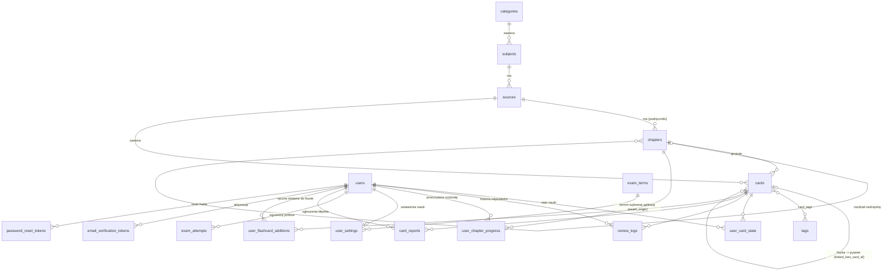

# 02. Baza danych

[← Spis treści](README.md)

Baza to **PostgreSQL 16**. Schemat tworzą wyłącznie migracje **Flyway** (`src/main/resources/db/migration`, pliki
`V1__...sql` do `V21__...sql`), uruchamiane automatycznie przy starcie aplikacji. Hibernate tylko sprawdza zgodność
(`ddl-auto: validate`), niczego nie tworzy i nie zmienia.

> Nie edytuj starych migracji. Każda zmiana schematu to **nowy plik** `V22__...sql` itd., bo Flyway zapamiętuje
> sumę kontrolną każdej wykonanej migracji (tabela `flyway_schema_history`).

## Schemat w skrócie



Dwie grupy tabel:

1. **Materiał (wspólny dla wszystkich):** `categories`, `subjects`, `sources`, `chapters`, `cards`, `tags`, `card_tags`.
2. **Dane użytkownika (osobne dla każdego konta):** `users`, `user_card_state`, `review_logs`,
   `user_chapter_progress`, `user_settings`, `exam_attempts`, `card_reports`, `user_flashcard_additions`, tokeny.
3. **Ustawiane przez administratora:** `exam_terms` (terminy egzaminów aplikacji).

Hierarchia materiału: **kategoria (rodzaj) → przedmiot / akt prawny → źródło → (rozdział) → karta**.
Przykład: *Prawo karne i postępowanie karne → Kodeks karny → Egzamin notarialny 2024 → pytanie*.

## Tabele materiału

### `categories` — rodzaje (działy prawa)

| Kolumna | Typ | Znaczenie |
|---------|-----|-----------|
| `id` | bigserial, PK | |
| `name` | varchar(255) | Nazwa, np. „Prawo karne i postępowanie karne” |
| `slug` | varchar(255), unikalny | Krótki identyfikator do adresów i skryptów |
| `items_label` | varchar(50), domyślnie „Przedmioty” | Jak nazywać zawartość: „Przedmioty” albo „Akty prawne” |
| `sort_order` | int ≥ 0, domyślnie 100 | Kolejność wyświetlania (mniejsza = wyżej) |

Migracja V4 tworzy kategorię „Student”, a V9 dodaje działy prawa: Prawo konstytucyjne i UE, Prawo cywilne i
postępowanie cywilne, Prawo karne i postępowanie karne, Prawo administracyjne, Prawo gospodarcze i handlowe, Prawo
pracy i ubezpieczeń społecznych, Prawo korporacyjne oraz Inne.

### `subjects` — przedmioty i akty prawne

| Kolumna | Typ | Znaczenie |
|---------|-----|-----------|
| `id` | bigserial, PK | |
| `name` | varchar(255) | Np. „Kodeks karny” |
| `slug` | varchar(255), unikalny | |
| `category_id` | FK → `categories`, NOT NULL | W jakim rodzaju leży przedmiot |

### `sources` — źródła pytań

| Kolumna | Typ | Znaczenie |
|---------|-----|-----------|
| `id` | bigserial, PK | |
| `subject_id` | FK → `subjects`, NOT NULL | |
| `name`, `author`, `edition` | tekst | Nazwa źródła, autor i wydanie (autor i wydanie opcjonalne) |
| `source_type` | varchar(30), `TEXTBOOK` albo `FLAT_POOL` | Rodzaj źródła (patrz niżej) |

Dwa rodzaje źródeł:

- **`FLAT_POOL` (pula płaska)** — zwykły zbiór pytań, np. „Egzamin notarialny 2024”. Wszystkie karty są od razu
  dostępne do nauki.
- **`TEXTBOOK` (podręcznik)** — karty należą do rozdziałów. Karta jest dostępna do nauki **dopiero po oznaczeniu jej
  rozdziału jako przeczytanego** (tabela `user_chapter_progress`). To zabezpiecza przed pytaniami z rozdziałów,
  których jeszcze nie czytałeś.

### `chapters` — rozdziały podręczników

| Kolumna | Typ | Znaczenie |
|---------|-----|-----------|
| `id` | bigserial, PK | |
| `source_id` | FK → `sources`, NOT NULL | |
| `parent_chapter_id` | FK → `chapters`, opcjonalny | Rozdział nadrzędny (zagnieżdżanie) |
| `title` | varchar(500) | |
| `order_index` | int | Kolejność w źródle; według niej wchodzą nowe karty |

### `cards` — pytania testowe i fiszki

To najważniejsza tabela. **Jedna tabela trzyma dwa rodzaje kart**:

- **pytanie testowe** — ma `correct_option` (A, B albo C) i trzy odpowiedzi `option_a/b/c`. Żyje w **Testach**;
- **fiszka** — nie ma `correct_option`, ma `back` (odwrót fiszki). Żyje w **Fiszkach**.

| Kolumna | Typ | Znaczenie |
|---------|-----|-----------|
| `id` | bigserial, PK | |
| `source_id` | FK → `sources`, NOT NULL | Źródło karty |
| `chapter_id` | FK → `chapters`, opcjonalny | Rozdział (wymagany dla kart z podręcznika) |
| `type` | varchar(50) | `DEFINITION`, `PAREMIA`, `COMPARISON` albo `CLOZE` |
| `front` | text, NOT NULL | Treść pytania albo przód fiszki |
| `back` | text, opcjonalny | Odwrót fiszki. Dla pytania testowego może być pusty |
| `page_number` | int ≥ 0, opcjonalny | Numer strony w podręczniku |
| `is_verbatim_quote` | boolean | Czy treść to dosłowny cytat |
| `option_a`, `option_b`, `option_c` | text | Trzy odpowiedzi pytania testowego |
| `correct_option` | varchar(1): A, B, C | Poprawna odpowiedź. **Jej obecność = karta jest pytaniem testowym** |
| `explanation` | text | Wyjaśnienie pokazywane po odpowiedzi |
| `legal_basis` | text, do 500 znaków | Podstawa prawna, np. „art. 148 § 1 k.k.” |
| `valid_as_of` | date | „Stan prawny na dzień” |
| `linked_test_card_id` | FK → `cards`, ON DELETE SET NULL | Tylko fiszka: z którym pytaniem jest powiązana |
| `origin` | varchar(40), domyślnie `AUTHORED` | Pochodzenie (patrz niżej) |
| `exam_year` | int 1990–2100 | Rok egzaminu (wymagany poza `AUTHORED`, zabroniony dla `AUTHORED`) |
| `hidden` | boolean, domyślnie false | Ukryta karta znika wszystkim (testy, fiszki, liczniki, egzamin) |
| `auto_generated` | boolean, domyślnie false | Fiszka utworzona automatycznie z pytania przez wyzwalacz |
| `created_at` | timestamp | Data utworzenia (nigdzie niepokazywana) |

**Pochodzenie (`origin`)** — skąd jest pytanie:

| Kod | Znaczenie |
|-----|-----------|
| `AUTHORED` | Pytanie autorskie (napisane przez nas) |
| `ADVOCATE_LEGAL_ADVISER` | Aplikacja adwokacka i radcowska |
| `JUDGE_PROSECUTOR` | Aplikacja sędziowska i prokuratorska |
| `NOTARY` | Aplikacja notarialna |
| `SUPPLEMENTARY_JUDGE` | Aplikacja uzupełniająca sędziowska |
| `BAILIFF` | Aplikacja komornicza |

**Ograniczenia CHECK w `cards`** (baza pilnuje ich niezależnie od aplikacji):

| Nazwa | Reguła |
|-------|--------|
| `chk_cards_type` | `type` to jedna z czterech wartości |
| `chk_cards_text_not_blank` | `front` niepusty; `back` albo NULL, albo niepusty; fiszka (bez `correct_option`) musi mieć `back` |
| `chk_cards_correct_option` | `correct_option` to NULL albo A/B/C |
| `chk_cards_test_has_options` | Pytanie testowe musi mieć wszystkie trzy odpowiedzi |
| `chk_cards_page_number` | Numer strony nie jest ujemny |
| `chk_cards_legal_basis_length` | Podstawa prawna ma najwyżej 500 znaków |
| `chk_cards_linked_only_on_flashcard` | Powiązanie ma tylko fiszka, nigdy pytanie testowe |
| `chk_cards_not_linked_to_self` | Karta nie może być powiązana sama ze sobą |
| `chk_cards_origin` | `origin` to jedna z sześciu wartości |
| `chk_cards_exam_year` | `AUTHORED` → rok pusty; pozostałe → rok od 1990 do 2100 |
| `chk_cards_auto_generated_flashcard` | Automatyczna fiszka jest zawsze fiszką powiązaną z pytaniem |

Część ograniczeń z migracji V8 i V16 jest dodana jako `NOT VALID`: baza pilnuje każdego **nowego i zmienianego**
wiersza, ale nie sprawdza wstecz starych. Gdy dane są czyste, można to nadrobić poleceniem
`ALTER TABLE cards VALIDATE CONSTRAINT nazwa;`.

### `tags` i `card_tags`

`tags` (`id`, `name` unikalna) to etykiety; `card_tags` (`card_id`, `tag_id`, klucz główny złożony) łączy karty z
tagami. Usunięcie karty usuwa jej wpisy w `card_tags`.

## Tabele użytkownika

### `users`

| Kolumna | Typ | Znaczenie |
|---------|-----|-----------|
| `id` | bigserial, PK | |
| `private_email` | varchar(255), unikalny | **Adres logowania** (prywatny) |
| `university_email` | varchar(255), unikalny | Adres uczelniany: na niego idzie link aktywacyjny i reset hasła |
| `password_hash` | varchar(255) | Skrót BCrypt hasła (samo hasło nigdy nie jest zapisywane) |
| `is_university_email_verified` | boolean | Czy kliknięto link aktywacyjny |
| `is_active` | boolean | Czy konto jest aktywne (bez aktywacji nie da się zalogować) |
| `role` | varchar(20): `STUDENT` albo `ADMIN` | Rola. Domyślnie `STUDENT` |
| `created_at` | timestamp | |
| `terms_accepted_at` | timestamp | Kiedy zaakceptowano regulamin. NULL = konto sprzed regulaminu |
| `tokens_valid_from` | bigint | Tokeny JWT wystawione przed tą chwilą (sekundy od 1970) przestają działać. NULL = bez ograniczenia |

### `email_verification_tokens` i `password_reset_tokens`

| Tabela | Kolumny | Uwagi |
|--------|---------|-------|
| `email_verification_tokens` | `id`, `user_id`, `token` (unikalny), `expires_at`, `used_at`, `created_at` | Token to losowy UUID zapisany **wprost**. Ważny 24 godziny |
| `password_reset_tokens` | `id`, `user_id` (ON DELETE CASCADE), `token_hash` (unikalny, 64 znaki), `expires_at`, `used_at`, `created_at` | W bazie jest tylko **skrót SHA-256** tokenu, a sam token jest wyłącznie w mailu. Ważny 1 godzinę |

### `user_chapter_progress`

Klucz główny (`user_id`, `chapter_id`); kolumny `is_read` i `read_at`. Wiersz istnieje, gdy użytkownik kiedykolwiek
oznaczył rozdział (jako przeczytany albo z powrotem jako nieprzeczytany). Karta z podręcznika jest dla użytkownika
dostępna, gdy `is_read = true` dla jej rozdziału.

### `user_card_state` — stan nauki jednej karty u jednego użytkownika

Klucz główny (`user_id`, `card_id`). Wiersz powstaje przy **pierwszej odpowiedzi** na kartę; do tej pory karta jest
„nowa”. Kolumny:

| Kolumna | Znaczenie |
|---------|-----------|
| `stability` | Stabilność pamięci w dniach (parametr FSRS). Im wyższa, tym wolniej zapominasz |
| `difficulty` | Trudność karty od 1 do 10 (parametr FSRS) |
| `due_date` | Kiedy karta ma wrócić |
| `reps` | Ile razy odpowiedziano |
| `lapses` | Ile razy użytkownik się pomylił („licznik błędów”) |
| `state` | `NEW`, `LEARNING`, `REVIEW` albo `RELEARNING` |
| `last_review_at` | Czas ostatniej odpowiedzi |
| `avg_time_seconds` | Średni czas odpowiedzi |
| `suspended`, `suspended_at` | Czy użytkownik zawiesił kartę i od kiedy (CHECK pilnuje, że oba pola są spójne) |
| `version` | Numer wersji do blokady optymistycznej |

### `review_logs` — historia każdej odpowiedzi

Jeden wiersz na odpowiedź (nigdy nie jest modyfikowany).

| Kolumna | Znaczenie |
|---------|-----------|
| `id` | Numer wiersza |
| `user_id`, `card_id` | Kto odpowiedział i na którą kartę |
| `rating` | Ocena FSRS 1–4 (1 = Nie pamiętam, 2 = Trudne, 3 = Znam, 4 = Łatwe) |
| `reviewed_at` | Kiedy |
| `elapsed_days` | Ile dni minęło od poprzedniej odpowiedzi. **NULL = pierwsze zobaczenie karty** (po tym liczy się dzienny limit nowych) |
| `stability_before`, `stability_after` | Stabilność przed i po odpowiedzi |
| `time_spent_seconds` | Czas odpowiedzi |
| `mode` | `FLASHCARD` albo `TEST` |
| `was_correct` | Tylko test: czy wybrana opcja była poprawna |
| `was_guessed` | Tylko test: zaznaczono „Nie jestem pewien” |

Z tej tabeli liczą się statystyki, dzienne limity, „pewne błędy” (odblokowanie fiszki) i lista „Powtórz moje błędy”.

### `user_settings` — ustawienia nauki

Klucz główny `user_id` (jeden wiersz na użytkownika, tworzony dopiero po pierwszym zapisie ustawień).
**NULL w polu liczbowym oznacza „użyj wartości domyślnej z konfiguracji serwera”.**

| Kolumna | Zakres (CHECK) | Znaczenie |
|---------|----------------|-----------|
| `new_cards_per_day` | 0–200 | Dzienny limit nowych fiszek |
| `new_test_questions_per_day` | 0–500 | Dzienny limit nowych pytań testowych |
| `max_reviews_per_day` | 10–1000 | Dzienny limit zaległych powtórek |
| `desired_retention` | 0,70–0,97 | Docelowa szansa przypomnienia |
| `exam_origin` | kod aplikacji albo NULL | Aplikacja, do której użytkownik się przygotowuje (CHECK `chk_user_settings_exam_origin`: tylko aplikacje, bez pytań autorskich). Data egzaminu i tryb egzaminacyjny biorą się z `exam_terms`. Własnej daty użytkownika nie ma (kolumna `exam_date` zniknęła w V21) |
| `shuffle_options` | boolean, domyślnie true | Mieszanie kolejności odpowiedzi A/B/C w pytaniach (korzysta z tego frontend) |
| `test_origins` | lista kodów po przecinku albo NULL | Filtr pochodzenia pytań w Testach. NULL = wszystkie |
| `updated_at` | timestamp | |

### `exam_terms` — terminy egzaminów aplikacji

Jeden wiersz na aplikację (5 wierszy założonych w V21; bez pytań autorskich, pilnuje tego CHECK `chk_exam_terms_origin`).

| Kolumna | Typ | Znaczenie |
|---------|-----|-----------|
| `origin` | klucz główny, kod aplikacji | `ADVOCATE_LEGAL_ADVISER`, `JUDGE_PROSECUTOR`, `NOTARY`, `SUPPLEMENTARY_JUDGE`, `BAILIFF` |
| `exam_date` | data albo NULL | Data najbliższego egzaminu. NULL = „termin nieogłoszony” |
| `updated_at` | timestamp | Kiedy administrator ostatnio zmienił termin |

Terminy ustawia administrator (`PUT /api/exam-terms/{origin}`), użytkownicy tylko je czytają. Tryb egzaminacyjny
i plan nowych pytań liczą się z terminu aplikacji wybranej w `user_settings.exam_origin`.

### `exam_attempts` — podejścia do egzaminu próbnego

Zapisuje **tylko podsumowanie** podejścia: `id`, `user_id` (kto zdawał), `finished_at`, `scope_label` (nazwa zakresu w chwili egzaminu),
`question_count`, `answered_count`, `correct_count`, `pass_threshold_percent`, `pass_points`, `passed`,
`time_limit_minutes`, `duration_seconds`, `timed_out`. Pojedynczych odpowiedzi baza nie przechowuje; szczegółowy raport
użytkownik dostaje w odpowiedzi tuż po zakończeniu. CHECK-i pilnują zakresów (np. 1–200 pytań, próg 1–100%,
`pass_points` od 1 do liczby pytań).

`pass_points` (migracja V20) to próg zaliczenia w punktach: 100 przy pełnym egzaminie 150 pytań. Zapisuje go serwer.
Podejścia sprzed stałego formatu mają w tej kolumnie `NULL` i zachowują własny próg z `pass_threshold_percent`. Od
stałego formatu `pass_threshold_percent` jest tylko zaokrągleniem progu w punktach w górę do pełnego procentu
(100 z 150 to 67).

### `card_reports` — zgłoszenia błędów w pytaniach

`id`, `user_id`, `card_id`, `reason` (`WRONG_ANSWER`, `OUTDATED`, `UNCLEAR`, `OTHER`), `comment` (do 1000 znaków),
`status` (`NEW`, `RESOLVED`, `REJECTED`), `created_at`, `resolved_at`.
Indeks unikalny `uq_card_reports_open_per_user_card` pilnuje, że użytkownik ma **co najwyżej jedno otwarte (`NEW`)
zgłoszenie dla jednego pytania**: kolejne zgłoszenie tego samego pytania uzupełnia poprzednie.
Aplikacja nie ma ekranu do rozpatrywania zgłoszeń; robi się to zapytaniem SQL (patrz niżej).

### `user_flashcard_additions` — ręczne „Dodaj do fiszek”

`id`, `user_id`, `question_id` (pytanie testowe), `added_at`; para (`user_id`, `question_id`) jest unikalna.

## Wyzwalacze: fiszka z każdego pytania (migracja V18)

Każde pytanie testowe automatycznie dostaje **własną fiszkę**. Robią to wyzwalacze w bazie, więc działa to także
wtedy, gdy pytanie dodasz zwykłym SQL-em, a nie przez API.

| Wyzwalacz | Kiedy | Co robi |
|-----------|-------|---------|
| `trg_cards_sync_question_flashcard` | po `INSERT` i `UPDATE` na `cards` | Tworzy fiszkę pytania, a przy zmianie pytania aktualizuje ją |
| `trg_cards_delete_question_flashcard` | przed `DELETE` na `cards` | Usuwa automatyczną fiszkę razem z pytaniem |
| `trg_cards_restore_question_flashcard` | po `DELETE` ręcznej fiszki powiązanej z pytaniem | Przywraca fiszkę automatyczną tego pytania |

Zasady, które wprowadza funkcja `sync_question_flashcard()`:

- **Przód** fiszki = treść pytania. **Tył** = poprawna odpowiedź, a jeśli pytanie ma wyjaśnienie, to po pustej linii
  także ono.
- Podstawa prawna, stan prawny na dzień, pochodzenie, rok, źródło i rozdział są **kopiowane** z pytania (fiszka z
  pytania z podręcznika zależy od przeczytania tego samego rozdziału).
- Jeśli pytanie ma już fiszkę napisaną ręcznie (powiązaną, a nie automatyczną), automatycznej **nie** tworzy. Gdy
  ręczną fiszkę dodasz do pytania, które ma już automatyczną, ta automatyczna jest usuwana.
- Ukrycie pytania ukrywa jego automatyczną fiszkę, odkrycie ją odkrywa.
- Automatyczna fiszka ma `auto_generated = true`, typ `DEFINITION` i `linked_test_card_id` wskazujące pytanie.

To, że fiszka istnieje w bazie, **nie znaczy**, że użytkownik ją widzi. Fiszka powiązana z pytaniem jest w Fiszkach
dopiero po „pewnym błędzie” w tym pytaniu albo po ręcznym „Dodaj do fiszek” (patrz
[04](04-nauka-testy-fiszki-fsrs.md#fiszki-z-pytań-i-odblokowywanie)).

## Usuwanie i kaskady

| Usuwasz | Co znika razem z tym |
|---------|----------------------|
| **Użytkownika** | Wszystko jego: stan kart, historia odpowiedzi, postęp rozdziałów, ustawienia, egzaminy, zgłoszenia, ręczne dodania, tokeny (`ON DELETE CASCADE`, migracja V11) |
| **Kartę** | Jej stan u wszystkich użytkowników, historia odpowiedzi, tagi, zgłoszenia, ręczne dodania. Automatyczna fiszka pytania znika razem z pytaniem. Fiszka ręczna powiązana z usuwanym pytaniem zostaje zwykłą fiszką (`SET NULL`) |

Przy usuwaniu kategorii, przedmiotów, źródeł i rozdziałów kaskady nie ma: baza odmówi, dopóki coś do nich należy.
Aplikacja nie ma zresztą endpointów do usuwania treści (tylko dodawanie i ukrywanie kart).

## Indeksy

Poza kluczami głównymi i unikalnymi baza ma indeksy pod najczęstsze zapytania (migracja V8 i późniejsze), m.in.:

- `user_card_state (user_id, due_date)` — zaległe powtórki, kolejki, licznik na pasku,
- `user_card_state (user_id) WHERE suspended` — indeks częściowy, lista zawieszonych,
- `review_logs (user_id, reviewed_at)` — aktywność, retencja, historia,
- `review_logs (user_id, mode, reviewed_at) WHERE elapsed_days IS NULL` — dzienny limit nowych kart (liczy tylko
  pierwsze zobaczenia),
- `cards (source_id)`, `cards (chapter_id)`, `cards (origin)`, `cards (linked_test_card_id) WHERE ... IS NOT NULL`,
- `exam_attempts (user_id, finished_at DESC)`, `card_reports (status, created_at)` i inne.

## Historia migracji

| Migracja | Etap | Co wprowadza |
|----------|------|--------------|
| V1 | start | Pierwszy schemat: użytkownicy, tokeny aktywacji, przedmioty, rozdziały, źródła, karty, tagi, postęp, stan karty, dziennik |
| V2 | | Kolumna `role` w `users` |
| V3 | | Przebudowa: źródła należą do przedmiotu i mają typ; rozdziały należą do źródła; karta musi mieć źródło |
| V4 | | Tabela `categories`; przedmioty dostają kategorię (początkowo wszystkie w „Student”) |
| V5 | | Kolumny pytań ABC: `option_a/b/c`, `correct_option`, `explanation` |
| V6 | | Powrót kolumny `parent_chapter_id` w `chapters` |
| V7 | | `mode`, `was_correct`, `was_guessed` w `review_logs` (osobne limity i statystyki fiszek i testów) |
| V8 | 2 | Indeksy i ograniczenia CHECK (`NOT VALID`) |
| V9 | 3 | Etykieta i kolejność kategorii, działy prawa |
| V10 | 5A | Tokeny resetu hasła (tylko skróty), `terms_accepted_at` |
| V11 | 5B | `ON DELETE CASCADE` na kluczach do `users` (usuwanie konta, RODO) |
| V12 | 5C | `legal_basis`, `valid_as_of`, tabela `card_reports` |
| V13 | 7 | Blokada optymistyczna (`version`), tabela `user_settings` |
| V14 | 8 | Zawieszanie kart (`suspended`, `suspended_at`) |
| V15 | 10 | Tabela `exam_attempts` |
| V16 | 14 | Fiszki i Testy osobno: `back` opcjonalne, `linked_test_card_id` |
| V17 | 15 | `tokens_valid_from` (unieważnianie sesji po zmianie hasła) |
| V18 | 17 | `origin`, `exam_year`, `hidden`, `auto_generated`, wyzwalacze fiszek, kaskady po kartach, `user_flashcard_additions` |
| V19 | 18 | `test_origins` w `user_settings` (filtr pochodzenia) |
| V20 | 28 | `pass_points` w `exam_attempts` (stały format egzaminu: próg w punktach) |
| V21 | 29 | `exam_terms` (terminy egzaminów ustawia administrator), `exam_origin` w `user_settings`; usunięta `user_settings.exam_date` (własna data użytkownika znika razem z zapisanymi wartościami) |

Numery „Etap” wskazują, w którym etapie pracy nad projektem migracja powstała.

## Przydatne zapytania SQL (ręczna administracja)

Aplikacja nie ma panelu administratora, więc część czynności robi się w bazie (np. przez `psql`). Poniższe zapytania
pasują do schematu z migracji V1–V21.

**Nadanie roli administratora.** Rola jest zapisana także w tokenie JWT, więc po zmianie użytkownik musi się
**wylogować i zalogować ponownie**, żeby dostać nowy token z rolą `ADMIN`.

```sql
UPDATE users SET role = 'ADMIN' WHERE private_email = 'ty@example.com';
```

**Terminy egzaminów** ustawia administrator w aplikacji (Konto → „Terminy egzaminów”, czyli
`PUT /api/exam-terms/{origin}`). Awaryjnie można to zrobić w bazie:

```sql
UPDATE exam_terms SET exam_date = '2027-03-15', updated_at = now() WHERE origin = 'NOTARY';
UPDATE exam_terms SET exam_date = NULL, updated_at = now() WHERE origin = 'BAILIFF';  -- termin nieogłoszony
```

**Ukrycie i odkrycie karty** (znika wszystkim; historia odpowiedzi zostaje):

```sql
UPDATE cards SET hidden = true  WHERE id = 123;
UPDATE cards SET hidden = false WHERE id = 123;
```

**Nowe zgłoszenia błędów w pytaniach:**

```sql
SELECT r.id, r.card_id, r.reason, r.comment, r.created_at, c.front
FROM card_reports r
JOIN cards c ON c.id = r.card_id
WHERE r.status = 'NEW'
ORDER BY r.created_at;
```

**Rozpatrzenie zgłoszenia** (po rozpatrzeniu użytkownik może zgłosić to samo pytanie ponownie):

```sql
UPDATE card_reports SET status = 'RESOLVED', resolved_at = now() WHERE id = 45;  -- albo 'REJECTED'
```

**Przeniesienie przedmiotów do działów prawa** i **reset postępów nauki**: gotowe skrypty
`docs/assign-subjects-to-categories.sql` i `docs/reset-study-progress.sql` (opis w [README](README.md)).
