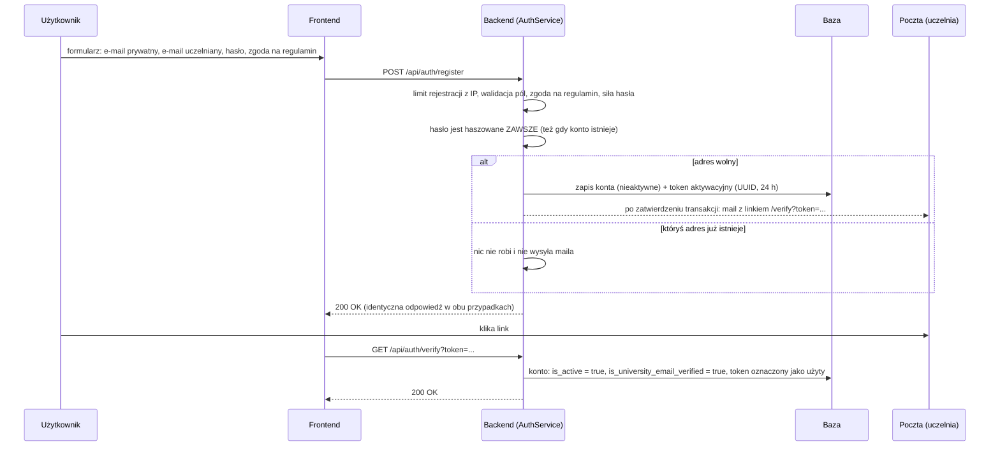
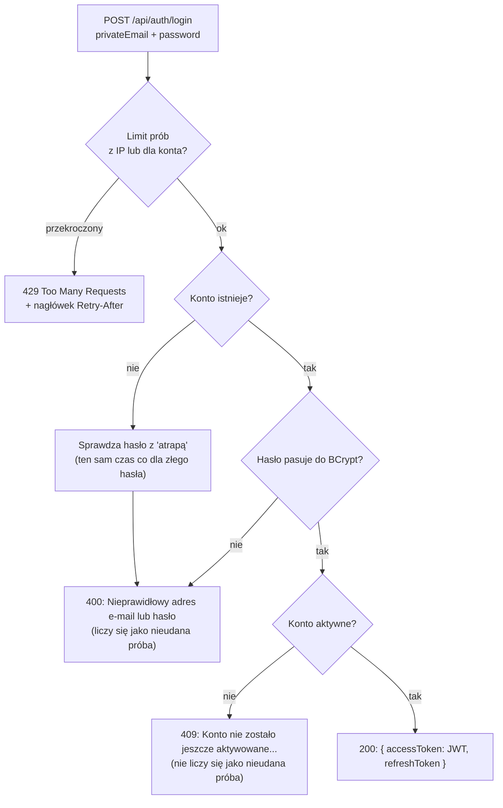
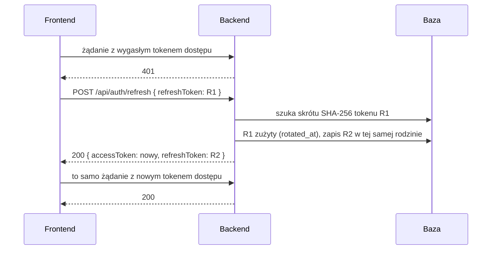
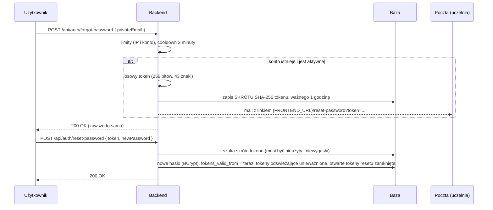

# 03. Bezpieczeństwo i konta

[← Spis treści](README.md)

Ten plik opisuje, jak działają konta: rejestracja, aktywacja, logowanie, tokeny (dostępu i odświeżające), reset i zmiana
hasła, role,
limity prób oraz usuwanie konta i eksport danych. Konkretne endpointy z przykładami są w
[API: konta i logowanie](api/01-auth.md) i [API: konto zalogowanego](api/02-konto.md).

## W skrócie

- Logujesz się **prywatnym adresem e-mail** i hasłem. Konto trzeba **aktywować linkiem wysłanym na adres uczelniany**.
- Po zalogowaniu dostajesz **parę tokenów**: krótki **token dostępu** JWT (30 minut), który frontend dołącza do każdego
  żądania, i **token odświeżający** (30 dni), którym przeglądarka po cichu zdobywa kolejny token dostępu. Dzięki temu
  nikt nie jest wylogowywany co pół godziny, a skradziony token dostępu szybko przestaje działać.
- Hasła są zapisane jako skrót **BCrypt**. Tokeny z maila (reset hasła) w bazie są zapisane tylko jako skrót SHA-256.
- Zmiana albo reset hasła **wylogowuje wszystkie urządzenia**; wylogowanie unieważnia sesję na serwerze.
- Odpowiedzi na rejestrację, „wyślij link ponownie” i „zapomniałem hasła” są **zawsze takie same**, niezależnie od tego,
  czy konto istnieje (nikt obcy nie sprawdzi, kto ma konto).
- Logowanie, rejestracja i maile mają **limity prób**.
- Są dwie role: `STUDENT` (domyślna) i `ADMIN`.

## Rejestracja i aktywacja konta

Reguły:

- **Normalizacja adresów:** spacje z brzegów są obcinane, litery zamieniane na małe (`Jan@Gmail.com` i
  `jan@gmail.com` to jedno konto).
- **Hasło:** co najmniej **8 znaków** i najwyżej **72 bajty** (BCrypt używa tylko pierwszych 72 bajtów, więc dłuższe
  hasło jest odrzucane zamiast po cichu ucinane). Pole w żądaniu ma też limit 72 znaków.
- **Regulamin:** pole `acceptedTerms` musi być `true`. Czas zgody jest zapisany w `users.terms_accepted_at`.
- **Dwa adresy:** prywatny służy do logowania, uczelniany do aktywacji i resetu hasła. Oba muszą być unikalne w
  systemie.
- **Link aktywacyjny** jest ważny 24 godziny. Ponowne kliknięcie użytego linku na już aktywnym koncie kończy się
  sukcesem (operacja idempotentna). Link użyty, ale konto nieaktywne, albo wygasły daje błąd 409.
- **Ponowne wysłanie linku** (`/resend-verification`) działa tylko dla nieaktywnych kont i nie częściej niż co **2
  minuty** na konto.
- Przy równoległej rejestracji tego samego adresu (dwa żądania naraz) przepuszcza jedno unikalność w bazie; drugie
  dostaje taką samą odpowiedź 200 jak każde istniejące konto.

> Uwaga: link aktywacyjny w mailu jest dziś wpisany na stałe jako `http://localhost:5173/verify?token=...`. To jedna
> z rzeczy zostawionych celowo na koniec (patrz [Znane ograniczenia](07-znane-ograniczenia.md)). Linki resetu hasła
> korzystają już z konfigurowalnego `FRONTEND_URL`.

## Logowanie

Ważne szczegóły:

- Błędne hasło i nieistniejące konto dają **ten sam komunikat i ten sam kod 400** („Nieprawidłowy adres e-mail lub
  hasło”). Dla nieistniejącego konta serwer i tak liczy hasz BCrypt, żeby czas odpowiedzi niczego nie zdradzał.
- Konto nieaktywowane po poprawnym haśle dostaje **409** i podpowiedź, żeby kliknąć link albo poprosić o nowy.
- Udane logowanie zeruje licznik nieudanych prób dla tej pary (IP, e-mail).

## Token dostępu JWT i sesja

Token tworzy `JwtService` (biblioteka jjwt, podpis HMAC). Zawiera:

| Claim  | Znaczenie                                                                    |
|--------|------------------------------------------------------------------------------|
| `sub`  | Prywatny e-mail użytkownika                                                  |
| `role` | `STUDENT` albo `ADMIN`                                                       |
| `iat`  | Kiedy wystawiono (sekundy od 1970)                                           |
| `exp`  | Kiedy wygasa (domyślnie po **30 minutach**: `APP_JWT_EXPIRATION_MS=1800000`) |

Frontend dołącza token do każdego żądania w nagłówku `Authorization: Bearer <token>`. Backend **nie trzyma sesji**
(tryb bezstanowy): wszystko, co trzeba, jest w tokenie i w jednym lekkim zapytaniu do bazy.

**Co sprawdza `JwtAuthenticationFilter` przy każdym żądaniu:**

1. czy token ma poprawny podpis i nie wygasł,
2. czy konto o tym adresie nadal istnieje (usunięte konto = 401, mimo że token jest jeszcze ważny),
3. czy token został wystawiony **nie wcześniej** niż `users.tokens_valid_from` (reguła `SessionRules`). Token bez
   znacznika `iat` nie przechodzi, jeśli konto ma ustawione ograniczenie.

Jeśli którykolwiek warunek nie jest spełniony, żądanie jest traktowane jak anonimowe, a endpoint chroniony odpowiada
**401** (nie 403 — to ustawienie `HttpStatusEntryPoint(UNAUTHORIZED)`).

**Wylogowanie wszystkich urządzeń:** przy zmianie hasła (w koncie i przez reset) backend zapisuje
`tokens_valid_from` = „teraz” i unieważnia wszystkie tokeny odświeżające konta. Wszystkie wcześniej wydane tokeny
dostępu od tej chwili dają 401, a tokeny odświeżające przestają działać. Przy zmianie hasła z konta odpowiedź zawiera
**nową parę tokenów**, więc bieżące urządzenie nie zostaje wylogowane.

**Rola w tokenie:** rola jest odczytywana z tokenu, a nie z bazy przy każdym żądaniu. Dlatego po nadaniu komuś roli
`ADMIN` w bazie musi się on wylogować i zalogować ponownie.

## Sesja: token dostępu i token odświeżający

Token dostępu jest krótki, bo jest bezstanowy: serwer nie może go „cofnąć” przed czasem (poza zmianą hasła). Żeby
mimo to nie wylogowywać co 30 minut, logowanie zwraca drugi token, **odświeżający**, którego ważność jest sprawdzana w
bazie (`RefreshTokenService`, tabela `refresh_tokens`).

Zasady:

- **Rotacja.** Każde odświeżenie zużywa token i wydaje następny. Ważny jest zawsze tylko ostatni z „rodziny” (jedno
  logowanie na jednym urządzeniu, `family_id`).
- **Tylko skrót w bazie.** Token to 256-bitowa wartość losowa; w tabeli leży jej SHA-256, tak jak przy linkach resetu
  hasła. Wyciek bazy nie daje działających sesji.
- **Wykrywanie kradzieży.** Użycie tokenu już zużytego **dawniej niż 10 sekund temu** (`RefreshRules.REUSE_GRACE`)
  oznacza,
  że ktoś ma kopię. Cała rodzina zostaje unieważniona, a użytkownik loguje się ponownie. Do 10 sekund wystawiany jest
  kolejny token tej samej rodziny, bo to zwykle dwie karty przeglądarki odświeżające naraz albo odpowiedź, która zgubiła
  się w drodze.
- **Unieważnianie.** Wylogowanie (`POST /api/auth/logout`) kończy sesję tego urządzenia. Zmiana i reset hasła kończą
  wszystkie sesje konta. Usunięcie konta kasuje tokeny kaskadowo. Nieaktywne konto nie może odświeżać.
- **Ważność.** 30 dni (`APP_JWT_REFRESH_DAYS`), liczone od ostatniego odświeżenia, więc aktywny użytkownik nie musi się
  logować. Wygasłe wiersze starsze niż 7 dni są sprzątane przy okazji wystawiania kolejnego tokenu.
- **Limit.** `refresh` i `logout` mają wspólny limit 300 żądań / 5 min z jednego adresu IP (hojny, bo wiele osób siedzi
  za jednym adresem uczelni).

Frontend trzyma oba tokeny w `localStorage`. Jedno wspólne odświeżenie obsługuje wszystkie równoległe żądania w karcie,
a
między kartami pilnuje tego blokada Web Locks. Zapis w `localStorage` jest wygodny, ale dostępny dla skryptów strony,
więc
przy ataku XSS token da się wykraść. Docelowo token odświeżający powinien być w ciasteczku `HttpOnly; Secure; SameSite`,
niedostępnym dla skryptów; wymaga to zmian w CORS i wdrożeniu (adres frontendu i backendu w jednej domenie), więc
czeka na etap wdrożenia ([Znane ograniczenia](07-znane-ograniczenia.md)).

## Reset i zmiana hasła

### Reset hasła („zapomniałem hasła”)

- Link idzie na **zweryfikowany adres uczelniany** konta, nie na prywatny.
- W bazie leży tylko skrót tokenu, więc wyciek bazy nie daje nikomu działających linków.
- Token jest jednorazowy i ważny **1 godzinę**; użycie lub wygaśnięcie daje błąd 400 „Link do zmiany hasła jest
  nieprawidłowy lub wygasł. Poproś o nowy.”
- Ustawianie nowego hasła z tokenem też ma limit (20 prób na godzinę z jednego IP).

### Zmiana hasła z poziomu konta

`PUT /api/users/me/password` wymaga **obecnego hasła** (zabezpieczenie przed zmianą z zostawionej sesji). Nowe hasło
musi być inne niż obecne. Po zmianie:

- wszystkie dotychczasowe sesje przestają działać (`tokens_valid_from` i unieważnienie tokenów odświeżających), ale
  odpowiedź zawiera świeżą parę tokenów,
- otwarte linki do resetu hasła są unieważniane,
- na adres uczelniany idzie powiadomienie „Hasło do Twojego konta w Gradus iuris zostało zmienione” z linkiem do
  ustawienia
  hasła od nowa, gdyby to nie był właściciel.

Zgadywanie obecnego hasła podlega **temu samemu limitowi co logowanie**.

## Role i uprawnienia

| Rola                 | Co może                                                                                                                                                                                                                                                                                                                                                                                                                                                                                                                                                                                         |
|----------------------|-------------------------------------------------------------------------------------------------------------------------------------------------------------------------------------------------------------------------------------------------------------------------------------------------------------------------------------------------------------------------------------------------------------------------------------------------------------------------------------------------------------------------------------------------------------------------------------------------|
| `STUDENT` (domyślna) | Uczyć się, rozwiązywać testy i egzaminy, zmieniać ustawienia, zgłaszać błędy, zarządzać własnym kontem                                                                                                                                                                                                                                                                                                                                                                                                                                                                                          |
| `ADMIN`              | Wszystko jak `STUDENT` oraz operacje administratora: ukrycie pytania (`PUT /api/questions/{id}/hidden`), ukrycie samej fiszki (`PUT /api/questions/{id}/flashcard-hidden`), ustawienie terminu egzaminu ścieżki (`PUT /api/exam-terms/{trackId}`) i zarządzanie oznaczeniami pytań (`/api/admin/question-marks/**`). Cała ścieżka `/api/admin/**` jest w `SecurityConfig` zarezerwowana dla roli `ADMIN` (osobna reguła przed „każde inne żądanie wymaga logowania”), a kontroler ma jeszcze `@PreAuthorize`. Treści (akty prawne, pytania) administrator wczytuje skryptami SQL, nie przez API |

Uprawnienia wymusza adnotacja `@PreAuthorize("hasRole('ADMIN')")` na metodach kontrolerów. Zwykły użytkownik
dostaje wtedy **403**.

Dlaczego nie ma endpointu do przeglądania pytań z poprawnymi odpowiedziami: odpowiedź zawierałaby poprawną opcję i
wyjaśnienie. Użytkownik dostaje pytania wyłącznie przez kolejki nauki, egzamin i własne testy, które pilnują, co jest w
jego puli, i **nie zawierają poprawnej odpowiedzi** (ta wraca dopiero po udzieleniu odpowiedzi; w egzaminie po jego
zakończeniu).

**Jak zrobić administratora:** w aplikacji nie ma ekranu do nadawania ról; robi się to w bazie (patrz
[02](02-baza-danych.md#przydatne-zapytania-sql-ręczna-administracja)).

### Co jest publiczne, a co wymaga logowania

| Adres                                                                             | Dostęp           |
|-----------------------------------------------------------------------------------|------------------|
| `/api/auth/**` (rejestracja, aktywacja, logowanie, reset)                         | publiczny        |
| `/actuator/**`, `/swagger-ui.html`, `/swagger-ui/**`, `/v3/api-docs/**`, `/error` | publiczny        |
| żądania `OPTIONS` (przeglądarkowe sprawdzanie CORS)                               | publiczny        |
| **wszystko inne** (`anyRequest().authenticated()`)                                | tylko zalogowani |

CSRF jest wyłączony (API jest bezstanowe i używa tokenu w nagłówku, nie ciasteczek).

## Limity prób

Limity liczy `AuthRateLimiter` w **pamięci serwera** (przesuwne okno czasowe). Po przekroczeniu serwer odpowiada **429**
z polskim komunikatem („Zbyt wiele prób. Spróbuj ponownie za 7 min”) i nagłówkiem `Retry-After`.

| Akcja                                                                     | Limit | Okno    | Klucz                                                           |
|---------------------------------------------------------------------------|-------|---------|-----------------------------------------------------------------|
| Logowanie (wszystkie próby)                                               | 30    | 5 min   | adres IP                                                        |
| Nieudane logowania na to samo konto                                       | 8     | 15 min  | IP + adres e-mail                                               |
| Rejestracja                                                               | 10    | 1 godz. | adres IP                                                        |
| „Wyślij link ponownie” i „zapomniałem hasła”                              | 10    | 1 godz. | adres IP (nadmiar = 429)                                        |
| to samo                                                                   | 3     | 1 godz. | konto (nadmiar = **cicho** pomijane, odpowiedź 200 bez wysyłki) |
| Ustawianie nowego hasła z tokenu                                          | 20    | 1 godz. | adres IP                                                        |
| Odświeżenie sesji i wylogowanie (`/api/auth/refresh`, `/api/auth/logout`) | 300   | 5 min   | adres IP                                                        |

Dodatkowo nie wysyła się kolejnego maila (aktywacja, reset) częściej niż co **2 minuty** dla konta.

Dlaczego limit „na konto” jest cichy: gdyby odpowiedź była inna dla istniejącego i nieistniejącego konta, dałoby to
sposób na sprawdzanie cudzych adresów.

Z limitu logowania korzystają też zmiana hasła i usunięcie konta (błędne hasło liczy się jako nieudana próba).

> Limity są w pamięci jednej instancji aplikacji. Za serwerem pośredniczącym (nginx, hosting) trzeba ustawić
> `FORWARD_HEADERS_STRATEGY=native`, inaczej wszyscy użytkownicy mają jeden adres IP i wspólny limit (patrz
> [05](05-konfiguracja-i-uruchomienie.md)).

## Eksport danych i usuwanie konta (RODO)

**`GET /api/users/me/export`** zwraca jeden plik JSON z **wszystkimi danymi**, które serwis trzyma o użytkowniku:
konto (bez hasła i tokenów), stan nauki każdego pytania (osobno w trybie Testy i Fiszki), pełną historię odpowiedzi,
wysłane zgłoszenia, podsumowania egzaminów, zapisane własne testy, czas nauki dzień po dniu, ręczne dodania do fiszek i
ustawienia nauki (wybrana ścieżka, zawężenie puli do aktów, limity). Dokładny kształt pliku:
[API: konto zalogowanego](api/02-konto.md).

**`DELETE /api/users/me`** (z hasłem w treści żądania) usuwa konto **razem z całą historią nauki**. Kasowanie
powiązanych danych robi sama baza (`ON DELETE CASCADE`, patrz [02](02-baza-danych.md#usuwanie-i-kaskady)). Złe hasło
daje 400 i konto zostaje nietknięte.
Znikają też zapisane własne testy, czas nauki i tokeny odświeżające. Po usunięciu zwracane jest `204 No Content`.

## Co jest zabezpieczone, a co jeszcze nie

Zabezpieczone: hasła (BCrypt), tokeny resetu i odświeżające (skróty), krótko żyjące podpisane tokeny JWT, rotacja
tokenów odświeżających z wykrywaniem kradzieży, unieważnianie sesji, jednakowe
odpowiedzi chroniące przed sprawdzaniem cudzych kont, limity prób, ochrona endpointów rolami, walidacja wejścia.

Zostawione celowo na koniec (przed wdrożeniem na prawdziwy serwer): domyślny sekret JWT w `application.yml`, plik
`../.env.stary` w repozytorium, konfiguracja CORS, link aktywacyjny wpisany na stałe, `show-sql`, szczegóły zdrowia w
Actuatorze i otwarty Swagger. Pełna lista z wyjaśnieniami: [Znane ograniczenia](07-znane-ograniczenia.md).
