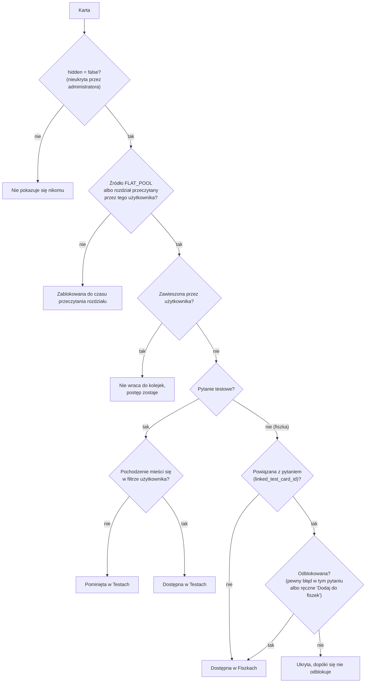
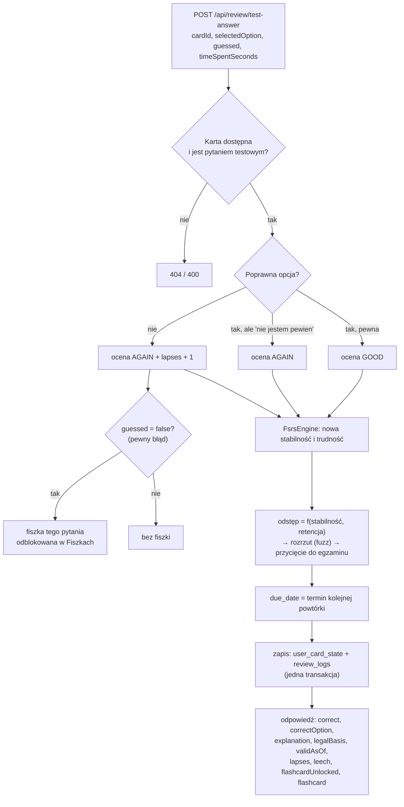
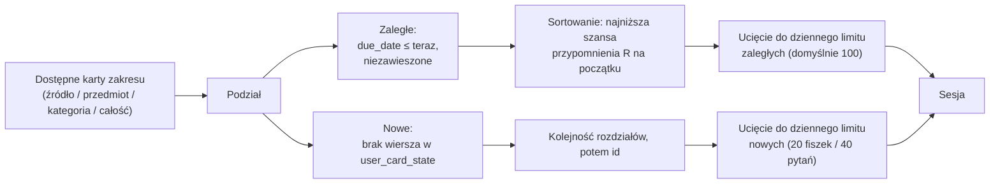

# 04. Nauka: testy, fiszki i algorytm FSRS

[← Spis treści](README.md)

To najważniejszy plik dokumentacji. Wyjaśnia, **jak aplikacja decyduje, co pokazać dziś i kiedy to pokazać znowu**.
Kod, o którym tu mowa, leży głównie w pakietach `review`, `review.fsrs`, `flashcard`, `settings` i `card`.

## Spis

1. [Dwa światy: Testy i Fiszki](#dwa-światy-testy-i-fiszki)
2. [Skąd karta trafia do nauki (dostępność)](#skąd-karta-trafia-do-nauki-dostępność)
3. [Odpowiedź w teście krok po kroku](#odpowiedź-w-teście-krok-po-kroku)
4. [Fiszki z pytań i odblokowywanie](#fiszki-z-pytań-i-odblokowywanie)
5. [FSRS-6 po ludzku](#fsrs-6-po-ludzku)
6. [Od stabilności do terminu powtórki](#od-stabilności-do-terminu-powtórki)
7. [Kolejka na dziś i limity dzienne](#kolejka-na-dziś-i-limity-dzienne)
8. [Tryb egzaminacyjny i plan nowych pytań](#tryb-egzaminacyjny-i-plan-nowych-pytań)
9. [Trudne pytania i zawieszanie](#trudne-pytania-i-zawieszanie)
10. [Dodatkowe sesje: „Powtórz moje błędy” i „Przerób błędy”](#dodatkowe-sesje-powtórz-moje-błędy-i-przerób-błędy)
11. [Egzamin próbny](#egzamin-próbny)
12. [Filtr pochodzenia pytań](#filtr-pochodzenia-pytań)
13. [Zabezpieczenia spójności](#zabezpieczenia-spójności)

---

## Dwa światy: Testy i Fiszki

Aplikacja ma dwa osobne tryby nauki. Technicznie są to ten sam mechanizm powtórek, ale z osobnymi kartami, limitami i
statystykami (kolumna `mode` w `review_logs`: `FLASHCARD` albo `TEST`).

| | **Testy** | **Fiszki** |
|---|-----------|------------|
| Karta | Pytanie ABC: trzy odpowiedzi, **dokładnie jedna poprawna** (`correct_option`) | Przód i odwrót (`front`, `back`), bez opcji |
| Jak odpowiadasz | Wybierasz A, B albo C; opcjonalnie zaznaczasz „Nie jestem pewien” | Odwracasz fiszkę i sam oceniasz: Nie pamiętam / Trudne / Znam / Łatwe |
| Endpoint odpowiedzi | `POST /api/review/test-answer` | `POST /api/review` |
| Ocena pamięci (1–4) | Wyznacza serwer z reguły (patrz niżej) | Wybierasz Ty |
| Limit nowych dziennie | 40 pytań (domyślnie) | 20 fiszek (domyślnie) |

Karta jest **albo** pytaniem testowym, **albo** fiszką. Próba odpowiedzi na pytanie testowe jako fiszkę (albo
odwrotnie) kończy się błędem 400. Nie da się „obejść” testu przez fiszkę.

## Skąd karta trafia do nauki (dostępność)

Karta trafia do kolejki nauki, gdy spełnia **wszystkie** warunki:



Za „przeczytane rozdziały” odpowiada `PUT /api/chapters/{id}/progress` (tabela `user_chapter_progress`). Reguła
dostępności jest zapisana w zapytaniach `CardRepository.findReadableRefs...` i `countReadableById`.

Gdy użytkownik zna numer karty z nieprzeczytanego rozdziału podręcznika, odpowiedź na nią kończy się tak samo, jak dla
nieistniejącej (404), więc nie da się „odpowiadać na zapas” na pytania z rozdziałów, których jeszcze nie odblokował.
Ukrycie karty **nie** blokuje odpowiedzi w sesji, którą użytkownik już ma otwartą (nowe sesje jej nie zawierają).

## Odpowiedź w teście krok po kroku

Użytkownik wybiera A, B albo C i może zaznaczyć **„Nie jestem pewien”** (pole `guessed`). Serwer sprawdza odpowiedź
i na tej podstawie wyznacza ocenę dla algorytmu:

| Wybór | „Nie jestem pewien” | Ocena FSRS | Licznik błędów (`lapses`) | Skutek |
|-------|---------------------|------------|---------------------------|--------|
| poprawny | nie | **Znam** (GOOD, 3) | bez zmian | Pytanie wraca po dłuższej przerwie |
| poprawny | tak | **Nie pamiętam** (AGAIN, 1) | bez zmian | Zgadłeś, więc nie liczy się jako wiedza: wróci szybko |
| błędny | tak | **Nie pamiętam** (AGAIN, 1) | +1 | Wiesz, że nie wiesz: wróci szybko, bez fiszki |
| błędny | nie | **Nie pamiętam** (AGAIN, 1) | +1 | **Pewny błąd**: wróci szybko i **odblokowuje fiszkę** pytania |

Dlaczego test nigdy nie daje oceny „Łatwe” (EASY): przy trzech opcjach nie da się odróżnić „łatwego” pytania od
szczęśliwego trafienia.



Odpowiedź serwera zawiera m.in. poprawną opcję, wyjaśnienie, podstawę prawną, aktualną liczbę błędów, informację czy
pytanie jest już „trudne” (`leech`), czy ta odpowiedź **właśnie** odblokowała fiszkę (`flashcardUnlocked`, tylko przy
pierwszym pewnym błędzie w tym pytaniu) oraz stan fiszki (`flashcard`).

Fiszki oceniasz sam (`POST /api/review`, pole `rating` od 1 do 4). „Nie pamiętam” (1) zwiększa licznik błędów.

## Fiszki z pytań i odblokowywanie

Każde pytanie testowe ma w bazie **automatycznie utworzoną fiszkę** (wyzwalacze, opis w
[02](02-baza-danych.md#wyzwalacze-fiszka-z-każdego-pytania-migracja-v18)): przód to treść pytania, tył to poprawna
odpowiedź i wyjaśnienie.

Użytkownik **nie widzi** tej fiszki od razu. Pojawia się ona w jego Fiszkach dopiero, gdy:

1. **pomylił to pytanie w teście bez zaznaczenia „Nie jestem pewien”** (pewny błąd), albo
2. **sam ją dodał** przyciskiem „Dodaj do fiszek” (`POST /api/questions/{id}/flashcard`).

Idea: pewny błąd to utrwalone błędne przekonanie, więc warto je przepracować także w formie fiszki. Pomyłka, o której
użytkownik wiedział („nie jestem pewien”), nie wymaga fiszki.

Stany fiszki pytania (`FlashcardStatus`) widziane z punktu widzenia użytkownika:

| Stan | Znaczenie | Czy można zmienić |
|------|-----------|-------------------|
| `UNAVAILABLE` | Pytanie nie ma widocznej fiszki (np. została ukryta) | — |
| `AVAILABLE` | Fiszki nie ma jeszcze w Fiszkach | „Dodaj do fiszek” |
| `ADDED_MANUALLY` | Użytkownik sam ją dodał | „Usuń z fiszek” (kasuje też harmonogram tej fiszki) |
| `ADDED_BY_MISTAKE` | Trafiła przez pewny błąd | **Nie da się cofnąć** |

Kto ma pewny błąd w pytaniu, ma fiszkę niezależnie od ręcznego dodania, więc „Usuń z fiszek” nie ma wpływu na fiszkę
odblokowaną przez błąd.

## FSRS-6 po ludzku

**FSRS** (Free Spaced Repetition Scheduler) to nowoczesny algorytm powtórek rozłożonych w czasie. Wersja 6 ma
**21 parametrów** (w0–w20). Implementacja jest w `review/fsrs/FsrsEngine.java`, a jej wyniki są sprawdzane testem
`FsrsEngineTest` względem referencyjnej biblioteki `py-fsrs`.

Algorytm dla każdej karty u każdego użytkownika pamięta dwie liczby (kolumny `stability` i `difficulty` w
`user_card_state`):

| Pojęcie | Co znaczy | Zakres |
|---------|-----------|--------|
| **Stabilność** (S) | Po ilu dniach szansa przypomnienia sobie karty spada do **90%**. Im wyższa, tym trwalej pamiętasz | od 0,001 dnia w górę |
| **Trudność** (D) | Jak trudna jest ta karta dla Ciebie | 1–10 |
| **Przypominalność** (R, *retrievability*) | Szansa, że **teraz** sobie przypomnisz | 0–100% |

**Krzywa zapominania.** Im więcej dni minęło od ostatniej powtórki (t), tym niższa szansa przypomnienia:

```
R(t, S) = (1 + F · t / S) ^ (−w20),    gdzie F = 0,9^(−1 / w20) − 1
```

Wzór jest tak dobrany, że **R(S, S) = 90%**: po upływie czasu równego stabilności masz dokładnie 90% szans.
Dla karty o stabilności 2,3065 dnia:

| Minęło dni | 0 | 1 | 2,31 | 5 | 10 | 30 |
|------------|---|---|------|---|----|----|
| Szansa przypomnienia | 100% | 94,7% | 90,0% | 83,9% | 77,4% | 66,8% |

**Odstęp do następnej powtórki** (`nextIntervalDays`) to czas, po którym przypominalność spadnie do **docelowej
retencji** (domyślnie 90%; użytkownik może ustawić 70–97%):

```
odstęp = (S / F) · ( retencja^(−1 / w20) − 1 )
```

Przy retencji 90% odstęp jest równy stabilności. Wyższa retencja skraca odstępy (np. dla S = 10: przy 90% odstęp
10 dni, przy 95% tylko 4 dni). Odstęp jest ograniczony do 36 500 dni (100 lat).

**Pierwsza odpowiedź na kartę** (`firstReview`) ustawia stabilność wprost z parametrów w0–w3, zależnie od oceny:

| Ocena | Stabilność startowa | Trudność startowa | Odstęp przy retencji 90% |
|-------|--------------------|--------------------|---------------------------|
| Nie pamiętam (1) | 0,212 dnia (ok. 5 godzin) | 6,41 | 0,21 dnia |
| Trudne (2) | 1,293 dnia | 5,11 | 1,29 dnia |
| Znam (3) | 2,3065 dnia | 2,12 | 2,31 dnia |
| Łatwe (4) | 8,2956 dnia | 1,00 | 8,30 dnia |

**Kolejne odpowiedzi** (`nextState`) zależą od tego, ile czasu minęło (`elapsedDays`):

- **Minęła co najmniej doba** i ocena inna niż „Nie pamiętam”: stabilność **rośnie**. Wzrost jest tym większy,
  im niższa była przypominalność w chwili odpowiedzi (udane przypomnienie „na ostatnią chwilę” wzmacnia pamięć
  najbardziej), im łatwiejsza karta, a „Trudne” daje karę (w15), „Łatwe” premię (w16).
- **Minęła co najmniej doba** i ocena „Nie pamiętam” (zapomniałeś): stabilność **spada** do nowej, niższej wartości
  (wzór z w11–w14), ale nigdy nie wyżej niż po „krótkim” wzorze.
- **Minęło mniej niż doba** (powtórka tego samego dnia): osobny wzór krótkoterminowy (w17–w19).
- **Trudność** zmienia się po każdej odpowiedzi: „Nie pamiętam” podnosi ją, „Łatwe” obniża, a w7 ściąga ją z
  powrotem ku wartości środkowej.

Stan karty (`state`) pomaga tylko w prezentacji: `NEW` (jeszcze nieodpowiadana), `LEARNING` (pierwsza odpowiedź to
„Nie pamiętam”), `REVIEW` (ostatnia ocena inna niż „Nie pamiętam”), `RELEARNING` (zapomniana po wcześniejszej nauce).

**Domyślne parametry** (`FsrsWeights.defaults()`), wspólne dla wszystkich użytkowników:

| w0 | w1 | w2 | w3 | w4 | w5 | w6 | w7 | w8 | w9 | w10 |
|----|----|----|----|----|----|----|----|----|----|-----|
| 0,212 | 1,2931 | 2,3065 | 8,2956 | 6,4133 | 0,8334 | 3,0194 | 0,001 | 1,8722 | 0,1666 | 0,796 |

| w11 | w12 | w13 | w14 | w15 | w16 | w17 | w18 | w19 | w20 |
|-----|-----|-----|-----|-----|-----|-----|-----|-----|-----|
| 1,4835 | 0,0614 | 0,2629 | 1,6483 | 0,6014 | 1,8729 | 0,5425 | 0,0912 | 0,0658 | 0,1542 |

Parametry nie są dopasowywane do konkretnego użytkownika (patrz [Znane ograniczenia](07-znane-ograniczenia.md)).

### Przykład: pytanie, na które za każdym razem odpowiadasz „Znam”

Obliczone prawdziwym silnikiem (`FsrsEngine`, retencja 90%), przy założeniu, że wracasz dokładnie w dniu terminu
(bez rozrzutu terminów, żeby było czytelnie):

| Odpowiedź | Minęło od poprzedniej | Stabilność po | Trudność po | Następna powtórka za |
|-----------|----------------------|---------------|-------------|----------------------|
| 1. (pierwsza) | — | 2,31 | 2,12 | 2 dni |
| 2. | 2 dni | 10,96 | 2,11 | 11 dni |
| 3. | 11 dni | 46,28 | 2,10 | 46 dni |
| 4. | 46 dni | 162,86 | 2,10 | 163 dni |
| 5. | 163 dni | 497,45 | 2,09 | 497 dni |

Odstępy rosną kilkukrotnie przy każdej udanej odpowiedzi (tu od pięciu razy na początku do trzech razy na końcu).
Dlatego dobrze znane pytania znikają na długo i nie zawalają kolejki.

**Co jeśli się pomylisz?** Pytanie z pierwszego wiersza (stabilność 2,31), na które po 2 dniach odpowiesz błędnie
(„Nie pamiętam”), dostaje stabilność **0,61 dnia** i trudność 7,40, czyli wraca po kilkunastu godzinach, i dopiero od
nowa buduje odstępy.

## Od stabilności do terminu powtórki

Po obliczeniu nowej stabilności serwer wyznacza **dokładny termin** w kilku krokach (`ReviewService.applyReview`):

1. **Odstęp w dniach** = wzór FSRS dla stabilności i **efektywnej retencji** użytkownika (w 30 ostatnich dniach przed
   egzaminem co najmniej 95%, patrz niżej).
2. **Rozrzut terminów (fuzz)** — `SchedulingRules.fuzz`. Żeby karty uczone tego samego dnia nie wracały wszystkie
   naraz, odstęp od 2,5 dnia jest losowo przesuwany o kilka dni (jak w Anki). Dla odstępów poniżej 2,5 dnia bez
   zmian. Przykłady zakresów: 3 dni → 2–4; 10 dni → 8–12; 30 dni → 27–33; 100 dni → 93–107. Wynik nigdy nie jest
   krótszy niż 2 dni.
3. **Przycięcie do egzaminu** — `capForExam`: jeśli ustawiono datę egzaminu, odstęp nie może go przekroczyć (karta ma
   wrócić najpóźniej dzień przed egzaminem).
4. **Zamiana odstępu na termin** — `ReviewPolicy.computeDueDate`:
   - odstęp **krótszy niż doba** (np. „Nie pamiętam” przy nowej karcie, ok. 5 godzin): termin = teraz + ten czas;
   - odstęp **od doby wzwyż**: zaokrąglenie do pełnych dni i ustawienie na **początek dnia** (00:00). Dzięki temu
     karta „na jutro” jest do zrobienia od północy, a nie dopiero o tej godzinie, o której uczyłeś się dziś.

## Kolejka na dziś i limity dzienne

Kolejki budują `ReviewQueueService` (fiszki i testy) oraz `QueueRules`.

**Skład sesji:** najpierw **zaległe** powtórki, potem **nowe** karty.



- **Zaległe** są układane od kart, które najpewniej już zapomniałeś (najniższa przypominalność R; przy remisie starszy
  termin, potem niższe id). To zapobiega „ścianie zaległości” po przerwie w nauce: robisz najpilniejsze, reszta czeka.
- **Nowe** karty wchodzą w kolejności rozdziałów (`order_index`), a w obrębie rozdziału według `id`. Dla Testów
  zarówno zaległe, jak i nowe są dodatkowo **losowo mieszane** (zaległe osobno od nowych; zaległe na początku).
- **Zawieszone** karty mają stan, więc nie są „nowe”, ale nie wracają do kolejki.

### Limity dzienne

Domyślne wartości są w `application.yml` (sekcja `app.fsrs`), a każdy użytkownik może je zmienić w ustawieniach
(`PUT /api/me/settings`).

| Limit | Domyślnie | Zakres w ustawieniach | Co liczy się do limitu |
|-------|-----------|-----------------------|------------------------|
| Nowe fiszki dziennie | 20 | 0–200 | Pierwsze odpowiedzi (`elapsed_days IS NULL`) dziś w trybie `FLASHCARD` |
| Nowe pytania testowe dziennie | 40 | 0–500 | Pierwsze odpowiedzi dziś w trybie `TEST` |
| Zaległe powtórki dziennie | 100 | 10–1000 | Odpowiedzi dziś po co najmniej 1 dniu od poprzedniej (`elapsed_days ≥ 1`), osobno dla fiszek i testów |
| Docelowa retencja | 90% | 70–97% | — |

„Dziś” oznacza dobę w strefie `Europe/Warsaw` (północ do północy). Powtórki tej samej karty w ciągu jednego dnia (np.
„Nie pamiętam” wraca po kilku godzinach) **nie** zużywają limitu zaległych.

**Zwiększanie limitu na życzenie** (przyciski typu „Powtórz jeszcze”, „Ucz się dalej”): parametry
`extraNewCards` i `extraDueReviews` w zapytaniu o kolejkę.

- `extraNewCards=N` — dokładnie N nowych kart (niezależnie od limitu dziennego), ale nie więcej niż dostępnych.
  `extraNewCards=0` — sesja **bez nowych** kart (same zaległe; tak działa „Powtórz zaległe” w Testach).
- `extraDueReviews=N` — dokładnie N zaległych (niezależnie od limitu), N przycięte do 0–200.

`GET /api/review/queue/backlog` mówi, ile kart ma minięty termin (`dueNow`), ile z nich **nie zmieści się dziś** w
sesji (`deferred`), jaki jest limit (`dailyLimit`) i ile zaległych zrobiono już dziś (`doneToday`).

## Tryb egzaminacyjny i plan nowych pytań

Gdy użytkownik ustawi **datę egzaminu** (od dziś do 3 lat w przód), włączają się trzy mechanizmy
(`SchedulingRules`, `LearningSettingsService`):

| Mechanizm | Reguła |
|-----------|--------|
| **Wyższa retencja przed egzaminem** | W ostatnich **30 dniach** przed egzaminem retencja do liczenia terminów wynosi co najmniej **95%** (`EXAM_RETENTION`). Odstępy się skracają, więc materiał wraca częściej |
| **Odstęp nie wykracza poza egzamin** | Odstęp jest przycinany tak, by karta wróciła najpóźniej dzień przed egzaminem (co najmniej 1 dzień) |
| **Plan nowych pytań** | Ostatnie **7 dni** są zarezerwowane na same powtórki, więc dni do planowania nowych = dni do egzaminu − 7 (co najmniej 1). Aplikacja liczy, ile nowych pytań i fiszek dziennie trzeba zacząć, żeby zdążyć |

Przykład planu: zostało 300 nowych pytań, a do egzaminu 37 dni. Dni do planowania: 37 − 7 = 30. Sugerowana liczba:
300 / 30 = **10 nowych pytań dziennie** (zaokrąglone w górę).

Po egzaminie (data w przeszłości) ustawienia egzaminacyjne przestają działać (`examPassed = true`), a odstępy wracają
do zwykłych. Plan widać w odpowiedzi `GET /api/me/settings` (pole `plan`). Do planu liczą się tylko pytania z
pochodzeń wybranych w filtrze.

## Trudne pytania i zawieszanie

**Trudne pytanie (ang. *leech*):** karta, w której użytkownik pomylił się już **8 razy** lub więcej
(`app.review.leech-threshold`, domyślnie 8; `lapses ≥ próg`). Dalsze powtarzanie jej w tej samej formie rzadko pomaga,
więc aplikacja **podpowiada**, żeby ją zawiesić albo zgłosić (może być źle sformułowana). **Niczego nie zawiesza
sama.**

**Zawieszenie** (`PUT /api/me/suspended-cards/{cardId}`): karta znika z kolejek i liczników powtórek tego użytkownika,
ale **nie traci postępu** (stabilność, termin, historia zostają). Tylko dla tego jednego użytkownika. Po przywróceniu
(`DELETE`) karta wraca zgodnie z dotychczasowym terminem: jeśli jest zaległa, pojawi się wśród najsłabiej
zapamiętanych. Zawiesić można tylko kartę, na którą użytkownik już odpowiadał (tylko taka ma stan); dla pozostałych
odpowiedź jest jak dla nieistniejącej (404). Operacje są idempotentne.

`GET /api/me/difficult-cards` zwraca dwie listy (po maks. 200): zawieszone (od ostatnio zawieszonych) i trudne, które
nadal są w nauce (od największej liczby błędów).

## Dodatkowe sesje: „Powtórz moje błędy” i „Przerób błędy”

Obie sesje (i „Własny test” poniżej) to zwykłe sesje testowe: odpowiedzi idą normalną drogą (z oceną pamięci i terminami), więc to dodatkowe
ćwiczenie, a nie osobny tor nauki.

- **„Powtórz moje błędy”** (`/api/review/mistakes-queue`, `/mistakes-count`): pytania, w których **ostatnia**
  odpowiedź w teście z ostatnich **30 dni** była błędna. Pytanie, na które później odpowiedziano dobrze, znika z listy.
  Maksymalnie **50** pytań w sesji, w losowej kolejności; zawieszone, niedostępne i spoza filtra pochodzenia odpadają.
- **„Przerób błędy teraz”** (`/api/review/practice-queue?cardIds=...`): sesja z podanych pytań (np. błędnych po
  egzaminie próbnym), w podanej kolejności, maksymalnie 200. Pytania niedostępne są po cichu pomijane.

## Własny test

Użytkownik składa sesję sam (`CustomTestService`, `POST /api/review/custom-test`): wybiera dowolne **rodzaje i akty
prawne** (zakres to ich suma, bez powtórzeń), **które pytania** mają w niej być (wszystkie, nowe, z błędną ostatnią
odpowiedzią, zaległe), opcjonalnie **lata egzaminu** i **liczbę pytań** (1–200). Podgląd „Dostępnych: N” dla każdego
rodzaju daje `GET /api/review/custom-test/counts`, który liczy to samo co losowanie.

- **To nauka, nie egzamin.** Serwer tylko losuje numery pytań, a sesję otwiera się zwykłą kolejką ćwiczeń
  (`/practice-queue`), więc odpowiedzi mają ocenę pamięci i terminy, a pomyłki trafiają do „Moich błędów”.
  Nie ma progu zaliczenia ani raportu „zdał / nie zdał”.
- **Pula**: pytania testowe dostępne dla użytkownika (pula płaska albo przeczytany rozdział), nieukryte,
  **niezawieszone** i z wybranych pochodzeń (filtr pochodzenia). Zakres lat odrzuca pytania bez roku (autorskie).
- **Dobór przy ograniczonej liczbie**: `MISTAKES` bierze najświeższe błędy (jak „Moje błędy”, tylko w wybranym zakresie
  i bez limitu 50), `DUE` te o najniższej szansie przypomnienia (jak kolejka nauki), `ALL` i `NEW` losują. Kolejność w
  sesji jest zawsze losowa.
- **Limity dzienne**: własny test ich nie stosuje (użytkownik sam mówi, ile chce), ale pierwsze odpowiedzi na nowe
  pytania liczą się potem do dziennego limitu nowych pytań, jak każde inne.

## Egzamin próbny

Egzamin próbny (`/api/exams/*`) jest **odizolowany od nauki**: nie zmienia terminów powtórek (FSRS), nie dopisuje
niczego do dziennika odpowiedzi, nie rusza dziennych limitów ani licznika błędów kart.

**Format jest stały** (`ExamFormat`): zawsze **150 pytań** z całego dostępnego materiału, zaliczenie od
**100 punktów** (2/3 punktów). Użytkownik nie wybiera zakresu, liczby pytań ani progu, a próg ustala wyłącznie serwer.
Egzamin z jednego działu nie ma sensu (prawdziwy egzamin jest mieszany), więc ćwiczenie z wybranego działu to
[własny test](#własny-test), który niczego nie zalicza.

1. **Start** (`POST /api/exams/start`, bez ciała): serwer losuje 150 pytań testowych dostępnych dla Ciebie,
   niezawieszonych i z wybranych pochodzeń. Zwraca je **bez poprawnych odpowiedzi**, razem z progiem w punktach
   (`passPoints`). Niczego nie zapisuje. Jeśli w materiale jest mniej niż 150 pytań, egzamin ma wszystkie, a próg maleje
   proporcjonalnie (100 z 150, w górę do całego punktu; 12 pytań to próg 8).
2. **Rozwiązywanie** odbywa się po stronie frontendu (czas, opcjonalny limit minut, wybór odpowiedzi).
3. **Zakończenie** (`POST /api/exams/submit`): frontend wysyła tylko wybrane odpowiedzi, limit czasu i czas trwania.
   **Odpowiedzi ocenia serwer i on liczy próg.** Zapisuje podsumowanie podejścia i zwraca pełny raport.

**Punktacja** (`ExamScoring`): 1 punkt za poprawną odpowiedź, brak punktów ujemnych, brak odpowiedzi = 0. Wynik w
procentach jest zaokrąglany do 0,1 tylko do wyświetlania. **Zaliczenie** to co najmniej `passPoints` poprawnych
odpowiedzi (porównanie na liczbach całkowitych): 100 z 150 zalicza, 99 z 150 (66,0%) jeszcze nie.
W raporcie pytania, które w międzyczasie zniknęły (usunięte, ukryte, niedostępne), nie są oceniane i są liczone w
`excludedCount`; próg liczy się od liczby ocenionych pytań.

**Stałe proporcje działów.** Prawdziwy egzamin ma ustalone proporcje pytań z poszczególnych działów. Aplikacja ich
jeszcze nie odtwarza: 150 pytań jest losowane z całej puli (więc proporcje wynikają z tego, ile pytań ma każdy dział w
bazie). Gdy proporcje zostaną ustalone, trzeba tylko zmienić losowanie w `ExamService.start`.

Historia obejmuje ostatnie 50 podejść. Tabela `exam_attempts` trzyma tylko podsumowania. Podejścia sprzed stałego
formatu (własny zakres, liczba pytań i próg w procentach) zostają w historii bez zmian; rozpoznaje się je po
`passPoints = null`.

## Filtr pochodzenia pytań

Użytkownik może zawęzić Testy do wybranych pochodzeń (pytania autorskie, aplikacja adwokacka/radcowska,
sędziowska/prokuratorska, notarialna, uzupełniająca sędziowska, komornicza). Zapis jest na koncie (kolumna
`user_settings.test_origins`), więc działa tak samo na każdym urządzeniu.

- Zawsze musi być wybrane **co najmniej jedno** pochodzenie. Brak wpisu (`NULL`) oznacza „wszystkie”; dzięki temu
  pochodzenia dodane w przyszłości są od razu widoczne dla tych, którzy niczego nie zawężali.
- Filtr dotyczy **wyłącznie pytań testowych**: katalogu Testów, kolejek (nowe, zaległe), „Powtórz moje błędy”, licznika
  zaległych w Testach, planu do egzaminu i losowania egzaminu. **Fiszki i statystyki go nie uwzględniają.**
- Wyjątek: ocena zakończonego egzaminu (`submit`) filtra nie stosuje, bo ocenia to, co zostało pokazane.

## Zabezpieczenia spójności

### Ochrona przed podwójnym wysłaniem

Jeśli odpowiedź na tę samą kartę przyjdzie szybciej niż **1 sekundę** po poprzedniej, serwer ją ignoruje (zwraca stan
bez zmian). Bez tego podwójne kliknięcie albo automatyczny ponowny strzał po błędzie sieci byłby policzony jako druga
powtórka „tego samego dnia” i zniekształciłby stabilność karty oraz statystyki.

### Blokada optymistyczna

Gdy dwa okna odpowiedzą na tę samą kartę równocześnie, drugi zapis dostaje **409** („Ta karta została właśnie zmieniona
w innym oknie. Spróbuj jeszcze raz.”) zamiast po cichu nadpisać pierwszy.

### Jak liczone są statystyki

Opis endpointów jest w [API: statystyki](api/08-statystyki.md). Najważniejsze definicje:

| Wskaźnik | Definicja |
|----------|-----------|
| **Opanowane** | Karty o stabilności powyżej **21 dni** |
| **Wskaźnik zapamiętywania** | Odsetek udanych (ocena ≥ 2) wśród prawdziwych powtórek z 30 dni, czyli odpowiedzi po co najmniej 1 dniu od poprzedniej. Pierwsze zobaczenie karty i powtórki tego samego dnia nie wchodzą. Brak takich powtórek to „brak danych” (`null`), a nie 0% |
| **Skuteczność w testach** | Poprawne odpowiedzi z 30 dni, niezależnie od „Nie jestem pewien” |
| **Pewne błędy** | Błędne odpowiedzi bez „Nie jestem pewien” (utrwalone błędne przekonania) |
| **Szczęśliwe trafienia** | Poprawne odpowiedzi z „Nie jestem pewien” (wiedza krucha) |
| **Wszystkie karty** | Karty, które użytkownik **może teraz ćwiczyć** (pule płaskie i przeczytane rozdziały), a nie cała biblioteka |
