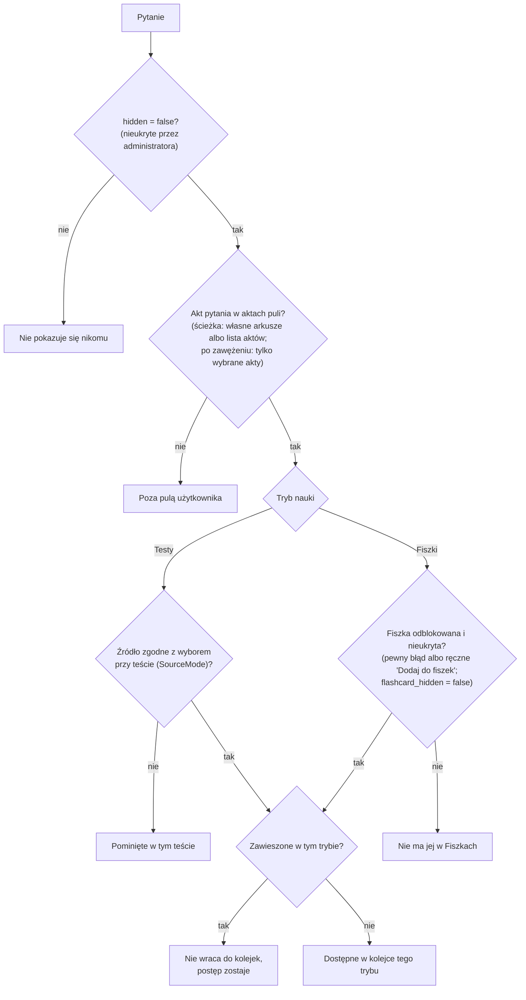
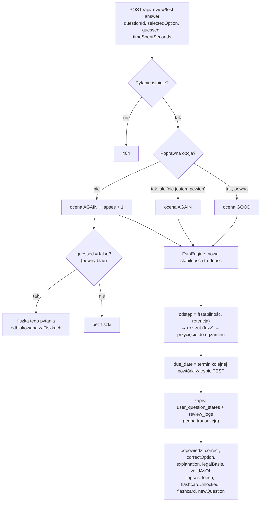
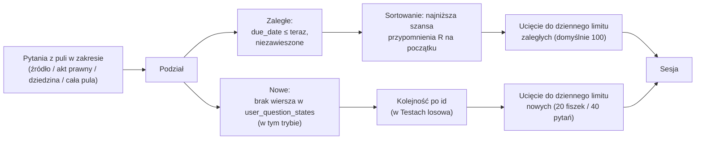

# 04. Nauka: testy, fiszki i algorytm FSRS

[← Spis treści](README.md)

To najważniejszy plik dokumentacji. Wyjaśnia, **jak aplikacja decyduje, co pokazać dziś i kiedy to pokazać znowu**.
Kod, o którym tu mowa, leży głównie w pakietach `pool`, `review`, `review.fsrs`, `flashcard`, `settings` i `question`.

## Spis

1. [Dwa tryby: Testy i Fiszki](#dwa-tryby-testy-i-fiszki)
2. [Pula pytań użytkownika](#pula-pytań-użytkownika)
3. [Odpowiedź w teście krok po kroku](#odpowiedź-w-teście-krok-po-kroku)
4. [Fiszki z pytań i odblokowywanie](#fiszki-z-pytań-i-odblokowywanie)
5. [FSRS-6 po ludzku](#fsrs-6-po-ludzku)
6. [Od stabilności do terminu powtórki](#od-stabilności-do-terminu-powtórki)
7. [Kolejka na dziś i limity dzienne](#kolejka-na-dziś-i-limity-dzienne)
8. [Tryb egzaminacyjny i plan nowych pytań](#tryb-egzaminacyjny-i-plan-nowych-pytań)
9. [Trudne pytania i zawieszanie](#trudne-pytania-i-zawieszanie)
10. [Dodatkowe sesje: „Powtórz moje błędy” i „Przerób błędy”](#dodatkowe-sesje-powtórz-moje-błędy-i-przerób-błędy)
11. [Egzamin próbny](#egzamin-próbny)
12. [Źródło pytań w teście](#źródło-pytań-w-teście)
13. [Zmiany w prawie](#zmiany-w-prawie)
14. [Zmiana ścieżki i zerowanie postępów](#zmiana-ścieżki-i-zerowanie-postępów)
15. [Zabezpieczenia spójności](#zabezpieczenia-spójności)

---

## Dwa tryby: Testy i Fiszki

Aplikacja ma dwa tryby nauki **tego samego pytania**. Pytanie jest jedno (tabela `questions`); fiszka to nie osobny
rekord ani kopia, tylko drugi tryb nauki: stan nauki pytania ma osobny wiersz w trybie `TEST` i w trybie `FLASHCARD`
(`user_question_states`), z **własnym harmonogramem FSRS** (stabilność, trudność, termin) i własnym licznikiem błędów.
Odpowiedź w teście nie przesuwa terminu fiszki i odwrotnie. Kolumna `mode` w `review_logs` też mówi, w którym trybie
padła odpowiedź.

| | **Testy** | **Fiszki** |
|---|-----------|------------|
| Co widzisz | Treść pytania i trzy odpowiedzi ABC, **dokładnie jedna poprawna** (`correct_option`) | Przód: treść pytania. Tył: poprawna odpowiedź z wyjaśnieniem i podstawą prawną |
| Jak odpowiadasz | Wybierasz A, B albo C; opcjonalnie zaznaczasz „Nie jestem pewien” | Odwracasz fiszkę i sam oceniasz: Nie pamiętam / Trudne / Znam / Łatwe |
| Endpoint odpowiedzi | `POST /api/review/test-answer` | `POST /api/review` |
| Ocena pamięci (1–4) | Wyznacza serwer z reguły (patrz niżej) | Wybierasz Ty |
| Które pytania | Wszystkie z puli | Tylko z **odblokowaną fiszką** (pewny błąd albo ręczne dodanie) |
| Limit nowych dziennie | 40 pytań (domyślnie; automatyczny, idzie za planem) | 20 fiszek (domyślnie) |

Ręcznie napisanych fiszek nie ma: każda fiszka pochodzi z pytania. Treść jest jedna, więc poprawka pytania poprawia
jednocześnie test i fiszkę.

## Pula pytań użytkownika

Pula to pytania, które użytkownik może rozwiązywać. Wylicza ją w jednym miejscu `PoolService`; nikt inny nie decyduje o
dostępie do pytań. Zasada jest **regułą**, a nie ręcznym przypisaniem pytań do ludzi:

1. **Ścieżka** (`user_settings.track_id`): pytania z jej **własnych arkuszy ALBO z aktów prawnych z jej listy**
   (`track_acts`). Pytania autorskie i pytania z arkuszy innych ścieżek trafiają do puli przez wspólne akty.
   Użytkownik, który nie wybrał ścieżki, ma pulę obejmującą wszystko.
2. **Student**: akty **wybranych przez niego przedmiotów** (`user_courses` → `course_acts`); bez wyboru akty wszystkich
   przedmiotów. Przedmioty dzielą akty na kursy; ten sam akt w kilku przedmiotach daje pytania raz. Zagadnienia spoza
   prawa (paremie, logika) to akty rodzaju `TOPIC`, a ich pytania są zwykłymi pytaniami. Wybrany przedmiot, którego już
   nie ma albo który nie ma aktów, jest pomijany (wybór nie może wyciąć całej puli). Student widzi w aplikacji wyłącznie
   przedmioty, nie listę aktów.
3. **Zawężenie** (aplikacje: `user_pool_acts`, Student: wybór przedmiotów w `user_courses`): użytkownik może trwale zawęzić
   pulę do wybranych aktów (Student: do wybranych przedmiotów; zawężenie aktami jest u Studenta ignorowane). Brak wpisów
   = cała pula ścieżki. Zawężenie **nie dotyczy egzaminu próbnego**.
4. **Źródło pytań** nie jest trwałą częścią puli: użytkownik wybiera je osobno **przy każdym teście** (`SourceMode`:
   wszystkie, Ministerstwo Sprawiedliwości, autorskie; patrz [Źródło pytań w teście](#źródło-pytań-w-teście)).

Ukryty akt (`legal_acts.hidden`) i ukryty arkusz (`question_sources.hidden`) **nie należą do żadnej puli**: zapytania
składające pulę (`PoolService`) ich nie widzą, więc znikają z testów, fiszek, liczników, kreatora, statystyk źródeł i
egzaminu, a pytania i historia odpowiedzi zostają (przywrócenie oddaje wszystko). Ukrywa je administrator w panelu.

Użytkownik widzi dziedziny, w których ma **akty w swojej puli**, i w każdej tylko te akty (dziedzina bez jego aktów, np.
„Student” u użytkownika aplikacji, jest pomijana). Zmiana ścieżki czyści zawężenie aktami;
wybrane przedmioty Studenta zostają.



Ukrycie pytania **nie** blokuje odpowiedzi w sesji, którą użytkownik już ma otwartą (nowe sesje go nie zawierają).
Pytania z poza puli nie są tajne: odpowiedź na pytanie o znanym numerze jest przyjmowana, ale aplikacja nigdy nie
pokazuje pytań spoza puli w kolejkach, katalogu ani statystykach.

## Odpowiedź w teście krok po kroku

Użytkownik wybiera A, B albo C i może zaznaczyć **„Nie jestem pewien”** (pole `guessed`). Serwer sprawdza odpowiedź
i na tej podstawie wyznacza ocenę dla algorytmu:

| Wybór | „Nie jestem pewien” | Ocena FSRS | Licznik błędów (`lapses`) | Skutek |
|-------|---------------------|------------|---------------------------|--------|
| poprawny | nie | **Znam** (GOOD, 3) | bez zmian | Pytanie wraca po dłuższej przerwie |
| poprawny | tak | **Nie pamiętam** (AGAIN, 1) | bez zmian | Zgadłeś, więc nie liczy się jako wiedza: wróci szybko |
| błędny | tak | **Nie pamiętam** (AGAIN, 1) | +1 | Wiesz, że nie wiesz: wróci szybko, bez fiszki |
| błędny | nie | **Nie pamiętam** (AGAIN, 1) | +1 | **Pewny błąd**: wróci szybko i **odblokowuje fiszkę** pytania |

Dlaczego test nigdy nie daje oceny „Łatwe” (EASY): przy trzech opcjach nie da się odróżnić „łatwego” pytania od
szczęśliwego trafienia.



Odpowiedź serwera zawiera m.in. poprawną opcję, wyjaśnienie, podstawę prawną, aktualną liczbę błędów, informację czy
pytanie jest już „trudne” (`leech`), czy ta odpowiedź **właśnie** odblokowała fiszkę (`flashcardUnlocked`, tylko przy
pierwszym pewnym błędzie w tym pytaniu) oraz stan fiszki (`flashcard`).

Fiszki oceniasz sam (`POST /api/review`, pole `rating` od 1 do 4). „Nie pamiętam” (1) zwiększa licznik błędów
w trybie fiszek.

## Fiszki z pytań i odblokowywanie

Każde pytanie może być fiszką (to tryb nauki tego samego pytania, nie osobny rekord; opis w
[02](02-baza-danych.md#fiszki-tryb-pytania-odblokowywanie)): przód to treść pytania, tył to poprawna odpowiedź i
wyjaśnienie. Administrator może ukryć samą fiszkę pytania (`flashcard_hidden`), wtedy pytanie zostaje tylko w testach.

Użytkownik **nie widzi** fiszki od razu. Pojawia się ona w jego Fiszkach dopiero, gdy:

1. **pomylił to pytanie w teście bez zaznaczenia „Nie jestem pewien”** (pewny błąd), albo
2. **sam ją dodał** przyciskiem „Dodaj do fiszek” (`POST /api/questions/{id}/flashcard`).

Idea: pewny błąd to utrwalone błędne przekonanie, więc warto je przepracować także w formie fiszki. Pomyłka, o której
użytkownik wiedział („nie jestem pewien”), nie wymaga fiszki. Fiszki **nie mają wyboru źródła** (wynikają z
błędów w testach), ale podlegają zawężeniu do aktów.

Stany fiszki pytania (`FlashcardStatus`) widziane z punktu widzenia użytkownika:

| Stan | Znaczenie | Czy można zmienić |
|------|-----------|-------------------|
| `UNAVAILABLE` | Fiszka pytania jest ukryta przez administratora | — |
| `AVAILABLE` | Fiszki nie ma jeszcze w Fiszkach | „Dodaj do fiszek” |
| `ADDED_MANUALLY` | Użytkownik sam ją dodał | „Usuń z fiszek” (kasuje też harmonogram fiszki, nie ruszając testu) |
| `ADDED_BY_MISTAKE` | Trafiła przez pewny błąd | **Nie da się cofnąć** |

Kto ma pewny błąd w pytaniu, ma fiszkę niezależnie od ręcznego dodania, więc „Usuń z fiszek” nie ma wpływu na fiszkę
odblokowaną przez błąd.

## FSRS-6 po ludzku

**FSRS** (Free Spaced Repetition Scheduler) to nowoczesny algorytm powtórek rozłożonych w czasie. Wersja 6 ma
**21 parametrów** (w0–w20). Implementacja jest w `review/fsrs/FsrsEngine.java`, a jej wyniki są sprawdzane testem
`FsrsEngineTest` względem referencyjnej biblioteki `py-fsrs`.

Algorytm dla każdego pytania u każdego użytkownika, osobno w każdym trybie, pamięta dwie liczby (kolumny `stability` i
`difficulty` w `user_question_states`):

| Pojęcie | Co znaczy | Zakres |
|---------|-----------|--------|
| **Stabilność** (S) | Po ilu dniach szansa przypomnienia sobie pytania spada do **90%**. Im wyższa, tym trwalej pamiętasz | od 0,001 dnia w górę |
| **Trudność** (D) | Jak trudne jest to pytanie dla Ciebie | 1–10 |
| **Przypominalność** (R, *retrievability*) | Szansa, że **teraz** sobie przypomnisz | 0–100% |

**Krzywa zapominania.** Im więcej dni minęło od ostatniej powtórki (t), tym niższa szansa przypomnienia:

```
R(t, S) = (1 + F · t / S) ^ (−w20),    gdzie F = 0,9^(−1 / w20) − 1
```

Wzór jest tak dobrany, że **R(S, S) = 90%**: po upływie czasu równego stabilności masz dokładnie 90% szans.
Dla pytania o stabilności 2,3065 dnia:

| Minęło dni | 0 | 1 | 2,31 | 5 | 10 | 30 |
|------------|---|---|------|---|----|----|
| Szansa przypomnienia | 100% | 94,7% | 90,0% | 83,9% | 77,4% | 66,8% |

**Odstęp do następnej powtórki** (`nextIntervalDays`) to czas, po którym przypominalność spadnie do **docelowej
retencji** (domyślnie 90%; użytkownik może ustawić 70–97%):

```
odstęp = (S / F) · ( retencja^(−1 / w20) − 1 )
```

Przy retencji 90% odstęp jest równy stabilności. Wyższa retencja skraca odstępy (np. dla S = 10: przy 90% odstęp
10 dni, przy 95% tylko 4 dni). Odstęp jest ograniczony do 36 500 dni (100 lat).

**Pierwsza odpowiedź na pytanie w danym trybie** (`firstReview`) ustawia stabilność wprost z parametrów w0–w3, zależnie od oceny:

| Ocena | Stabilność startowa | Trudność startowa | Odstęp przy retencji 90% |
|-------|--------------------|--------------------|---------------------------|
| Nie pamiętam (1) | 0,212 dnia (ok. 5 godzin) | 6,41 | 0,21 dnia |
| Trudne (2) | 1,293 dnia | 5,11 | 1,29 dnia |
| Znam (3) | 2,3065 dnia | 2,12 | 2,31 dnia |
| Łatwe (4) | 8,2956 dnia | 1,00 | 8,30 dnia |

**Kolejne odpowiedzi** (`nextState`) zależą od tego, ile czasu minęło (`elapsedDays`):

- **Minęła co najmniej doba** i ocena inna niż „Nie pamiętam”: stabilność **rośnie**. Wzrost jest tym większy,
  im niższa była przypominalność w chwili odpowiedzi (udane przypomnienie „na ostatnią chwilę” wzmacnia pamięć
  najbardziej), im łatwiejsze pytanie, a „Trudne” daje karę (w15), „Łatwe” premię (w16).
- **Minęła co najmniej doba** i ocena „Nie pamiętam” (zapomniałeś): stabilność **spada** do nowej, niższej wartości
  (wzór z w11–w14), ale nigdy nie wyżej niż po „krótkim” wzorze.
- **Minęło mniej niż doba** (powtórka tego samego dnia): osobny wzór krótkoterminowy (w17–w19).
- **Trudność** zmienia się po każdej odpowiedzi: „Nie pamiętam” podnosi ją, „Łatwe” obniża, a w7 ściąga ją z
  powrotem ku wartości środkowej.

Stan nauki (`state`) pomaga tylko w prezentacji: `NEW` (jeszcze nieodpowiadana), `LEARNING` (pierwsza odpowiedź to
„Nie pamiętam”), `REVIEW` (ostatnia ocena inna niż „Nie pamiętam”), `RELEARNING` (zapomniana po wcześniejszej nauce).

**Domyślne parametry** (`FsrsWeights.defaults()`), wspólne dla wszystkich użytkowników:

| w0 | w1 | w2 | w3 | w4 | w5 | w6 | w7 | w8 | w9 | w10 |
|----|----|----|----|----|----|----|----|----|----|-----|
| 0,212 | 1,2931 | 2,3065 | 8,2956 | 6,4133 | 0,8334 | 3,0194 | 0,001 | 1,8722 | 0,1666 | 0,796 |

| w11 | w12 | w13 | w14 | w15 | w16 | w17 | w18 | w19 | w20 |
|-----|-----|-----|-----|-----|-----|-----|-----|-----|-----|
| 1,4835 | 0,0614 | 0,2629 | 1,6483 | 0,6014 | 1,8729 | 0,5425 | 0,0912 | 0,0658 | 0,1542 |

Parametry nie są dopasowywane do konkretnego użytkownika (patrz [Znane ograniczenia](07-znane-ograniczenia.md)).

### Przykład: pytanie, na które za każdym razem odpowiadasz „Znam”

Obliczone prawdziwym silnikiem (`FsrsEngine`, retencja 90%), przy założeniu, że wracasz dokładnie w dniu terminu
(bez rozrzutu terminów, żeby było czytelnie):

| Odpowiedź | Minęło od poprzedniej | Stabilność po | Trudność po | Następna powtórka za |
|-----------|----------------------|---------------|-------------|----------------------|
| 1. (pierwsza) | — | 2,31 | 2,12 | 2 dni |
| 2. | 2 dni | 10,96 | 2,11 | 11 dni |
| 3. | 11 dni | 46,28 | 2,10 | 46 dni |
| 4. | 46 dni | 162,86 | 2,10 | 163 dni |
| 5. | 163 dni | 497,45 | 2,09 | 497 dni |

Odstępy rosną kilkukrotnie przy każdej udanej odpowiedzi (tu od pięciu razy na początku do trzech razy na końcu).
Dlatego dobrze znane pytania znikają na długo i nie zawalają kolejki.

**Co jeśli się pomylisz?** Pytanie z pierwszego wiersza (stabilność 2,31), na które po 2 dniach odpowiesz błędnie
(„Nie pamiętam”), dostaje stabilność **0,61 dnia** i trudność 7,40, czyli wraca po kilkunastu godzinach, i dopiero od
nowa buduje odstępy.

## Od stabilności do terminu powtórki

Po obliczeniu nowej stabilności serwer wyznacza **dokładny termin** w kilku krokach (`ReviewService.applyReview`):

1. **Odstęp w dniach** = wzór FSRS dla stabilności i **efektywnej retencji** użytkownika (w 30 ostatnich dniach przed
   egzaminem co najmniej 95%, patrz niżej).
2. **Rozrzut terminów (fuzz)** — `SchedulingRules.fuzz`. Żeby pytania uczone tego samego dnia nie wracały wszystkie
   naraz, odstęp od 2,5 dnia jest losowo przesuwany o kilka dni (jak w Anki). Dla odstępów poniżej 2,5 dnia bez
   zmian. Przykłady zakresów: 3 dni → 2–4; 10 dni → 8–12; 30 dni → 27–33; 100 dni → 93–107. Wynik nigdy nie jest
   krótszy niż 2 dni.
3. **Przycięcie do egzaminu** — `capForExam`: jeśli wybrana aplikacja ma ogłoszony termin egzaminu, odstęp nie może go przekroczyć (pytanie ma
   wrócić najpóźniej dzień przed egzaminem).
4. **Zamiana odstępu na termin** — `ReviewPolicy.computeDueDate`:
   - odstęp **krótszy niż doba** (np. „Nie pamiętam” przy nowym pytaniu, ok. 5 godzin): termin = teraz + ten czas;
   - odstęp **od doby wzwyż**: zaokrąglenie do pełnych dni i ustawienie na **początek dnia** (00:00). Dzięki temu
     pytanie „na jutro” jest do zrobienia od północy, a nie dopiero o tej godzinie, o której uczyłeś się dziś.

## Kolejka na dziś i limity dzienne

Kolejki budują `ReviewQueueService` (fiszki i testy) oraz `QueueRules`.

**Skład sesji:** najpierw **zaległe** powtórki, potem **nowe** pytania.



- **Zaległe** są układane od pytań, które najpewniej już zapomniałeś (najniższa przypominalność R; przy remisie starszy
  termin, potem niższe id). To zapobiega „ścianie zaległości” po przerwie w nauce: robisz najpilniejsze, reszta czeka.
- **Nowe** pytania wchodzą w kolejności `id`. Dla Testów zarówno zaległe, jak i nowe są dodatkowo **losowo mieszane**
  (zaległe osobno od nowych; zaległe na początku).
- **Zawieszone** pytania mają stan, więc nie są „nowe”, ale nie wracają do kolejki (zawieszenie jest osobne w każdym trybie).

### Limity dzienne

Domyślne wartości są w `application.yml` (sekcja `app.fsrs`), a każdy użytkownik może je zmienić w ustawieniach
(`PUT /api/me/settings`). Limity liczą się **osobno dla trybów** (testy i fiszki).

| Limit | Domyślnie | Zakres w ustawieniach | Co liczy się do limitu |
|-------|-----------|-----------------------|------------------------|
| Nowe fiszki dziennie | 20 | 0–200 | Pierwsze odpowiedzi (`elapsed_days IS NULL`) dziś w trybie `FLASHCARD` |
| Nowe pytania testowe dziennie | 40 (limit automatyczny, patrz niżej) | 0–500 albo automatyczny | Pierwsze odpowiedzi dziś w trybie `TEST` |
| Zaległe powtórki dziennie | 100 | 10–1000 | Odpowiedzi dziś po co najmniej 1 dniu od poprzedniej (`elapsed_days ≥ 1`), osobno dla fiszek i testów |
| Docelowa retencja | 90% | 70–97% | — |

„Dziś” oznacza dobę w strefie `Europe/Warsaw` (północ do północy). Powtórki tego samego pytania w ciągu jednego dnia (np.
„Nie pamiętam” wraca po kilku godzinach) **nie** zużywają limitu zaległych.

**Zwiększanie limitu na życzenie** (przyciski typu „Powtórz jeszcze”, „Ucz się dalej”): parametry
`extraNewCards` i `extraDueReviews` w zapytaniu o kolejkę.

- `extraNewCards=N` — dokładnie N nowych pytań (niezależnie od limitu dziennego), ale nie więcej niż dostępnych.
  `extraNewCards=0` — sesja **bez nowych** pytań (same zaległe; tak działa „Powtórz zaległe” w Testach).
- `extraDueReviews=N` — dokładnie N zaległych (niezależnie od limitu), N przycięte do 0–200.

`GET /api/review/queue/backlog` mówi, ile pytań ma minięty termin (`dueNow`), ile z nich **nie zmieści się dziś** w
sesji (`deferred`), jaki jest limit (`dailyLimit`) i ile zaległych zrobiono już dziś (`doneToday`).

## Tryb egzaminacyjny i plan nowych pytań

Użytkownik nie wpisuje własnej daty. **Wybiera ścieżkę**, do której się przygotowuje (`PUT /api/me/track`), a datę
egzaminu ustawia administrator osobno dla każdej aplikacji (tabela `exam_terms`). Gdy wybrana aplikacja ma ogłoszony
termin, włączają się trzy mechanizmy (`SchedulingRules`, `LearningSettingsService`). Aplikacja bez terminu
(„termin nieogłoszony”), ścieżka Student i brak wyboru oznaczają zwykłą naukę bez trybu egzaminacyjnego i bez planu.

Zmiana ścieżki czyści zawężenie puli do aktów, bo dotyczyło poprzedniej ścieżki.

| Mechanizm | Reguła |
|-----------|--------|
| **Wyższa retencja przed egzaminem** | W ostatnich **30 dniach** przed egzaminem retencja do liczenia terminów wynosi co najmniej **95%** (`EXAM_RETENTION`). Odstępy się skracają, więc materiał wraca częściej |
| **Odstęp nie wykracza poza egzamin** | Odstęp jest przycinany tak, by pytanie wróciło najpóźniej dzień przed egzaminem (co najmniej 1 dzień) |
| **Plan nowych pytań** | Ostatnie **14 dni** (`EXAM_REVIEW_RESERVE_DAYS`) są zarezerwowane na same powtórki: pytanie zaczęte później nie zdążyłoby dostać trzech poprawnych odpowiedzi, czyli stać się „opanowane”. Dni do planowania nowych = dni do egzaminu − 14. W rezerwie (14 dni i mniej) nowego się już nie planuje: `planningDays` i cel dnia wynoszą 0. Aplikacja liczy, ile nowych pytań dziennie trzeba zacząć, żeby zdążyć (fiszek się nie planuje: powstają z pomyłek, więc ich liczby nie da się przewidzieć) |

Przykład planu: zostało 300 nowych pytań, a do egzaminu 44 dni. Dni do planowania: 44 − 14 = 30. Cel na dziś:
300 / 30 = **10 nowych pytań dziennie** (zaokrąglone w górę).

**Cel dnia jest stały w ciągu dnia.** Liczy się od stanu z początku dnia: (pozostałe nowe + pytania zaczęte dzisiaj)
/ dni do planowania. Dzięki temu po zrobieniu dziesięciu pytań cel nie spada do „9 z 9”, tylko zostaje „10 z 10”
(`plan.newTestQuestionsToday` mówi, ile już zrobiono dzisiaj). Sam cel jest informacją; do kolejki wchodzi tyle nowych pytań,
ile pozwala dzienny limit (następny akapit).

**Limit nowych pytań: automatyczny albo własny.** Użytkownik nie musi niczego ustawiać. Gdy nie ustawił własnego limitu
(`user_settings.new_test_questions_per_day IS NULL`), obowiązuje limit automatyczny
(`LearningSettingsService.dailyNewTestQuestionLimit`, `SchedulingRules.autoNewQuestionsLimit`):

- nie mniej niż domyślny (40), żeby daleki egzamin nie oznaczał trzech pytań dziennie;
- gdy plan do egzaminu wymaga więcej, tyle, ile trzeba (cel dnia), ale **nie więcej niż 100** (`MAX_AUTO_NEW_PER_DAY`):
  powyżej powtórki rosną szybciej, niż da się je robić, i nauka przestaje działać;
- bez terminu egzaminu i w ostatnich 14 dniach: po prostu domyślny.

Limit automatyczny liczy się ze stanu z początku dnia, więc w ciągu dnia się nie zmienia. Własny limit (0–500) obowiązuje
wprost i nie ma sufitu 100. Gdy trzeba więcej, niż pozwala sufit (`plan.requiredTestQuestionsPerDay` >
`plan.maxTestQuestionsPerDay`), wszystkich nowych pytań nie da się zacząć na czas, a frontend mówi to wprost.

Po egzaminie (termin aplikacji w przeszłości) ustawienia egzaminacyjne przestają działać (`examPassed = true`), a odstępy wracają
do zwykłych. Plan widać w odpowiedzi `GET /api/me/settings` (pole `plan`). Do planu liczą się tylko pytania z puli
użytkownika (jego akty po zawężeniu i źródła z filtra), których jeszcze nie ruszył w teście.

## Trudne pytania i zawieszanie

**Trudne pytanie (ang. *leech*):** pytanie, w którym użytkownik pomylił się już **8 razy** lub więcej w danym trybie
(`app.review.leech-threshold`, domyślnie 8; `lapses ≥ próg`). Dalsze powtarzanie jej w tej samej formie rzadko pomaga,
więc aplikacja **podpowiada**, żeby ją zawiesić albo zgłosić (może być źle sformułowana). **Niczego nie zawiesza
sama.**

**Zawieszenie** (`PUT /api/me/suspended-questions/{questionId}?mode=`): pytanie znika z kolejek i liczników powtórek tego użytkownika w tym trybie,
ale **nie traci postępu** (stabilność, termin, historia zostają). Tylko dla tego jednego użytkownika. Po przywróceniu
(`DELETE`) pytanie wraca zgodnie z dotychczasowym terminem: jeśli jest zaległa, pojawi się wśród najsłabiej
zapamiętanych. Zawiesić można tylko pytanie, na które użytkownik już odpowiadał w tym trybie (tylko takie ma stan); dla pozostałych
odpowiedź jest jak dla nieistniejącej (404). Operacje są idempotentne.

`GET /api/me/difficult-questions` zwraca dwie listy (po maks. 200): zawieszone (od ostatnio zawieszonych) i trudne, które
nadal są w nauce (od największej liczby błędów).

## Dodatkowe sesje: „Powtórz moje błędy” i „Przerób błędy”

Obie sesje (i test z kreatora poniżej) to zwykłe sesje testowe: odpowiedzi idą normalną drogą (z oceną pamięci i terminami), więc to dodatkowe
ćwiczenie, a nie osobny tor nauki.

- **„Powtórz moje błędy”** (`/api/review/mistakes-queue`, `/mistakes-count`): pytania, w których **ostatnia**
  odpowiedź w teście z ostatnich **30 dni** była błędna. Pytanie, na które później odpowiedziano dobrze, znika z listy.
  Maksymalnie **50** pytań w sesji, w losowej kolejności; zawieszone i spoza puli odpadają (źródła nie zawęża).
- **„Przerób błędy teraz”** (`/api/review/practice-queue?questionIds=...`): sesja z podanych pytań (np. błędnych po
  egzaminie próbnym), w podanej kolejności, maksymalnie 200. Pytania spoza puli, ukryte i zawieszone są po cichu pomijane.

## Test z kreatora (dawniej „Własny test”)

Użytkownik składa sesję sam (`CustomTestService`, `POST /api/review/custom-test`): wybiera **źródło pytań** (wszystkie, Ministerstwo Sprawiedliwości, autorskie),
dowolne **dziedziny, akty prawne i rozdziały aktów** (Student: **przedmioty**; zakres to ich suma, bez powtórzeń; bez wyboru
cała pula), **które pytania** mają w niej być
(wszystkie, nowe, z błędną ostatnią odpowiedzią, zaległe, ze zmianą w prawie z ostatniego roku, o terminach, pułapki) i **liczbę pytań**: **10, 20, 50, 100 albo 150** (własnej liczby ani wyboru lat egzaminu nie ma).
Gdy w zakresie jest mniej niż 10 pytań, jedyny wybór to wszystkie z nich. Liczby pytań dla każdego rodzaju
daje `GET /api/review/custom-test/counts`, który liczy to samo co losowanie. Tym samym `POST` zaczynają się też „Losuj z całej
puli” (cała pula, wszystkie źródła, rodzaj `ALL`) i szybkie zestawy (cała pula, rodzaje `MISTAKES`, `LAW_CHANGE`, `NEW`, `TIME_LIMIT` albo `TRAPS`, do 20 pytań).

- **To nauka, nie egzamin.** Serwer losuje numery pytań, a sesję otwiera się zwykłą kolejką ćwiczeń
  (`/practice-queue`), więc odpowiedzi mają ocenę pamięci i terminy, a pomyłki trafiają do „Moich błędów”.
  Nie ma progu zaliczenia ani raportu „zdał / nie zdał”.
- **Zapisany jako sesja („Moje testy”).** Losowanie od razu zapisuje test (`CustomTestSessionService`, tabele
  `custom_test_sessions` i `custom_test_session_questions`): zakres, rodzaj pytań, źródło i
  wylosowane pytania w kolejności sesji. Odpowiedzi wysyłane z numerem testu (`sessionId`) dopisują się do niego; po
  odpowiedzi na ostatnie pytanie test jest ukończony, a porzucony w połowie zostaje na liście jako **nieukończony**.
  Lista (`GET /api/custom-tests/sessions`, stronami po 20, najwyżej 100) i szczegóły z odpowiedziami (`/{id}`) służą ekranowi „Moje
  testy”, z którego da się ułożyć test ponownie z tymi samymi ustawieniami. Sesja z paska zaległych, „Popraw błędy” i egzamin nie są
  zapisywane jako testy. Własne testy liczą się osobno od egzaminów w „Podsumowaniu nauki”.
- **Zakres**: dziedziny, akty, **rozdziały** i **przedmioty** (Student), w sumie bez powtórzeń. Przedmiot oznacza wszystkie
  jego akty; przedmiot bez aktów nie poszerza zakresu do całej puli. Rozdział (`act_sections`, `questions.section_id`) obejmuje
  tylko pytania do niego przypisane: pytania aktu bez rozdziału są tylko w zakresie „cały akt”. Zapisany test pamięta wybrane
  przedmioty (`course_ids`), ich akty (`act_ids`) i rozdziały (`section_ids`).
- **Pula**: pytania z puli użytkownika (jego akty po zawężeniu), nieukryte, **niezawieszone** w testach i z wybranego źródła.
- **Dobór przy ograniczonej liczbie**: `MISTAKES` bierze najświeższe błędy (jak „Moje błędy”, tylko w wybranym zakresie
  i bez limitu 50), `DUE` te o najniższej szansie przypomnienia (jak kolejka nauki), `ALL` i `NEW` losują. Kolejność w
  sesji jest zawsze losowa.
- **Limity dzienne**: własny test ich nie stosuje (użytkownik sam mówi, ile chce), ale pierwsze odpowiedzi na nowe
  pytania liczą się potem do dziennego limitu nowych pytań, jak każde inne.

## Czas nauki i czas odpowiedzi

Aplikacja mierzy czas na dwa sposoby, które się nie mieszają:

- **Czas odpowiedzi** (`timeSpentSeconds` przy odpowiedzi, `review_logs.time_spent_seconds`): ile trwało jedno pytanie
  albo jedna fiszka, od pokazania do odpowiedzi, **tylko przy widocznej karcie przeglądarki**. Pojedyncza odpowiedź liczy
  się najwyżej 120 s (`AnswerTimes`), żeby przerwa na kawę nie zawyżała średniej. Z niego jest „średnio na pytanie” i
  „średnio na fiszkę” w „Podsumowaniu nauki”.
- **Czas nauki** (`study_time_daily`): ile czasu użytkownik spędził na ekranach nauki (testy, powtórki, „Popraw błędy”,
  własny test, fiszki, egzamin próbny), razem z czytaniem wyjaśnień. Mierzy go przeglądarka: liczy tylko przy widocznej
  karcie i wstrzymuje się po 3 minutach bez ruchu, a porcje (1–300 s) wysyła co ok. 30 s przez `POST /api/me/study-time`.
  Serwer dolicza je do dzisiejszego dnia. Sumy „dziś / 7 dni / łącznie” zwraca `GET /api/statistics/learning-summary`.

## Egzamin próbny

Egzamin próbny (`/api/exams/*`) jest **odizolowany od nauki**: nie zmienia terminów powtórek (FSRS), nie dopisuje
niczego do dziennika odpowiedzi, nie rusza dziennych limitów ani licznika błędów.

**Format jest stały** (`ExamFormat`): **150 pytań**, zaliczenie od **100 punktów** (2/3 punktów). Użytkownik nie wybiera
zakresu, liczby pytań ani progu, a próg ustala wyłącznie serwer. Wybiera tylko **źródło pytań** (cztery możliwości, niżej).
Egzamin z jednego działu nie ma sensu (prawdziwy egzamin jest mieszany), więc ćwiczenie z wybranego działu to
[test z kreatora](#test-z-kreatora-dawniej-własny-test), który niczego nie zalicza.

1. **Wybór źródła.** `GET /api/exams/availability` mówi, ile pytań jest w każdym źródle, a `GET /api/exams/sheets` podaje
   egzaminy MS z poprzednich lat (według aplikacji i roku).
2. **Start** (`POST /api/exams/start`, bez ciała): w zależności od wyboru:
   - `source=ALL` (domyślnie), `MINISTRY` albo `AUTHORED`: serwer **losuje** 150 pytań z Twojej puli (**bez zawężenia do
     wybranych aktów**: prawdziwy egzamin obejmuje wszystko), niezawieszonych w testach, z wybranego źródła,
   - `sheetId=<numer>` (**Egzamin MS**): egzamin to **cały arkusz z wybranego roku**, dowolnej aplikacji (niezależnie od
     Twojej ścieżki i puli). Pytania idą w kolejności wczytania arkusza, bez losowania i bez pytań zawieszonych w testach;
     dłuższy arkusz jest obcięty do 150.

   Odpowiedź ma pytania **bez poprawnych odpowiedzi**, podpis (`scopeLabel`) i próg w punktach (`passPoints`). Niczego nie
   zapisuje. Jeśli pytań jest mniej niż 150, egzamin ma wszystkie, a próg maleje proporcjonalnie (100 z 150, w górę do
   całego punktu; 12 pytań to próg 8).
3. **Rozwiązywanie** odbywa się po stronie frontendu (czas, opcjonalny limit minut, wybór odpowiedzi).
4. **Zakończenie** (`POST /api/exams/submit`): frontend wysyła tylko wybrane odpowiedzi, limit czasu, czas trwania oraz
   źródło (`source` albo `sheetId`, wyłącznie do podpisu w historii). **Odpowiedzi ocenia serwer i on liczy próg.**
   Zapisuje podsumowanie podejścia i zwraca pełny raport. Podpis w historii to np. „Cała pula”, „Ministerstwo
   Sprawiedliwości”, „Pytania autorskie” albo „Egzamin MS: Notarialna 2024”.

**Punktacja** (`ExamScoring`): 1 punkt za poprawną odpowiedź, brak punktów ujemnych, brak odpowiedzi = 0. Wynik w
procentach jest zaokrąglany do 0,1 tylko do wyświetlania. **Zaliczenie** to co najmniej `passPoints` poprawnych
odpowiedzi (porównanie na liczbach całkowitych): 100 z 150 zalicza, 99 z 150 (66,0%) jeszcze nie.
W raporcie pytania, które w międzyczasie zniknęły (usunięte z bazy), nie są oceniane i są liczone w
`excludedCount`; próg liczy się od liczby ocenionych pytań.

**Stałe proporcje działów.** Prawdziwy egzamin ma ustalone proporcje pytań z poszczególnych działów. Aplikacja ich
jeszcze nie odtwarza: 150 pytań jest losowane z wybranego źródła (więc proporcje wynikają z tego, ile pytań ma każdy dział w
bazie). Wyjątkiem jest Egzamin MS, który jest prawdziwym arkuszem z danego roku, więc ma układ pytań z oryginału. Gdy proporcje zostaną ustalone, trzeba tylko zmienić losowanie w `ExamService.start`.

**Historia i raporty.** Lista podejść (`GET /api/exams/history`) jest stronicowana (domyślnie 20, najwyżej 100). Od poprawki 2
etapu 34 serwer zapisuje przy podejściu też **odpowiedzi użytkownika** (tabela `exam_attempt_answers`; w `exam_attempts`
`has_answers = true` i `excluded_count`), więc raport można otworzyć później (`GET /api/exams/attempts/{id}`). Nagłówek raportu
(wynik, czas, próg, podpis) jest z chwili egzaminu, a treść pytań, poprawny klucz i ocena przy każdym pytaniu z **aktualnych**
pytań: poprawione pytanie pokaże się poprawione. Podejścia sprzed poprawki 2 nie mają odpowiedzi (`detailsAvailable = false`) i
zostają na liście tylko z wynikiem. Zerowanie postępów i usunięcie konta kasują podejścia razem z odpowiedziami (kaskada w bazie).

## Źródło pytań w teście

Od Etapu 34 nie ma trwałego filtra źródeł na koncie. Źródło pytań wybiera się **osobno przy każdym teście** (`SourceMode`,
parametr `source` w `GET /api/tests/catalog`, `GET /api/review/custom-test/counts` i `POST /api/review/custom-test`):

- `ALL` (domyślnie): wszystkie źródła razem,
- `MINISTRY`: arkusze egzaminacyjne Ministerstwa Sprawiedliwości (arkusze wybranej ścieżki i arkusze innych ścieżek),
- `AUTHORED`: pytania autorskie dodane w aplikacji (m.in. paremie łacińskie).

Pod spodem tryb to `SourceFilter` (trzy grupy: `OWN_SHEETS`, `OTHER_SHEETS`, `AUTHORED`): `MINISTRY` to dwie pierwsze, `AUTHORED`
to trzecia. Dzięki temu reguła puli (`PoolService.forUser(userId, SourceFilter)`) i zapis w teście (`source_groups`) zostały
bez zmian; testy zapisane wcześniej mają tryb wyprowadzony z dawnego filtra (`SourceMode.fromFilter`).

- Wybór źródła obowiązuje tylko w kreatorze (Nauka i Powtórki). „Losuj z całej puli”, szybkie zestawy, pasek zaległych,
  „Powtórz moje błędy”, plan do egzaminu, statystyki testów i fiszki biorą **wszystkie** źródła. Egzamin próbny ma własny wybór
  źródła (wszystkie, Ministerstwo, autorskie albo cały egzamin MS z wybranego roku), opisany w [Egzamin próbny](#egzamin-próbny).
- Statystyki według źródeł (`GET /api/statistics/sources`) pokazują zawsze całą pulę ścieżki, każde źródło osobno.
- Kolumny `user_settings.include_own_sheets`, `include_other_sheets` i `include_authored` zostały w bazie, ale **nie są już
  używane** (encja ich nie mapuje); to samo dotyczy `user_settings.shuffle_options` (kolejność odpowiedzi miesza frontend
  zawsze).

## Zmiany w prawie

Prawo się zmienia, a pytania trzeba wtedy poprawić. Administrator zapisuje przy takim pytaniu **datę zmiany**
(`questions.law_changed_at`) i opcjonalnie **krótki opis** (`law_change_note`). Jako datę wpisuje dzień wejścia zmiany w
życie, a gdy treść pytania poprawił później, dzień tej poprawki: o tym, kto ma pytanie powtórzyć, decyduje to, czy jego
ostatnia odpowiedź była **przed** tą datą. Zmianę z datą z przyszłości aplikacja pokazuje, ale niczego jeszcze nie
przestawia. Daty wpisuje się skryptem SQL ([przykład](02-baza-danych.md#przydatne-zapytania-sql-ręczna-administracja)).

Dwa skutki dla użytkownika:

1. **Pytanie wraca jako zaległe.** Każdy, kto odpowiadał na pytanie **przed** datą zmiany, dostaje je z powrotem do
   powtórki (`LawChangeService`, w obu trybach: Testy i Fiszki). Technicznie to przestawienie terminu stanu nauki na
   „teraz” (`due_date = now`, `version + 1`) dla stanów, które nie są zawieszone, mają termin w przyszłości i ostatnią
   odpowiedź sprzed zmiany. Pytanie powtórzone **po** zmianie już nie wraca (jego ostatnia odpowiedź jest późniejsza),
   więc przebieg jest **idempotentny** i można go powtarzać. Robi to `LawChangeJob`: **raz przy starcie aplikacji** (po
   wdrożeniu nowych pytań) i **codziennie o 00:10** (kiedy zaczynają obowiązywać zmiany z datą „na dziś”). Nowa data
   zaczyna więc działać najpóźniej następnej nocy; chcąc od razu, uruchom ten sam `UPDATE` ręcznie albo zrestartuj
   backend. Błąd przebiegu nie zatrzymuje aplikacji (następny przebieg nadrobi). Pytania nowe dla użytkownika (bez stanu
   nauki) nie potrzebują przestawiania: i tak są nowe.
2. **Kategoria „Zmiany w prawie” w teście z kreatora i w szybkim zestawie** (`kind = LAW_CHANGE`): pytania, w których zmiana weszła w życie nie
   wcześniej niż `app.questions.recent-change-days` dni temu (domyślnie **365**) i już obowiązuje (`LawChangePolicy`).
   Okno liczy się w chwili zapytania, więc pytanie wypada z kategorii samo po roku. Kategoria ma licznik
   `lawChanges` w `GET /api/review/custom-test/counts` i podlega puli, wybranemu źródłu i wyborowi zakresu jak inne rodzaje.
   Zawieszonych pytań nie obejmuje żaden rodzaj.
3. **Kategorie „Terminy” i „Pułapki”** (`kind = TIME_LIMIT` i `TRAPS`): pytania z **zatwierdzonym oznaczeniem** administratora
   (tabela `question_marks`). `TIME_LIMIT` to pytania o terminy, `TRAPS` to pytania z dowolnym zatwierdzonym podtypem pułapki
   (`TRAP_NEGATION`, `TRAP_ABSOLUTE`, `TRAP_NUMBERS`, `TRAP_CONJUNCTION`, `TRAP_OUTDATED_LAW`). Liczniki `timeLimits` i `traps` w
   `GET /api/review/custom-test/counts`; rodzaje podlegają puli, źródłu i zakresowi jak pozostałe i nie obejmują pytań
   zawieszonych. Oznaczeń nie widać w żadnym pytaniu ani odpowiedzi API.

### Oznaczenia pytań

Oznaczenia nadaje administrator, a **automat tylko je proponuje** (`QuestionMarkDetector`, czysta klasa bez bazy, `QuestionMarkService`
czyta pytania porcjami po 500). Propozycje mają stan `SUGGESTED` i nie wpływają na testy; liczą się dopiero oznaczenia
`CONFIRMED`. Ponowne uruchomienie automatu dodaje propozycje tylko dla par pytanie–oznaczenie, których jeszcze nie ma, więc
nie nadpisuje decyzji (także odrzuceń). Reguły są ostrożne i oparte na słowach; lepiej pominąć pytanie niż zalać
administratora fałszywymi trafieniami:

| Oznaczenie | Reguła automatu |
|------------|-----------------|
| `TIME_LIMIT` | W treści albo odpowiedziach jest liczba dni lub tygodni, albo słowo o terminie („termin”, „w ciągu”, „najpóźniej”, „upływa”, „przedawnienie”, „zawity”, „prekluzyjny”). Lata, miesiące i godziny liczą się dopiero razem ze słowem o terminie |
| `TRAP_NEGATION` | W treści jest wyraźne przeczenie albo wyjątek („nie jest”, „nieprawidłowe”, „z wyjątkiem”, „niedopuszczalne”, „wskaż zdanie fałszywe”) |
| `TRAP_ABSOLUTE` | Słowo absolutne („zawsze”, „nigdy”, „wyłącznie”, „jedynie”, „w każdym przypadku”) jest w jednej albo dwóch odpowiedziach z trzech |
| `TRAP_NUMBERS` | Co najmniej dwie odpowiedzi mają różne liczby z tą samą jednostką (dni, tygodnie, miesiące, lata, godziny, %, zł) |
| `TRAP_CONJUNCTION` | Dwie odpowiedzi różnią się tylko spójnikiem („i” / „oraz” zamiast „lub” / „albo”) |
| `TRAP_OUTDATED_LAW` | Automat go nie proponuje (z treści nie da się go rozpoznać); tylko ręcznie |

Obsługa: `POST /api/admin/question-marks/analyze` (uruchom automat), `GET /api/admin/question-marks` (kolejka propozycji),
`POST /api/admin/question-marks/bulk` (np. zatwierdź wszystkie), `PUT /api/admin/question-marks/questions/{id}/{mark}` (jedna
decyzja), `GET /api/admin/question-marks/summary` (liczby); opis w [api/04](api/04-pytania-admin.md#oznaczenia-pytań-apiadminquestion-marks).
Oznaczenia można też wczytać skryptem SQL `baza/09-oznaczenia.sql` (ekran do ich przeglądania jest w panelu administratora: `/admin/oznaczenia`).

Przy każdym pytaniu, które ma zapisaną zmianę, aplikacja pokazuje plakietkę **„Zmiana w prawie: data”** z opisem
(`lawChange` w odpowiedziach API), także po upływie roku (to informacja o treści pytania, a nie o kategorii). Pytania
powtarzające się w dwóch arkuszach to osobne wiersze: zmianę trzeba wpisać przy każdym z nich.

## Zmiana ścieżki i zerowanie postępów

**Postępy należą do użytkownika i pytań, nie do ścieżki.** Stan nauki (`user_question_states`), historia odpowiedzi
(`review_logs`), własne testy, egzaminy i czas nauki nie są związane ze ścieżką, więc **zmiana ścieżki ich nie rusza**
(`LearningSettingsService.chooseTrack`; pilnuje tego test). Zmiana czyści tylko zawężenie puli do aktów
(`user_pool_acts`); wybrane przedmioty Studenta zostają. Pytania wspólne dla dwóch ścieżek (przez
wspólne akty) mają jeden stan nauki, więc odpowiedź udzielona na jednej ścieżce liczy się na drugiej.

Kto chce zacząć od zera, **zeruje postępy** (`StudyProgressService`, `DELETE /api/me/study-progress`, w aplikacji: okno
zmiany ścieżki z opcją „Zacznij od zera” i Konto → „Wyzeruj postępy”). To świadoma, **nieodwracalna** operacja:

- znikają: stany nauki obu trybów, historia odpowiedzi, pytania dodane ręcznie do fiszek (więc żadna fiszka nie jest już
  odblokowana), własne testy („Moje testy”), egzaminy próbne i czas nauki;
- zostają: konto, wybrana ścieżka, ustawienia nauki (limity, retencja, wygląd), wybrane przedmioty i zawężenie puli,
  harmonogram (termin egzaminu pochodzi z `exam_terms`), zgłoszenia błędów i cała treść;
- wymaga wpisania słowa **WYZERUJ** (serwer też je sprawdza; bez niego niczego nie kasuje), a przed potwierdzeniem aplikacja
  pokazuje, ile czego zniknie (`GET /api/me/study-progress`). Nie ma kroku „pobierz swoje dane”.

Ten sam zakres danych usuwa skrypt `docs/reset-study-progress.sql` (dla wszystkich albo jednego użytkownika, do użytku
administratora).

## Zabezpieczenia spójności

### Ochrona przed podwójnym wysłaniem

Jeśli odpowiedź na to samo pytanie w tym samym trybie przyjdzie szybciej niż **1 sekundę** po poprzedniej, serwer ją ignoruje (zwraca stan
bez zmian). Bez tego podwójne kliknięcie albo automatyczny ponowny strzał po błędzie sieci byłby policzony jako druga
powtórka „tego samego dnia” i zniekształciłby stabilność pytania oraz statystyki.

### Blokada optymistyczna

Gdy dwa okna odpowiedzą na to samo pytanie w tym samym trybie równocześnie, drugi zapis dostaje **409** („To pytanie zostało
właśnie zmienione w innym oknie. Spróbuj jeszcze raz.”) zamiast po cichu nadpisać pierwszy.

### Jak liczone są statystyki

Opis endpointów jest w [API: statystyki](api/08-statystyki.md). Najważniejsze definicje:

| Wskaźnik | Definicja |
|----------|-----------|
| **Opanowane** | Pytania o stabilności powyżej **21 dni** (w danym trybie) |
| **Wskaźnik zapamiętywania** | Odsetek udanych (ocena ≥ 2) wśród prawdziwych powtórek z 30 dni, czyli odpowiedzi po co najmniej 1 dniu od poprzedniej. Pierwsze zobaczenie pytania i powtórki tego samego dnia nie wchodzą. Brak takich powtórek to „brak danych” (`null`), a nie 0% |
| **Skuteczność w testach** | Poprawne odpowiedzi z 30 dni, niezależnie od „Nie jestem pewien” |
| **Pewne błędy** | Błędne odpowiedzi bez „Nie jestem pewien” (utrwalone błędne przekonania) |
| **Szczęśliwe trafienia** | Poprawne odpowiedzi z „Nie jestem pewien” (wiedza krucha) |
| **Wszystkie pytania** | Pytania, które użytkownik **może teraz ćwiczyć** w trybie (pula, zawężenie do aktów, odblokowane fiszki), a nie cała biblioteka |
