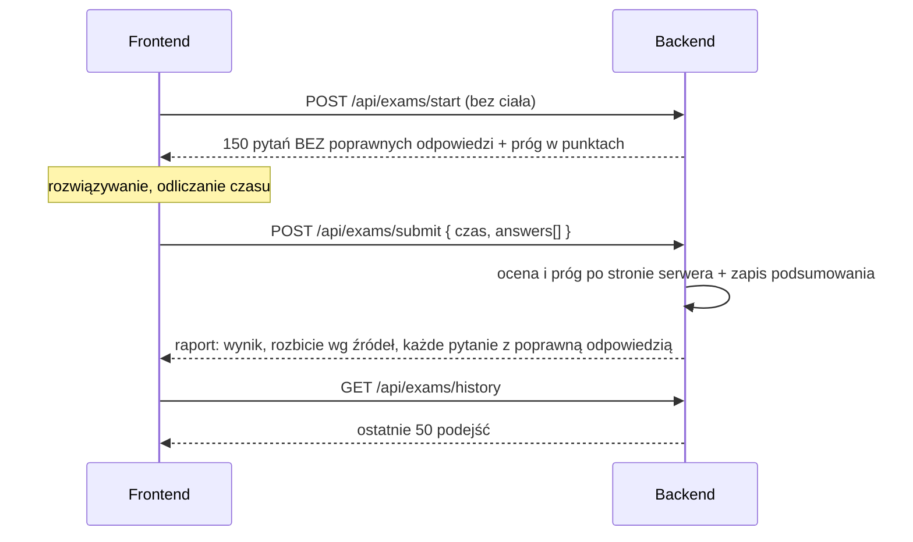

# API: egzamin próbny (`/api/exams`)

[← Przegląd API](README.md) · [Spis treści](../README.md)

Egzamin próbny ma **stały format**: zawsze **150 pytań** z całej puli użytkownika (pytania jego ścieżki i jego własnych
arkuszy), a zaliczenie jest od **100 punktów**. Pytania losuje serwer, serwer też ocenia egzamin i sam ustala próg.
Użytkownik nie wybiera ani zakresu, ani liczby pytań, ani progu (żądania ich nie przyjmują). Zawężenie puli do
wybranych aktów prawnych egzaminu **nie dotyczy** (prawdziwy egzamin też obejmuje wszystko), a źródła pytań egzamin nie zawęża
(zawsze wszystkie). Ćwiczenie z jednego działu to osobna funkcja, [test z kreatora](05-nauka.md), która niczego nie zalicza. Egzamin jest odizolowany od nauki: nie zmienia terminów powtórek,
dziennika odpowiedzi ani dziennych limitów. Zasady punktacji i zaliczenia:
[04](../04-nauka-testy-fiszki-fsrs.md#egzamin-próbny). Wszystkie endpointy wymagają tokenu.



## `POST /api/exams/start` — losowanie pytań

**Ciało żądania:** brak. Format egzaminu jest stały, więc nic się nie wybiera. Ciało wysłane przez starszego klienta
(zakres, `questionCount`) jest ignorowane.

Serwer losuje **150** pytań: z **puli** użytkownika (akty jego ścieżki albo jego arkusze, **bez** zawężenia do
wybranych aktów), niewyciszone (nieukryte przez administratora), niezawieszone w testach, ze **wszystkich źródeł**. Niczego nie zapisuje. Każde pytanie ma jedną poprawną odpowiedź (A, B albo C); poprawnej nie ma w
odpowiedzi tego endpointu.

Gdy w materiale jest mniej niż 150 takich pytań, egzamin ma tyle, ile jest, a próg maleje proporcjonalnie
(100 z 150, zaokrąglone w górę do całego punktu; np. 12 pytań to próg 8).

**Odpowiedź `200`**

```json
{
  "scopeLabel": "Cała pula",
  "requestedCount": 150,
  "passPoints": 100,
  "questions": [
    {
      "questionId": 101,
      "body": "Czy czyn zabroniony…?",
      "optionA": "…", "optionB": "…", "optionC": "…",
      "actName": "Kodeks karny",
      "actShortName": "k.k.",
      "sourceName": "Notarialna 2024",
      "sourceKind": "EXAM_SHEET",
      "examYear": 2024
    }
  ]
}
```

| Pole | Znaczenie |
|------|-----------|
| `requestedCount` | Ile pytań ma pełny egzamin: zawsze 150 |
| `passPoints` | Ile punktów trzeba mieć, żeby zdać ten egzamin: 100, a przy krótszym zestawie proporcjonalnie |
| `questions` | Bywa krótsze niż `requestedCount`. Pytania **nie zawierają** poprawnych odpowiedzi |
| `questions[].sourceKind` | `EXAM_SHEET` (arkusz egzaminu z danego roku, `examYear` wypełnione) albo `AUTHORED` (pytanie autorskie, `examYear` = `null`) |

**Błędy:** `400` — „Nie ma teraz pytań, które możesz rozwiązać na egzaminie.”

## `POST /api/exams/submit` — ocena egzaminu

Serwer sam sprawdza odpowiedzi i sam liczy próg zaliczenia. Od klienta bierze tylko to, czego nie może wiedzieć:
wybrane odpowiedzi, limit czasu i czas trwania.

**Ciało żądania**

```json
{
  "timeLimitMinutes": 150,
  "durationSeconds": 7710,
  "timedOut": false,
  "answers": [
    { "questionId": 101, "selectedOption": "B" },
    { "questionId": 102, "selectedOption": null }
  ]
}
```

| Pole | Wymagane | Reguła |
|------|----------|--------|
| `timeLimitMinutes` | nie | 1–600; brak = egzamin bez limitu czasu |
| `durationSeconds` | tak | Czas trwania, 0–172 800 |
| `timedOut` | nie | Czy egzamin zakończył się automatycznie z powodu końca czasu |
| `answers` | tak | 1–150 pozycji. `selectedOption` = `A`/`B`/`C` albo `null` (pytanie bez odpowiedzi) |

Progu zaliczenia ani zakresu klient nie wysyła: nieznane pola (np. `passThresholdPercent`) są ignorowane.

**Odpowiedź `200`**

```json
{
  "attempt": {
    "id": 9, "finishedAt": "2026-10-12T20:00:00", "scopeLabel": "Cała pula",
    "questionCount": 150, "answeredCount": 148, "correctCount": 112, "scorePercent": 74.7,
    "passThresholdPercent": 67, "passPoints": 100, "passed": true, "timeLimitMinutes": 150,
    "durationSeconds": 7710, "timedOut": false
  },
  "excludedCount": 0,
  "bySource": [ { "sourceName": "Notarialna 2024", "total": 150, "correct": 112 } ],
  "questions": [
    {
      "questionId": 101, "body": "…", "optionA": "…", "optionB": "…", "optionC": "…",
      "selectedOption": "B", "correctOption": "B", "correct": true,
      "explanation": "…", "legalBasis": "art. 26 § 1 k.k.", "validAsOf": "2026-01-01",
      "sourceName": "Notarialna 2024", "sourceKind": "EXAM_SHEET", "examYear": 2024,
      "actName": "Kodeks karny", "actShortName": "k.k.",
      "lawChange": null
    }
  ]
}
```

| Pole | Znaczenie |
|------|-----------|
| `attempt.scorePercent` | Wynik w %, zaokrąglony do 0,1 (tylko do wyświetlania) |
| `attempt.passPoints` | Próg zaliczenia w punktach: 100 przy 150 ocenionych pytaniach, przy mniejszej liczbie proporcjonalnie (w górę) |
| `attempt.passThresholdPercent` | Ten sam próg w pełnych procentach, zaokrąglony w górę (100 z 150 to 67). Do wyświetlania liczy się `passPoints` |
| `attempt.passed` | Zaliczone, gdy liczba poprawnych odpowiedzi jest co najmniej równa `passPoints` (liczby całkowite) |
| `excludedCount` | Pytania z listy, których nie dało się ocenić (usunięte lub już niedostępne); nie wchodzą do wyniku |
| `bySource` | Wynik w obrębie źródeł pytań (np. „Notarialna 2024”, „Pytania autorskie”), od największego |
| `questions` | Każde pytanie w kolejności egzaminu, z poprawną odpowiedzią, wyjaśnieniem, podstawą prawną (`legalBasis`, `validAsOf`), aktem prawnym i znacznikiem zmiany w prawie (`lawChange`, jak w [05](05-nauka.md#get-apireviewflashcard-queue--kolejka-fiszek)) |

Punktacja: 1 punkt za poprawną odpowiedź, bez punktów ujemnych, brak odpowiedzi = 0.

**Błędy:** `400` — to samo pytanie przesłane dwa razy („To samo pytanie zostało przesłane więcej niż raz.”), żadne z
pytań nie jest już dostępne („Żadne z przesłanych pytań nie jest już dostępne, więc nie ma czego oceniać.”), błędne
pola (komunikaty po polsku, np. „zbyt wiele pytań (egzamin ma najwyżej 150)”).

Ocena ocenia to, co zostało pokazane w `start`. Serwer nie pamięta, które pytania
wydał w `start`, więc zaliczenie dotyczy zestawu przesłanego w `submit` (to ćwiczenie dla samego użytkownika, nie
egzamin z uprawnieniami).

## `GET /api/exams/history` — historia podejść

Ostatnie **50** podejść zalogowanego użytkownika, od najnowszego. Elementy mają kształt `attempt` z raportu powyżej.

```json
[
  { "id": 9, "finishedAt": "2026-10-12T20:00:00", "scopeLabel": "Cała pula", "questionCount": 150,
    "answeredCount": 148, "correctCount": 112, "scorePercent": 74.7, "passThresholdPercent": 67,
    "passPoints": 100, "passed": true, "timeLimitMinutes": 150, "durationSeconds": 7710, "timedOut": false }
]
```

Serwer zawsze zapisuje `passPoints` (kolumna w bazie dopuszcza `NULL` z historycznych powodów, ale kod nie zapisuje
tam pustej wartości). `scopeLabel` to zawsze „Cała pula”.

Historia zawiera tylko podsumowania; pojedyncze odpowiedzi nie są przechowywane (raport dostaje się raz, po
zakończeniu).
