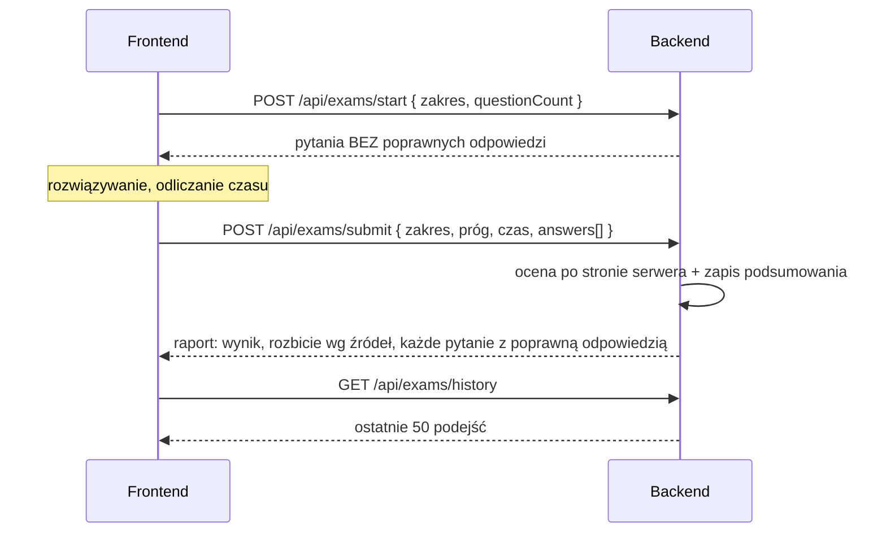

# API: egzamin próbny (`/api/exams`)

[← Przegląd API](README.md) · [Spis treści](../README.md)

Egzamin próbny to losowy zestaw pytań testowych z wybranego zakresu, oceniany **po stronie serwera**. Jest odizolowany
od nauki: nie zmienia terminów powtórek, dziennika odpowiedzi ani dziennych limitów. Zasady punktacji i zaliczenia:
[04](../04-nauka-testy-fiszki-fsrs.md#egzamin-próbny). Wszystkie endpointy wymagają tokenu.



## `POST /api/exams/start` — losowanie pytań

**Ciało żądania**

```json
{ "categoryId": null, "subjectId": 12, "sourceId": null, "questionCount": 50 }
```

| Pole | Wymagane | Opis |
|------|----------|------|
| `sourceId`, `subjectId`, `categoryId` | nie | Zakres od najwęższego (źródło, przedmiot, kategoria). Bez żadnego: **cały dostępny materiał** |
| `questionCount` | tak | Liczba pytań, **5–200** |

Serwer losuje pytania: tylko testowe, **dostępne** dla użytkownika (pula płaska albo przeczytany rozdział),
niezawieszone, z **pochodzeń wybranych w filtrze**. Jeśli jest ich mniej niż `questionCount`, dostajesz wszystkie.
Niczego nie zapisuje.

**Odpowiedź `200`**

```json
{
  "scopeLabel": "Kodeks karny",
  "requestedCount": 50,
  "questions": [
    {
      "cardId": 101,
      "front": "Czy czyn zabroniony…?",
      "optionA": "…", "optionB": "…", "optionC": "…",
      "sourceName": "Egzamin notarialny 2024",
      "origin": "NOTARY",
      "examYear": 2024
    }
  ]
}
```

`questions` bywa krótsze niż `requestedCount`. Pytania **nie zawierają** poprawnych odpowiedzi.

**Błędy:** `400` — „W wybranym zakresie nie ma teraz pytań testowych, które możesz rozwiązać.” albo, gdy pytania są,
ale wszystkie spoza filtra: „W wybranym zakresie nie ma pytań z wybranych pochodzeń. Zmień filtr pochodzenia w
Testach.”; `404` — nie ma wybranego zakresu; `400` — `questionCount` poza 5–200.

## `POST /api/exams/submit` — ocena egzaminu

Serwer sam sprawdza odpowiedzi. Od klienta bierze tylko to, czego nie może wiedzieć: wybrane odpowiedzi, ustawienia
egzaminu i czas.

**Ciało żądania**

```json
{
  "categoryId": null,
  "subjectId": 12,
  "sourceId": null,
  "timeLimitMinutes": 60,
  "passThresholdPercent": 75,
  "durationSeconds": 2710,
  "timedOut": false,
  "answers": [
    { "cardId": 101, "selectedOption": "B" },
    { "cardId": 102, "selectedOption": null }
  ]
}
```

| Pole | Wymagane | Reguła |
|------|----------|--------|
| zakres (`sourceId` / `subjectId` / `categoryId`) | nie | Ten sam co w `start` (służy do nazwania zakresu w historii) |
| `timeLimitMinutes` | nie | 1–600; brak = egzamin bez limitu czasu |
| `passThresholdPercent` | tak | Próg zaliczenia, 1–100 |
| `durationSeconds` | tak | Czas trwania, 0–172 800 |
| `timedOut` | nie | Czy egzamin zakończył się automatycznie z powodu końca czasu |
| `answers` | tak | 1–200 pozycji. `selectedOption` = `A`/`B`/`C` albo `null` (pytanie bez odpowiedzi) |

**Odpowiedź `200`**

```json
{
  "attempt": {
    "id": 9, "finishedAt": "2026-10-12T20:00:00", "scopeLabel": "Kodeks karny",
    "questionCount": 50, "answeredCount": 48, "correctCount": 41, "scorePercent": 82.0,
    "passThresholdPercent": 75, "passed": true, "timeLimitMinutes": 60,
    "durationSeconds": 2710, "timedOut": false
  },
  "excludedCount": 0,
  "bySource": [ { "sourceName": "Egzamin notarialny 2024", "total": 50, "correct": 41 } ],
  "questions": [
    {
      "cardId": 101, "front": "…", "optionA": "…", "optionB": "…", "optionC": "…",
      "selectedOption": "B", "correctOption": "B", "correct": true,
      "explanation": "…", "legalBasis": "art. 26 § 1 k.k.", "validAsOf": "2026-01-01",
      "sourceName": "Egzamin notarialny 2024", "origin": "NOTARY", "examYear": 2024
    }
  ]
}
```

| Pole | Znaczenie |
|------|-----------|
| `attempt.scorePercent` | Wynik w %, zaokrąglony do 0,1 (tylko do wyświetlania) |
| `attempt.passed` | Zaliczone, gdy `poprawne · 100 ≥ próg · liczba pytań` (porównanie na liczbach całkowitych) |
| `excludedCount` | Pytania z listy, których nie dało się ocenić (usunięte lub już niedostępne); nie wchodzą do wyniku |
| `bySource` | Wynik w obrębie źródeł pytań, od największego |
| `questions` | Każde pytanie w kolejności egzaminu, z poprawną odpowiedzią i wyjaśnieniem |

Punktacja: 1 punkt za poprawną odpowiedź, bez punktów ujemnych, brak odpowiedzi = 0.

**Błędy:** `400` — to samo pytanie przesłane dwa razy („To samo pytanie zostało przesłane więcej niż raz.”), żadne z
pytań nie jest już dostępne („Żadne z przesłanych pytań nie jest już dostępne, więc nie ma czego oceniać.”), błędne
pola (komunikaty po polsku, np. „próg zaliczenia musi wynosić od 1 do 100 procent”); `404` — nie ma zakresu.

Ocena **nie stosuje filtra pochodzenia**: ocenia to, co zostało pokazane w `start`.

## `GET /api/exams/history` — historia podejść

Ostatnie **50** podejść zalogowanego użytkownika, od najnowszego. Elementy mają kształt `attempt` z raportu powyżej.

```json
[
  { "id": 9, "finishedAt": "2026-10-12T20:00:00", "scopeLabel": "Kodeks karny", "questionCount": 50,
    "answeredCount": 48, "correctCount": 41, "scorePercent": 82.0, "passThresholdPercent": 75, "passed": true,
    "timeLimitMinutes": 60, "durationSeconds": 2710, "timedOut": false }
]
```

Historia zawiera tylko podsumowania; pojedyncze odpowiedzi nie są przechowywane (raport dostaje się raz, po
zakończeniu).
