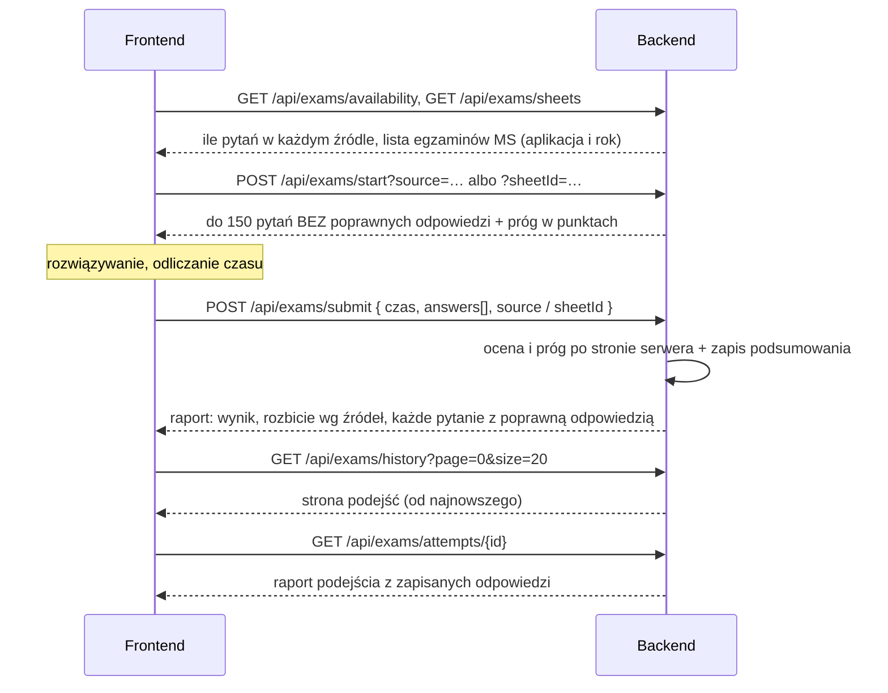

# API: egzamin próbny (`/api/exams`)

[← Przegląd API](README.md) · [Spis treści](../README.md)

Egzamin próbny ma **stały format**: **150 pytań** i zaliczenie od **100 punktów**. Pytania wybiera serwer, serwer też
ocenia egzamin i sam ustala próg. Użytkownik nie wybiera ani zakresu, ani liczby pytań, ani progu (żądania ich nie
przyjmują). Wybiera tylko **źródło pytań**, na cztery sposoby:

| Wybór | Jak wywołać | Skąd pytania |
|-------|-------------|--------------|
| Wszystkie źródła | `POST /api/exams/start` (domyślnie, `source=ALL`) | Losowe 150 z całej puli użytkownika |
| Ministerstwo | `?source=MINISTRY` | Losowe 150 ze wszystkich arkuszy egzaminacyjnych w puli |
| Autorskie | `?source=AUTHORED` | Losowe 150 z pytań dodanych w aplikacji |
| **Egzamin MS** | `?sheetId=<numer>` (numery z `GET /api/exams/sheets`) | **Cały jeden arkusz** z wybranego roku, w kolejności arkusza, bez losowania |

Zawężenie puli do wybranych aktów prawnych egzaminu **nie dotyczy** (prawdziwy egzamin też obejmuje wszystko).
Ćwiczenie z jednego działu to osobna funkcja, [test z kreatora](05-nauka.md), która niczego nie zalicza. Egzamin jest
odizolowany od nauki: nie zmienia terminów powtórek, dziennika odpowiedzi ani dziennych limitów. Zasady punktacji i
zaliczenia: [04](../04-nauka-testy-fiszki-fsrs.md#egzamin-próbny). Wszystkie endpointy wymagają tokenu.



## `GET /api/exams/availability` — ile pytań w każdym źródle

Bez parametrów. Zwraca, ile pytań da się teraz wylosować na egzamin z każdego źródła (cała pula ścieżki, **bez**
zawężenia do aktów i bez pytań zawieszonych w testach). Ekran egzaminu pokazuje te liczby przy wyborze źródła.

```json
{ "all": 1240, "ministry": 1190, "authored": 50 }
```

## `GET /api/exams/sheets` — egzaminy MS z poprzednich lat

Bez parametrów. Zwraca arkusze egzaminów z poprzednich lat pogrupowane według aplikacji (to samo, co w bazie jako
`question_sources` o rodzaju `EXAM_SHEET`). Ekran egzaminu pokazuje z tego wybór „aplikacja, potem rok”.

```json
{
  "applications": [
    {
      "trackId": 4, "slug": "notarialna", "name": "Aplikacja notarialna", "shortName": "Notarialna", "own": true,
      "sheets": [
        { "id": 31, "year": 2026, "questionCount": 150 },
        { "id": 30, "year": 2025, "questionCount": 148 }
      ]
    }
  ]
}
```

| Pole | Znaczenie |
|------|-----------|
| `applications` | Aplikacje, które mają co najmniej jeden niepusty arkusz. **Aplikacja użytkownika jest pierwsza** (`own: true`), pozostałe w kolejności ścieżek. Ścieżka Student i źródła autorskie nie występują |
| `applications[].sheets` | Egzaminy tej aplikacji **od najnowszego roku**. Arkusz bez pytań do rozwiązania jest pomijany |
| `sheets[].id` | Wartość parametru `sheetId` w `POST /api/exams/start` |
| `sheets[].questionCount` | Ile pytań będzie na egzaminie: widoczne pytania arkusza **bez** zawieszonych w testach, najwyżej 150 |

Lata nie muszą być ciągłe (np. 2016–2026 z lukami): brakujący rok po prostu nie ma wpisu. Wybór egzaminu **nie zależy** od
puli, ścieżki ani zawężenia użytkownika: można rozwiązać egzamin dowolnej aplikacji.

## `POST /api/exams/start` — wybór pytań

**Ciało żądania:** brak. Format egzaminu jest stały. Ciało wysłane przez starszego klienta (zakres, `questionCount`)
jest ignorowane.

| Parametr zapytania | Wymagany | Znaczenie |
|--------------------|----------|-----------|
| `source` | nie | `ALL` (domyślnie), `MINISTRY` albo `AUTHORED`: z jakiego źródła losować pytania |
| `sheetId` | nie | Numer egzaminu MS z `GET /api/exams/sheets`. Gdy jest podany, `source` jest pomijane |

**Losowanie** (`source`): serwer losuje **150** pytań z **puli** użytkownika (akty jego ścieżki albo jego arkusze, **bez**
zawężenia do wybranych aktów), niewyciszonych (nieukrytych przez administratora), niezawieszonych w testach, z wybranego
źródła. Niczego nie zapisuje.

**Egzamin MS** (`sheetId`): egzamin to **cały arkusz z wybranego roku**: wszystkie widoczne pytania arkusza **w kolejności
wczytania arkusza** (bez losowania), bez pytań zawieszonych w testach. Arkusz może być dowolnej aplikacji. Dłuższy niż 150
pytań zostałby obcięty do 150 (tyle ma egzamin i tyle przyjmuje zapis wyniku).

W obu przypadkach każde pytanie ma jedną poprawną odpowiedź (A, B albo C); poprawnej nie ma w odpowiedzi tego
endpointu. Gdy pytań jest mniej niż 150, egzamin ma tyle, ile jest, a próg maleje proporcjonalnie (100 z 150,
zaokrąglone w górę do całego punktu; np. 12 pytań to próg 8).

**Odpowiedź `200`**

```json
{
  "scopeLabel": "Egzamin MS: Notarialna 2024",
  "requestedCount": 150,
  "passPoints": 100,
  "questions": [
    {
      "questionId": 101,
      "body": "Czy czyn zabroniony…?",
      "optionA": "…", "optionB": "…", "optionC": "…",
      "actName": "Kodeks karny",
      "actShortName": "k.k.",
      "sourceName": "Notarialna 2024",
      "sourceKind": "EXAM_SHEET",
      "examYear": 2024
    }
  ]
}
```

| Pole | Znaczenie |
|------|-----------|
| `scopeLabel` | Podpis egzaminu: „Cała pula”, „Ministerstwo Sprawiedliwości”, „Pytania autorskie” albo „Egzamin MS: Notarialna 2024” |
| `requestedCount` | Ile pytań ma pełny egzamin: zawsze 150 |
| `passPoints` | Ile punktów trzeba mieć, żeby zdać ten egzamin: 100, a przy krótszym zestawie proporcjonalnie |
| `questions` | Bywa krótsze niż `requestedCount`. Pytania **nie zawierają** poprawnych odpowiedzi |
| `questions[].sourceKind` | `EXAM_SHEET` (arkusz egzaminu z danego roku, `examYear` wypełnione) albo `AUTHORED` (pytanie autorskie, `examYear` = `null`) |

**Błędy:** `400` — „Nie ma teraz pytań, które możesz rozwiązać na egzaminie.” (wszystkie źródła), „Nie ma teraz pytań z tego
źródła, które możesz rozwiązać na egzaminie. Wybierz inne źródło.” (`MINISTRY`/`AUTHORED`), „Nie ma takiego egzaminu MS. Wybierz
inny.” (nieznany `sheetId` albo numer źródła, które nie jest arkuszem egzaminu), „Z tego egzaminu MS nie ma teraz pytań, które
możesz rozwiązać. Wybierz inny egzamin.” (arkusz bez pytań do rozwiązania)

## `POST /api/exams/submit` — ocena egzaminu

Serwer sam sprawdza odpowiedzi i sam liczy próg zaliczenia. Od klienta bierze tylko to, czego nie może wiedzieć:
wybrane odpowiedzi, limit czasu i czas trwania.

**Ciało żądania**

```json
{
  "timeLimitMinutes": 150,
  "durationSeconds": 7710,
  "timedOut": false,
  "answers": [
    { "questionId": 101, "selectedOption": "B" },
    { "questionId": 102, "selectedOption": null }
  ],
  "source": "ALL",
  "sheetId": null
}
```

| Pole | Wymagane | Reguła |
|------|----------|--------|
| `timeLimitMinutes` | nie | 1–600; brak = egzamin bez limitu czasu |
| `durationSeconds` | tak | Czas trwania, 0–172 800 |
| `timedOut` | nie | Czy egzamin zakończył się automatycznie z powodu końca czasu |
| `answers` | tak | 1–150 pozycji. `selectedOption` = `A`/`B`/`C` albo `null` (pytanie bez odpowiedzi) |
| `source` | nie | `ALL`/`MINISTRY`/`AUTHORED`: źródło, z którego losowano pytania. **Tylko do podpisu w historii**; brak = „Cała pula” |
| `sheetId` | nie | Numer egzaminu MS, gdy to był egzamin z wybranego roku. **Tylko do podpisu** (ma pierwszeństwo przed `source`) |

Progu zaliczenia ani zakresu klient nie wysyła: nieznane pola (np. `passThresholdPercent`) są ignorowane.

**Odpowiedź `200`**

```json
{
  "attempt": {
    "id": 9, "finishedAt": "2026-10-12T20:00:00", "scopeLabel": "Egzamin MS: Notarialna 2024",
    "questionCount": 150, "answeredCount": 148, "correctCount": 112, "scorePercent": 74.7,
    "passThresholdPercent": 67, "passPoints": 100, "passed": true, "timeLimitMinutes": 150,
    "durationSeconds": 7710, "timedOut": false, "detailsAvailable": true
  },
  "excludedCount": 0,
  "bySource": [ { "sourceName": "Notarialna 2024", "total": 150, "correct": 112 } ],
  "questions": [
    {
      "questionId": 101, "body": "…", "optionA": "…", "optionB": "…", "optionC": "…",
      "selectedOption": "B", "correctOption": "B", "correct": true,
      "explanation": "…", "legalBasis": "art. 26 § 1 k.k.", "validAsOf": "2026-01-01",
      "sourceName": "Notarialna 2024", "sourceKind": "EXAM_SHEET", "examYear": 2024,
      "actName": "Kodeks karny", "actShortName": "k.k.",
      "lawChange": null
    }
  ]
}
```

| Pole | Znaczenie |
|------|-----------|
| `attempt.scopeLabel` | Podpis z chwili egzaminu: „Cała pula” (też gdy nie podano źródła), „Ministerstwo Sprawiedliwości”, „Pytania autorskie” albo „Egzamin MS: <nazwa arkusza>” (np. „Egzamin MS: Notarialna 2024”). Gdy arkusz zniknął albo `sheetId` nie wskazuje arkusza egzaminu, podpis to „Egzamin MS” |
| `attempt.scorePercent` | Wynik w %, zaokrąglony do 0,1 (tylko do wyświetlania) |
| `attempt.passPoints` | Próg zaliczenia w punktach: 100 przy 150 ocenionych pytaniach, przy mniejszej liczbie proporcjonalnie (w górę) |
| `attempt.passThresholdPercent` | Ten sam próg w pełnych procentach, zaokrąglony w górę (100 z 150 to 67). Do wyświetlania liczy się `passPoints` |
| `attempt.passed` | Zaliczone, gdy liczba poprawnych odpowiedzi jest co najmniej równa `passPoints` (liczby całkowite) |
| `excludedCount` | Pytania z listy, których nie dało się ocenić (usunięte lub już niedostępne); nie wchodzą do wyniku |
| `bySource` | Wynik w obrębie źródeł pytań (np. „Notarialna 2024”, „Pytania autorskie”), od największego |
| `questions` | Każde pytanie w kolejności egzaminu, z poprawną odpowiedzią, wyjaśnieniem, podstawą prawną (`legalBasis`, `validAsOf`), aktem prawnym i znacznikiem zmiany w prawie (`lawChange`, jak w [05](05-nauka.md#get-apireviewflashcard-queue--kolejka-fiszek)) |

Punktacja: 1 punkt za poprawną odpowiedź, bez punktów ujemnych, brak odpowiedzi = 0.

**Błędy:** `400` — to samo pytanie przesłane dwa razy („To samo pytanie zostało przesłane więcej niż raz.”), żadne z
pytań nie jest już dostępne („Żadne z przesłanych pytań nie jest już dostępne, więc nie ma czego oceniać.”), błędne
pola (komunikaty po polsku, np. „zbyt wiele pytań (egzamin ma najwyżej 150)”).

Ocena ocenia to, co zostało pokazane w `start`. Serwer nie pamięta, które pytania
wydał w `start`, więc zaliczenie dotyczy zestawu przesłanego w `submit` (to ćwiczenie dla samego użytkownika, nie
egzamin z uprawnieniami).

## `GET /api/exams/history` — historia podejść

Podejścia zalogowanego użytkownika, od najnowszego, **stronami**: parametry `page` (od 0) i `size` (domyślnie 20, najwyżej 100;
złe wartości są przycinane, nie dają błędu). Odpowiedź to `PageResponse` (`items`, `page`, `size`, `totalElements`,
`totalPages`); elementy mają kształt `attempt` z raportu powyżej.

```json
{
  "items": [
    { "id": 9, "finishedAt": "2026-10-12T20:00:00", "scopeLabel": "Egzamin MS: Notarialna 2024", "questionCount": 150,
      "answeredCount": 148, "correctCount": 112, "scorePercent": 74.7, "passThresholdPercent": 67,
      "passPoints": 100, "passed": true, "timeLimitMinutes": 150, "durationSeconds": 7710, "timedOut": false,
      "detailsAvailable": true }
  ],
  "page": 0, "size": 20, "totalElements": 45, "totalPages": 3
}
```

Serwer zawsze zapisuje `passPoints` (kolumna w bazie dopuszcza `NULL` z historycznych powodów, ale kod nie zapisuje
tam pustej wartości). `scopeLabel` to podpis z chwili egzaminu (patrz wyżej): wcześniejsze podejścia mają „Cała pula”.

`detailsAvailable` mówi, czy da się otworzyć raport podejścia (`GET /api/exams/attempts/{id}`). Odpowiedzi zapisują się od
poprawki 2 etapu 34; **starsze podejścia** mają `detailsAvailable = false` i zostają na liście tylko z wynikiem.

> **Zmiana niezgodna wstecz:** do poprawki 2 ten endpoint zwracał zwykłą tablicę ostatnich 50 podejść. Teraz zwraca stronę
> (`PageResponse`), więc frontend i backend trzeba wdrożyć razem. To samo dotyczy `GET /api/custom-tests/sessions`.

## `GET /api/exams/attempts/{id}` — raport zapisanego podejścia

Raport jednego podejścia, w tym samym kształcie co odpowiedź `POST /api/exams/submit` (`attempt`, `excludedCount`,
`bySource`, `questions`). Służy ekranowi „Moje testy” → Egzaminy.

- **Wynik, czas, próg i podpis** w nagłówku (`attempt`) są **z chwili egzaminu** (zapisane podsumowanie).
- **Treść pytań, wyjaśnienia, poprawne odpowiedzi i ocena poszczególnych pytań** pochodzą z **aktualnych** pytań w bazie:
  zapisana jest tylko odpowiedź użytkownika (`exam_attempt_answers`). Jeśli pytanie zostało poprawione (np. zmieniono klucz),
  raport pokaże je poprawione, a ocena przy nim może się różnić od tej z egzaminu; nagłówek zostaje bez zmian.
- Pytania, które zostały później usunięte z bazy, znikają z raportu razem ze swoimi zapisanymi odpowiedziami.

**Błędy:** `404` — „Nie ma raportu tego egzaminu. Starsze podejścia mają zapisany tylko wynik.” Dotyczy podejścia bez zapisanych
odpowiedzi (`detailsAvailable = false`), cudzego i nieistniejącego (nie zdradzamy, które z nich).
